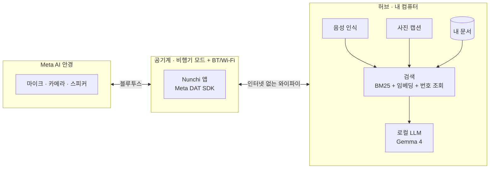

<div align="center">

# Your Glasses Don't Need the Cloud

**Private, Real-Time Multimodal RAG for Smart Glasses on a Local Hub**

Smart glasses that see, retrieve, and answer without sending a single frame off your network.<br>
눈으로 본 것을 묻고 답하는 스마트 안경, 사진 한 장도 내 네트워크 밖으로 나가지 않습니다.

**박성모 (Park Sungmo)**

[](LICENSE)
[](https://github.com/ai-Glasses-ROK/nunchi/actions/workflows/hub-tests.yml)


</div>

<p align="center">
  
  &nbsp;&nbsp;
  
</p>

**Nunchi (눈치)** 는 Meta AI 안경 → 공기계(비행기 모드 + 블루투스·와이파이) → 책상 위 허브(로컬 LLM + RAG)를 잇는 연구용 시스템입니다. 안경이 보고 듣는 것을 **인터넷 없이** 내 문서에 근거해 답하고, 공기계를 비행기 모드로 두어 **재난문자·전화·알림 방해 없이** 씁니다. 이름처럼, 말하지 않은 맥락("이게 뭐야?")까지 사진으로 알아챕니다.

> 🕶️ 안경이 아직 없어도 됩니다. Meta의 **가상 안경(MockDeviceKit)** 으로 iOS 시뮬레이터에서 전 과정을 재현했습니다.

## Abstract

Today's smart-glasses assistants stream what the wearer sees to cloud models. We argue this is unnecessary. We present **Nunchi** (눈치 — the Korean knack for picking up what goes unsaid), a local hub that connects Meta smart glasses, through a spare phone in airplane mode, to an on-premise LLM with vision and retrieval-augmented generation. Photos taken through the glasses are first captioned, and the caption is fused with the spoken question before retrieval (*caption-then-retrieve*), so an ambiguous query such as "what is this?" still returns the right manual section: without the caption the correct section falls outside the top four results; with it, it ranks first. On a single laptop (Apple M5 Pro, 24 GB), over 16 runs each, the first sentence of a spoken answer is ready in a median of 0.65 s for voice questions and 2.6 s for photo questions (full answer 2.7 s), and nothing leaves the user's network. On a 16-question manual QA set, 94% of answers are correct with perfect retrieval. We further evaluate local models on the 2026 Korean CSAT. Matching question numbers to section headings lifts retrieval hit rate from 38% (Korean) and 26% (English) to 100%; with the original text and only the referenced section in the prompt, RAG accuracy then reaches the direct-question level in Korean (62% vs 59%) and comes within 12 points in English (81% vs 93%). From photos of the common math questions, a 4B-class Gemma 4 model reaches 77% when it first transcribes and then reasons, ahead of a local 20B model (73%) under the same output budget and 17–23 points behind published cloud results on image input, a gap we trace largely to transcription errors and the token budget rather than reasoning. Given clean text, the same 4B model answers 93% of the English reading questions, while Korean reading remains the clearest gap (59% for the 4B model, 53% for the 20B model at low reasoning effort).

**요약** — 안경 AI의 본업인 "보고·찾고·답하기"는 노트북 한 대로 충분했습니다.

- **사진 질문**: "이게 뭐야?"처럼 검색어가 없는 질문도, 사진을 먼저 한 줄로 묘사(캡션)해 검색어에 붙이면 정답 조각이 상위 4위 밖 → **1위**.
- **속도** (노트북 한 대, 각 16회 중앙값): 음성 질문의 첫 문장 0.65초, 사진 질문의 첫 문장 2.6초 · 완료 2.7초. 인터넷 사용 0.
- **매뉴얼 Q&A**: 16문항 중 94% 정답, 검색 100%.
- **수능**: 번호로 묻는 시험지 검색을 **번호 조회**로 국어 38%·영어 26% → 100% 적중, `gemma4:e4b`의 국어 RAG 정답률이 문항을 직접 줬을 때 수준(62%)까지. 수학을 사진으로 풀 때 4B급 Gemma 4가 OCR→사고로 **77%**(로컬 20B는 73%) — 공개된 클라우드 결과(93.5~100)보다 17~23점 낮지만, 차이의 상당 부분은 OCR 오류와 출력 한도 때문. 영어 독해는 같은 4B 모델이 **93%**. 긴 한국어 독해는 아직 뚜렷한 한계(`gemma4:e4b` 59% · `gpt-oss:20b` 53% (사고 low)).

## 결과 한눈에

모두 **노트북 한 대**(Apple M5 Pro 24GB)에서 인터넷 없이 잰 값입니다. 지연은 서로 다른 질문·사진으로 16번씩 잰 중앙값(p50)입니다.

| 무엇을 | 결과 |
|---|---|
| 음성 질문 → 첫 문장 도착 (폰이 바로 읽기 시작) | **0.65초** (p90 0.80초) |
| 사진 질문 → 답 완료 | **2.7초** (p90 2.9초) · 그중 캡션+검색 1.2초 |
| 사진 질문 "이게 뭐야?"의 캡션→검색 | 캡션 없이 정답 조각 상위 4위 밖 → 캡션 붙이면 **1위** |
| 매뉴얼 Q&A (예제 16문항) | 정답 **94%** · 검색 **100%** |
| 블루투스 통화 음질(8kHz) vs 16kHz | 문자 오류율 0.178 vs **0.094** · 정답 81% vs **94%** |
| 수능 · 번호로 묻는 시험지 RAG | 검색 적중 국어 38%·영어 26% → **100%** (번호 조회) · `gemma4:e4b` 정답률 국어 12→**62%**, 영어 15→**81%** |
| 수능 영어 · 문항 직접 제공 | `gemma4:e4b` **93%** (25/27) |
| 수능 수학 · 사진 (공통 22문항) | `gemma4:e4b` OCR→사고 **77%** · `gpt-oss:20b` 73% ↔ 공개 클라우드 결과 93.5~100 (참고 비교) |
| 수능 국어 · 문항 직접 제공 | `gemma4:e4b` 59% · `gpt-oss:20b` 53% (사고 low) — 로컬 모델의 가장 큰 한계 |

<p align="center">
  
  
</p>

자세한 표·방법·한계: [평가와 실험 결과](docs/05-applications/03-evaluation.md)

## 어떻게 동작하나



| 단계 | 하는 일 | 왜 |
|---|---|---|
| ① 듣기 | 안경 마이크(블루투스) → 폰이 16kHz WAV로 녹음 → 허브가 무음 자르기·정규화 | 블루투스 통화 음질(HFP 8kHz)은 문자 오류율이 약 2배 ([실측](docs/05-applications/03-evaluation.md#2-음성-8khz-vs-16khz)) |
| ② 보기 | 안경 카메라 사진 → **캡션 먼저** ("HG-2000, E2, 계기판…") | "이게 뭐야?"에는 검색어가 없음 |
| ③ 찾기 | 한국어 2-gram BM25 + bge-m3 임베딩 → RRF, 질문에 "N번·N단계"가 있으면 **그 절 통째로** | 형태소 분석기 없이 폰에서도 같은 검색 |
| ④ 답하기 | Gemma 4가 문서 근거로 1~3문장, 문장이 완성될 때마다 바로 전송 | 귀로 듣는 답은 짧고 빨라야 함 |
| ⑤ 말하기 | 폰 TTS(또는 허브 TTS) → 안경 스피커 | 첫 문장부터 읽기 시작 |

**모든 모델은 [Ollama](https://ollama.com) 하나로**: 답변·음성 인식·사진 = Gemma 4 (e4b, 메모리 8GB면 e2b), 임베딩 = bge-m3, (선택) 음성 합성 = lfm3-audio.

## 빠른 시작 (맥, 15분)

```bash
git clone https://github.com/ai-Glasses-ROK/nunchi.git && cd nunchi
```

```bash
scripts/setup_mac.sh --examples
```

```bash
cd hub && .venv/bin/nunchi ask "발전기에 E2 코드가 떴어. 어떻게 해?"
```

```text
🔎 검색 (hybrid, 28.1ms)
  [1] HG-2000 휴대용 발전기 점검 절차 > 경고등과 고장 코드 의미 0.68 키워드 8.3
  …
💬 E2 코드가 떴다면 엔진 과열 상태이므로 발전기를 끄고 30분 동안 식힌 다음 공기 흡입구에 먼지가 막혔는지 확인해야 합니다.
```

폰·안경에서 쓰려면 허브를 네트워크에 열고([토큰 필수](docs/04-practice/04-hub-api.md)), [iOS 앱](docs/04-practice/05-ios-app.md)이나 [Android 앱](docs/04-practice/06-android-app.md) 또는 브라우저(`http://<허브IP>:8765`)로 접속하세요.

```bash
.venv/bin/nunchi serve --host 0.0.0.0 --token 내비밀번호
```

윈도우·리눅스·완전 오프라인 설치: [허브 설치](docs/03-setup/01-hub.md) · [오프라인 꾸러미](docs/03-setup/02-offline-bundle.md)

## 세 가지 모드

| 모드 | 구성 | 언제 |
|---|---|---|
| **허브 모드** (기본) | 안경 → 공기계 → 와이파이 → 허브 LLM | 정확도·사진 질문이 중요할 때 |
| **폰 단독 모드** | 안경 → 공기계 안에서 검색 + 기기 내 LLM(iOS 26 Foundation Models) | 허브 없이 걸어 다닐 때 |
| **웹 클라이언트** | 아무 폰 브라우저 → 허브 | 앱 설치 없이 바로 시험 |

## 레포 구조

```
nunchi/
├── hub/                 허브 서버·CLI (Python, FastAPI) — 테스트 45개
├── clients/ios/         iOS 앱 (SwiftUI, Meta DAT 1.0.1, 가상 안경)
├── clients/android/     Android 앱 (Kotlin, Compose)
├── research/csat/       수능 실험 (문제 원문은 포함하지 않음)
├── research/latency/    지연시간 측정 (p50/p90)
├── research/results/    실험 원자료 (문항별 결과·지연시간, 숫자만)
├── examples/            가상의 예제 문서 3개 + 평가 질문 16개
├── scripts/             맥 설치, 오프라인 꾸러미 만들기
├── .github/workflows/   허브 테스트 자동 실행 (Python 3.10·3.12)
└── docs/                기초 → 개념 → 설치 → 실전 → 응용 → 참고 (32편)
```

## 문서

개발을 몰라도 읽을 수 있게 **용어부터** 썼습니다. → **[문서 지도](docs/README.md)**

| 나는… | 시작 |
|---|---|
| 개발을 전혀 몰라요 | [큰 그림](docs/01-basics/01-big-picture.md) → [용어 사전](docs/01-basics/02-glossary.md) → [터미널 첫걸음](docs/01-basics/07-terminal-101.md) |
| 일단 돌려 보고 싶어요 | [허브 설치](docs/03-setup/01-hub.md) → [첫 RAG](docs/04-practice/01-first-rag.md) → [음성](docs/04-practice/02-voice.md) → [사진](docs/04-practice/03-vision.md) |
| 안경으로 실사용하고 싶어요 | [공기계 준비](docs/03-setup/03-spare-phone.md) → [재난문자 방해 없이](docs/03-setup/04-airplane-mode.md) → [오프라인 와이파이](docs/03-setup/05-offline-network.md) |
| 연구 결과가 궁금해요 | [평가](docs/05-applications/03-evaluation.md) → [설계 결정](docs/02-concepts/01-architecture.md) → [로드맵](docs/05-applications/04-research-roadmap.md) |

## 꼭 읽어 주세요

- **재난문자 차단은 전용 공기계에서만.** 비행기 모드는 위급재난문자까지 막습니다. 평소 쓰는 폰은 그대로 두고, 현장에는 재난 정보를 받을 다른 수단을 두세요. → [오프라인과 재난문자](docs/02-concepts/02-offline-and-alerts.md)
- **시험장에서 쓰면 부정행위입니다.** 수능 실험은 모델 능력을 재기 위한 연구용이며, 시험장에 전자기기를 가져가거나 쓰면 그 시험이 무효가 됩니다.
- **찍히는 사람의 동의.** 안경 카메라로 다른 사람을 찍거나 녹음할 때는 알리고 동의를 받으세요. → [안전·개인정보·법](docs/06-reference/03-safety-privacy-legal.md)
- Meta와 무관한 독립 연구 프로젝트입니다. Meta Wearables Device Access Toolkit은 개발자 프리뷰이며 [Meta 약관](https://wearables.developer.meta.com/terms)을 따릅니다.

## 인용

```bibtex
@software{nunchi2026,
  title  = {Your Glasses Don't Need the Cloud: Private, Real-Time Multimodal RAG for Smart Glasses on a Local Hub},
  author = {Park, Sungmo},
  year   = {2026},
  url    = {https://github.com/ai-Glasses-ROK/nunchi}
}
```

## 라이선스

[MIT](LICENSE). 모델(Gemma, bge-m3 등)과 Meta DAT SDK는 각자의 라이선스를 따릅니다. 수능 문제의 저작권은 한국교육과정평가원에 있으며 이 레포에는 포함하지 않았습니다.
