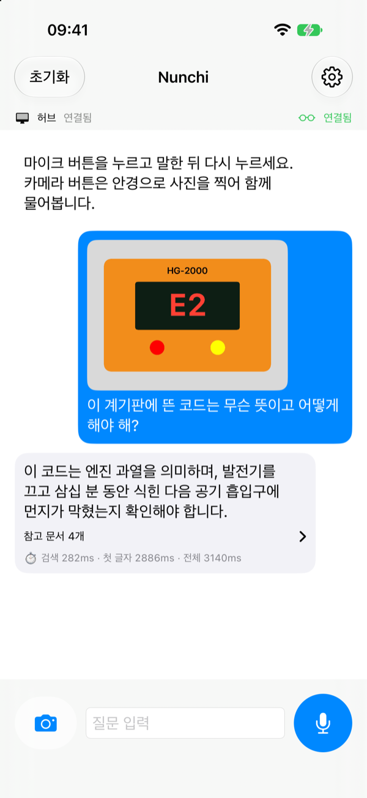
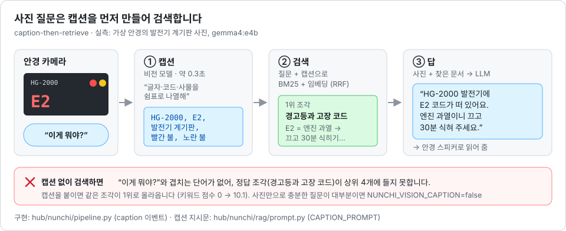
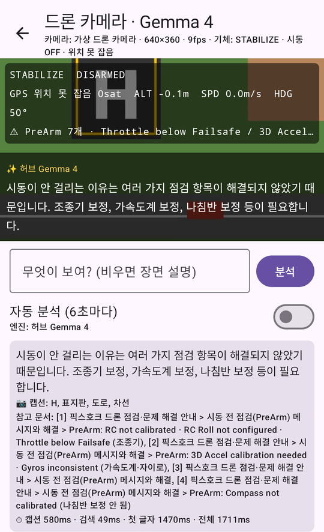
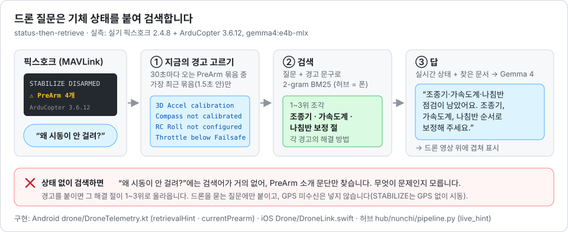
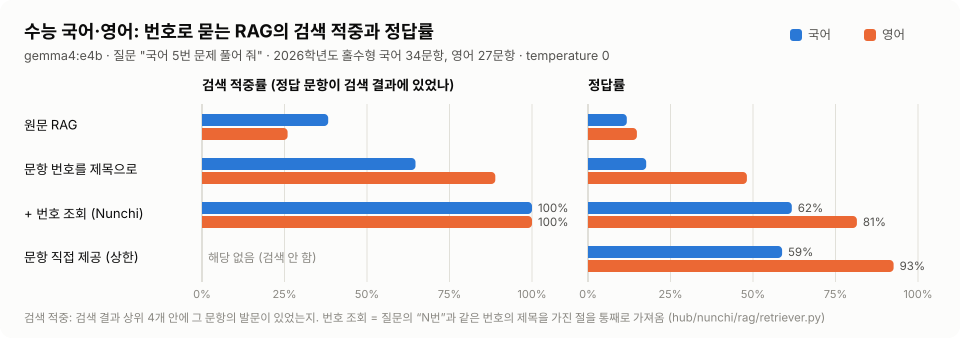
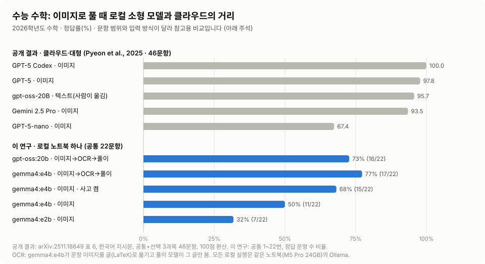
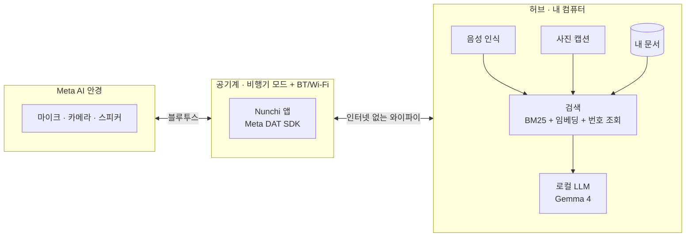
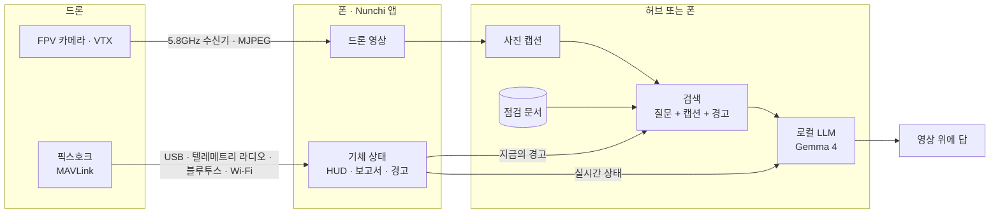

<div align="center">

# Your Glasses Don't Need the Cloud

**Private, Real-Time Multimodal RAG for Smart Glasses on a Local Hub**

Smart glasses and drone cameras that see, retrieve, and answer without sending a single frame off your network.<br>
눈으로 본 것을 묻고 답하는 스마트 안경과 드론 카메라, 사진 한 장도 내 네트워크 밖으로 나가지 않습니다.

**박성모 (Park Sungmo)**

[](LICENSE)
[](https://github.com/ai-Glasses-ROK/nunchi/actions/workflows/hub-tests.yml)
[](https://github.com/ai-Glasses-ROK/nunchi/actions/workflows/android-build.yml)


</div>

<p align="center">
  
  &nbsp;&nbsp;
  
</p>
<p align="center">
  
  &nbsp;&nbsp;
  
</p>

**Nunchi (눈치)** 는 Meta AI 안경 → 공기계(비행기 모드 + 블루투스·와이파이) → 책상 위 허브(로컬 LLM + RAG)를 잇는 연구용 시스템입니다. 안경이 보고 듣는 것을 **인터넷 없이** 내 문서에 근거해 답하고, 공기계를 비행기 모드로 두어 **재난문자·전화·알림 방해 없이** 씁니다. 이름처럼, 말하지 않은 맥락("이게 뭐야?")까지 사진으로 알아챕니다.

같은 허브와 앱이 **드론**에도 붙습니다. 픽스호크 비행컨트롤러의 실시간 상태(MAVLink)와 드론 카메라 영상을 받아, Gemma 4가 영상을 보고 **내 점검 문서와 기체 상태**를 근거로 답한 결과를 영상 위에 띄웁니다. "왜 시동이 안 걸려?"처럼 말하지 않은 원인까지 기체가 보낸 경고로 알아챕니다.

> 🕶️ 안경이 아직 없어도 됩니다. Meta의 **가상 안경(MockDeviceKit)** 으로 iOS 시뮬레이터에서 전 과정을 재현했습니다.<br>
> 🛸 드론도 마찬가지예요. **가상 드론·가상 카메라**로 전 과정을 재현할 수 있고, **실기 픽스호크(ArduCopter 3.6.12)와 실제 카메라**로도 확인했습니다.

## 목차

- [Abstract](#abstract)
- [결과 한눈에](#결과-한눈에)
  - [안경](#안경)
  - [드론](#드론)
- [어떻게 동작하나](#어떻게-동작하나)
  - [안경](#안경-1)
  - [드론](#드론-1)
- [빠른 시작 (맥, 15분)](#빠른-시작-맥-15분)
  - [드론 빠른 시작](#드론-빠른-시작)
- [네 가지 모드](#네-가지-모드)
- [레포 구조](#레포-구조)
- [문서](#문서)
- [꼭 읽어 주세요](#꼭-읽어-주세요)
- [인용](#인용)
- [라이선스](#라이선스)

## Abstract

Today's smart-glasses assistants stream what the wearer sees to cloud models. We argue this is unnecessary. We present **Nunchi** (눈치 — the Korean knack for picking up what goes unsaid), a local hub that connects Meta smart glasses, through a spare phone in airplane mode, to an on-premise LLM with vision and retrieval-augmented generation. Photos taken through the glasses are first captioned, and the caption is fused with the spoken question before retrieval (*caption-then-retrieve*), so an ambiguous query such as "what is this?" still returns the right manual section: without the caption the correct section falls outside the top four results; with it, it ranks first. On a single laptop (Apple M5 Pro, 24 GB), over 16 runs each, the first sentence of a spoken answer is ready in a median of 0.65 s for voice questions and 2.6 s for photo questions (full answer 2.7 s), and nothing leaves the user's network. On a 16-question manual QA set, 94% of answers are correct with perfect retrieval. We further evaluate local models on the 2026 Korean CSAT. Matching question numbers to section headings lifts retrieval hit rate from 38% (Korean) and 26% (English) to 100%; with the original text and only the referenced section in the prompt, RAG accuracy then reaches the direct-question level in Korean (62% vs 59%) and comes within 12 points in English (81% vs 93%). From photos of the common math questions, a 4B-class Gemma 4 model reaches 77% when it first transcribes and then reasons, ahead of a local 20B model (73%) under the same output budget and 17–23 points behind published cloud results on image input, a gap we trace largely to transcription errors and the token budget rather than reasoning. Given clean text, the same 4B model answers 93% of the English reading questions, while Korean reading remains the clearest gap (59% for the 4B model, 53% for the 20B model at low reasoning effort).

We extend the same hub and apps to a drone. The phone reads the flight controller (a Pixhawk speaking MAVLink) over USB, telemetry radio, Bluetooth or Wi-Fi and treats the vehicle's live state as a document. Its current warnings are appended to the query (*status-then-retrieve*), so "why won't it arm?" retrieves the matching fixes instead of a generic introduction, while drone-camera frames go through the same caption-then-retrieve pipeline and the answer is drawn over the video. On a real Pixhawk 2.4.8 running ArduCopter 3.6.12, the app parsed 981 frames over 35 s with no checksum errors; given the vehicle's real pre-arm warnings, a local Gemma 4 named the right fixes (radio, accelerometer and compass calibration) in 1.1–1.7 s. A drone-camera frame was described in 1.5 s from a synthetic feed and in 2.3–3.9 s from a real camera relayed to the Android emulator and iOS simulator. Without any LLM, the phone answers state questions extractively in under 5 ms. Live 5.8 GHz analog video reception remains untested.

**요약** — 안경 AI의 본업인 "보고·찾고·답하기"는 노트북 한 대로 충분했고, 같은 방식이 드론에도 통했습니다.

- **사진 질문**: "이게 뭐야?"처럼 검색어가 없는 질문도, 사진을 먼저 한 줄로 묘사(캡션)해 검색어에 붙이면 정답 조각이 상위 4위 밖 → **1위**.
- **속도** (노트북 한 대, 각 16회 중앙값): 음성 질문의 첫 문장 0.65초, 사진 질문의 첫 문장 2.6초 · 완료 2.7초. 인터넷 사용 0.
- **매뉴얼 Q&A**: 16문항 중 94% 정답, 검색 100%.
- **수능**: 번호로 묻는 시험지 검색을 **번호 조회**로 국어 38%·영어 26% → 100% 적중, `gemma4:e4b`의 국어 RAG 정답률이 문항을 직접 줬을 때 수준(62%)까지. 수학을 사진으로 풀 때 4B급 Gemma 4가 OCR→사고로 **77%**(로컬 20B는 73%) — 공개된 클라우드 결과(93.5~100)보다 17~23점 낮지만, 차이의 상당 부분은 OCR 오류와 출력 한도 때문. 영어 독해는 같은 4B 모델이 **93%**. 긴 한국어 독해는 아직 뚜렷한 한계(`gemma4:e4b` 59% · `gpt-oss:20b` 53% (사고 low)).
- **드론 질문**: "왜 시동이 안 걸려?"처럼 검색어가 없는 질문도, 기체가 보낸 경고(PreArm)를 검색어에 붙이면(**상태→검색**) PreArm 소개 문단 대신 **해결 절이 1~3위**. 실기 경고로 Gemma 4가 1.1~1.7초에 "조종기·가속도계·나침반 보정"이라고 답함.
- **드론 카메라**: 한 장면 → Gemma 4 → 영상 위 답까지 가상 영상 **1.5초**, 실제 카메라 **2.3초**(Android)·**3.9초**(iOS). 실기 픽스호크의 MAVLink 981개를 **CRC 오류 0**으로 읽음.

## 결과 한눈에

### 안경

모두 **노트북 한 대**(Apple M5 Pro 24GB)에서 인터넷 없이 잰 값입니다. 지연은 서로 다른 질문·사진으로 16번씩 잰 중앙값(p50)입니다.

| 무엇을 | 결과 |
|---|---|
| 음성 질문 → 첫 문장 도착 (폰이 바로 읽기 시작) | **0.65초** (p90 0.80초) |
| 사진 질문 → 답 완료 | **2.7초** (p90 2.9초) · 그중 캡션+검색 1.2초 |
| 사진 질문 "이게 뭐야?"의 캡션→검색 | 캡션 없이 정답 조각 상위 4위 밖 → 캡션 붙이면 **1위** |
| 매뉴얼 Q&A (예제 16문항) | 정답 **94%** · 검색 **100%** |
| 블루투스 통화 음질(8kHz) vs 16kHz | 문자 오류율 0.178 vs **0.094** · 정답 81% vs **94%** |
| 수능 · 번호로 묻는 시험지 RAG | 검색 적중 국어 38%·영어 26% → **100%** (번호 조회) · `gemma4:e4b` 정답률 국어 12→**62%**, 영어 15→**81%** |
| 수능 영어 · 문항 직접 제공 | `gemma4:e4b` **93%** (25/27) |
| 수능 수학 · 사진 (공통 22문항) | `gemma4:e4b` OCR→사고 **77%** · `gpt-oss:20b` 73% ↔ 공개 클라우드 결과 93.5~100 (참고 비교) |
| 수능 국어 · 문항 직접 제공 | `gemma4:e4b` 59% · `gpt-oss:20b` 53% (사고 low) — 로컬 모델의 가장 큰 한계 |

<p align="center">
  
  
</p>

자세한 표·방법·한계: [평가와 실험 결과](docs/05-applications/03-evaluation.md)

### 드론

실기 픽스호크 2.4.8(ArduCopter 3.6.12, 책상 위·프로펠러 없음) + 맥북 허브(`gemma4:e4b-mlx`) + Android 15 에뮬레이터·iPhone 17 시뮬레이터에서 한 번씩 잰 값입니다.

| 무엇을 | 결과 |
|---|---|
| 실기 픽스호크 MAVLink 수신 (맥 USB, 35초) | 프레임 981개 · **CRC 오류 0** · MAVLink v1 |
| "왜 시동이 안 걸려?"의 상태→검색 | 상태 없이 PreArm 소개 문단 → 경고를 붙이면 **조종기·가속도계·나침반 절 1~3위** |
| 같은 질문 + 실기 상태 → Gemma 4 | **1.1초**(채팅) · **1.7초**(드론 화면, 영상 포함) — "조종기·가속도계·나침반 보정" |
| 드론 카메라 한 장면 → 영상 위 답 | 가상 영상 **1.5초** · 실제 카메라 Android **2.3초** · iOS **3.9초** |
| 상태 질문, 폰 단독 (LLM 없이) | **1~4ms** · 기체 값 + 문서의 해결 문장 |
| 허브 검색 = 폰 검색 (예제 질문 28개) | 1위 **28/28 일치** |
| 아직 못 한 것 | 5.8GHz 영상 실수신, 텔레메트리 라디오 쌍, 실제 폰의 USB OTG·블루투스, 폰 안 Gemma 4 |

자세한 조건·원자료·한계: [드론 실험 기록과 결과](docs/07-drone/06-experiments.md)

## 어떻게 동작하나

### 안경



| 단계 | 하는 일 | 왜 |
|---|---|---|
| ① 듣기 | 안경 마이크(블루투스) → 폰이 16kHz WAV로 녹음 → 허브가 무음 자르기·정규화 | 블루투스 통화 음질(HFP 8kHz)은 문자 오류율이 약 2배 ([실측](docs/05-applications/03-evaluation.md#2-음성-8khz-vs-16khz)) |
| ② 보기 | 안경 카메라 사진 → **캡션 먼저** ("HG-2000, E2, 계기판…") | "이게 뭐야?"에는 검색어가 없음 |
| ③ 찾기 | 한국어 2-gram BM25 + bge-m3 임베딩 → RRF, 질문에 "N번·N단계"가 있으면 **그 절 통째로** | 형태소 분석기 없이 폰에서도 같은 검색 |
| ④ 답하기 | Gemma 4가 문서 근거로 1~3문장, 문장이 완성될 때마다 바로 전송 | 귀로 듣는 답은 짧고 빨라야 함 |
| ⑤ 말하기 | 폰 TTS(또는 허브 TTS) → 안경 스피커 | 첫 문장부터 읽기 시작 |

**모든 모델은 [Ollama](https://ollama.com) 하나로**: 답변·음성 인식·사진 = Gemma 4 (e4b, 메모리 8GB면 e2b), 임베딩 = bge-m3, (선택) 음성 합성 = lfm3-audio.

### 드론



| 단계 | 하는 일 | 왜 |
|---|---|---|
| ① 상태 읽기 | 비행컨트롤러의 MAVLink를 USB OTG·텔레메트리 라디오·블루투스·Wi-Fi UDP로 → 모드·배터리·GPS·경고를 HUD와 **실시간 상태 보고서**로 | 기체가 자기 문제를 이미 알고 있음 |
| ② 지금의 경고 고르기 | 30초마다 오는 PreArm 묶음 중 **가장 최근 묶음(1.5초 안)** 만 | 실기 ArduPilot은 경고를 한꺼번에 보냄. 이미 해결된 옛 경고는 빼야 함 ([실기에서 발견](docs/07-drone/04-status-then-retrieve.md#3-prearm-최근-묶음-규칙--실기에서-배운-것)) |
| ③ 보기 | 드론 카메라 프레임(768px) → **캡션 먼저** | 안경과 같은 캡션→검색 |
| ④ 찾기 | 질문 + 캡션 + (드론 질문이면) **경고 문구** → 점검 문서 검색 (**상태→검색**) | "왜 시동이 안 걸려?"에는 검색어가 없음 |
| ⑤ 답하기 | `[실시간 기체 상태]` + 찾은 문서 + 사진 → Gemma 4 → **영상 위에 겹쳐** | 값은 상태에서, 해결 방법은 문서에서 |

허브가 없으면 폰 안에서도 돕니다: 허브와 같은 결과를 내는 2-gram BM25 + 폰 Gemma 4(LiteRT-LM), 모델이 없으면 기체 값과 문서 문장으로 추출형 답. 아이폰은 USB 시리얼·USB 영상 수신기를 못 써서, 컴퓨터가 UDP·MJPEG로 중계합니다.

## 빠른 시작 (맥, 15분)

```bash
git clone https://github.com/ai-Glasses-ROK/nunchi.git && cd nunchi
```

```bash
scripts/setup_mac.sh --examples
```

```bash
cd hub && .venv/bin/nunchi ask "발전기에 E2 코드가 떴어. 어떻게 해?"
```

```text
🔎 검색 (hybrid, 28.1ms)
  [1] HG-2000 휴대용 발전기 점검 절차 > 경고등과 고장 코드 의미 0.68 키워드 8.3
  …
💬 E2 코드가 떴다면 엔진 과열 상태이므로 발전기를 끄고 30분 동안 식힌 다음 공기 흡입구에 먼지가 막혔는지 확인해야 합니다.
```

폰·안경에서 쓰려면 허브를 네트워크에 열고([토큰 필수](docs/04-practice/04-hub-api.md)), [iOS 앱](docs/04-practice/05-ios-app.md)이나 [Android 앱](docs/04-practice/06-android-app.md) 또는 브라우저(`http://<허브IP>:8765`)로 접속하세요.

```bash
.venv/bin/nunchi serve --host 0.0.0.0 --token 내비밀번호
```

윈도우·리눅스·완전 오프라인 설치: [허브 설치](docs/03-setup/01-hub.md) · [오프라인 꾸러미](docs/03-setup/02-offline-bundle.md)

### 드론 빠른 시작

**하드웨어 없이** — Android 앱을 설치하고([빌드 방법](docs/04-practice/06-android-app.md#명령줄로-빌드하고-에뮬레이터에서-실행-android-studio-없이)) 가상 드론(100초 시나리오) + 가상 카메라 + 드론 화면을 엽니다. 허브를 띄워 두면 **분석**까지 됩니다.

```bash
adb shell am start -n io.github.aiglassesrok.nunchi/.MainActivity --es nunchi_demo drone
```

**실기 픽스호크** — 컴퓨터 USB에 꽂고 15초 동안 읽어 요약합니다(표준 라이브러리만, 맥·리눅스).

```bash
python3 scripts/mavlink_bridge.py --probe 15
```

폰·아이폰 앱으로 중계하려면(앱: 드론 화면 → Wi-Fi UDP → 연결). Android 폰은 USB OTG로 바로 꽂아도 됩니다.

```bash
python3 scripts/mavlink_bridge.py --udp 폰IP:14550
```

**드론 영상** — 5.8GHz 수신기나 카메라를 컴퓨터에 꽂고 MJPEG로 중계합니다(앱: 드론 카메라 → 네트워크(MJPEG) → `http://컴퓨터IP:8090/stream.mjpg`).

```bash
python3 scripts/video_relay.py --device 장치번호 --host 0.0.0.0
```

카메라 + 송신기 배선과 수신기 고르기: [실습 9 — 드론 영상 연결](docs/04-practice/09-fpv-video.md) · 전체: [드론 실험 한눈에](docs/07-drone/01-overview.md)

## 네 가지 모드

| 모드 | 구성 | 언제 |
|---|---|---|
| **허브 모드** (기본) | 안경 → 공기계 → 와이파이 → 허브 LLM | 정확도·사진 질문이 중요할 때 |
| **폰 단독 모드** | 안경 → 공기계 안에서 검색 + 기기 내 LLM(iOS 26 Foundation Models · Android 폰 Gemma 4) | 허브 없이 걸어 다닐 때 |
| **드론 모드** | 픽스호크(MAVLink) + 드론 카메라 → Gemma 4 → 영상 위에 결과, 기체 상태로 RAG (허브 또는 폰 안) | 현장 점검·드론 문제 해결 → [드론 실험](docs/07-drone/01-overview.md) · [실습 8](docs/04-practice/08-drone.md) · [실습 9](docs/04-practice/09-fpv-video.md) |
| **웹 클라이언트** | 아무 폰 브라우저 → 허브 | 앱 설치 없이 바로 시험 |

## 레포 구조

```
nunchi/
├── hub/                 허브 서버·CLI (Python, FastAPI) — 테스트 52개, 드론 실시간 상태(live_context) 포함
├── clients/ios/         iOS 앱 (SwiftUI, Meta DAT 1.0.1, 가상 안경, 드론 화면)
├── clients/android/     Android 앱 (Kotlin, Compose) — 안경 + 드론(MAVLink·드론 카메라) + 폰 RAG, 단위 테스트 23개
├── research/csat/       수능 실험 (문제 원문은 포함하지 않음)
├── research/latency/    지연시간 측정 (p50/p90)
├── research/results/    실험 원자료 (문항별 결과·지연시간, 숫자만)
├── examples/            가상의 예제 문서 3개 + 평가 질문 16개, drone/ 픽스호크 점검 안내
├── scripts/             맥 설치, 오프라인 꾸러미, 드론 중계(mavlink_bridge.py · video_relay.py), 문서 목차(make_toc.py)
├── .github/workflows/   허브 테스트(Python 3.10·3.12)·Android 빌드·단위 테스트 자동 실행
└── docs/                기초 → 개념 → 설치 → 실전 → 응용 → 참고 → 드론 실험 (42편)
```

## 문서

개발을 몰라도 읽을 수 있게 **용어부터** 썼습니다. → **[문서 지도](docs/README.md)**

| 나는… | 시작 |
|---|---|
| 개발을 전혀 몰라요 | [큰 그림](docs/01-basics/01-big-picture.md) → [용어 사전](docs/01-basics/02-glossary.md) → [터미널 첫걸음](docs/01-basics/07-terminal-101.md) |
| 일단 돌려 보고 싶어요 | [허브 설치](docs/03-setup/01-hub.md) → [첫 RAG](docs/04-practice/01-first-rag.md) → [음성](docs/04-practice/02-voice.md) → [사진](docs/04-practice/03-vision.md) |
| 안경으로 실사용하고 싶어요 | [공기계 준비](docs/03-setup/03-spare-phone.md) → [재난문자 방해 없이](docs/03-setup/04-airplane-mode.md) → [오프라인 와이파이](docs/03-setup/05-offline-network.md) |
| 연구 결과가 궁금해요 | [평가](docs/05-applications/03-evaluation.md) → [설계 결정](docs/02-concepts/01-architecture.md) → [로드맵](docs/05-applications/04-research-roadmap.md) |
| 드론 실험이 궁금해요 | [드론 실험 한눈에](docs/07-drone/01-overview.md) → [상태→검색](docs/07-drone/04-status-then-retrieve.md) → [실험 기록과 결과](docs/07-drone/06-experiments.md) |
| 드론을 직접 붙이고 싶어요 | [키트와 배선](docs/07-drone/02-hardware.md) → [실습 8 — 드론 연결](docs/04-practice/08-drone.md) → [실습 9 — 영상 연결](docs/04-practice/09-fpv-video.md) → [문제 해결](docs/07-drone/08-troubleshooting.md) |

## 꼭 읽어 주세요

- **재난문자 차단은 전용 공기계에서만.** 비행기 모드는 위급재난문자까지 막습니다. 평소 쓰는 폰은 그대로 두고, 현장에는 재난 정보를 받을 다른 수단을 두세요. → [오프라인과 재난문자](docs/02-concepts/02-offline-and-alerts.md)
- **시험장에서 쓰면 부정행위입니다.** 수능 실험은 모델 능력을 재기 위한 연구용이며, 시험장에 전자기기를 가져가거나 쓰면 그 시험이 무효가 됩니다.
- **찍히는 사람의 동의.** 안경·드론 카메라로 다른 사람을 찍거나 녹음할 때는 알리고 동의를 받으세요. → [안전·개인정보·법](docs/06-reference/03-safety-privacy-legal.md)
- **드론은 프로펠러를 뗀 채로 점검하고, 비행 규정을 지키세요.** 앱은 기체를 읽기만 하지만 조종기로는 시동이 걸립니다. VTX는 안테나 없이 켜지 말고 출력은 국내 기준(일반적으로 25mW 이하)을 확인하세요. → [드론 안전·법·전파](docs/07-drone/07-safety.md)
- Meta와 무관한 독립 연구 프로젝트입니다. Meta Wearables Device Access Toolkit은 개발자 프리뷰이며 [Meta 약관](https://wearables.developer.meta.com/terms)을 따릅니다.

## 인용

```bibtex
@software{nunchi2026,
  title  = {Your Glasses Don't Need the Cloud: Private, Real-Time Multimodal RAG for Smart Glasses on a Local Hub},
  author = {Park, Sungmo},
  year   = {2026},
  url    = {https://github.com/ai-Glasses-ROK/nunchi}
}
```

## 라이선스

[MIT](LICENSE). 모델(Gemma, bge-m3 등)과 Meta DAT SDK는 각자의 라이선스를 따릅니다. 수능 문제의 저작권은 한국교육과정평가원에 있으며 이 레포에는 포함하지 않았습니다.
