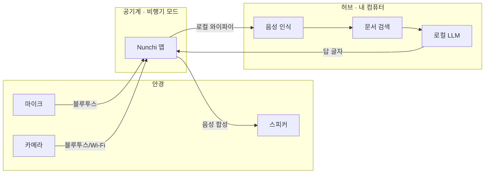

# 한 장으로 보는 큰 그림

## 한 문장 요약

**안경은 눈·귀·입, 폰은 전화 교환원, 허브는 두뇌.** 두뇌를 클라우드가 아니라 책상 위 내 컴퓨터(또는 폰 안)에 둡니다.

## 비유로 이해하기

여러분이 캠핑장에서 안경을 쓰고 이렇게 묻는다고 해 볼게요.

> "여기 체크아웃 몇 시까지야?"

1. **안경(귀)** 이 목소리를 듣습니다. 안경 안에는 AI가 없어요. 마이크·카메라·스피커만 있습니다.
2. **폰(교환원)** 이 블루투스로 그 소리를 받아서 허브로 넘깁니다.
3. **허브(두뇌)** 가 할 일:
   - 소리를 글자로 바꿈 → "여기 체크아웃 몇 시까지야?" (음성 인식, STT)
   - 내가 넣어 둔 문서(캠핑장 안내문)에서 관련 부분을 찾음 (검색, RAG)
   - 찾은 내용을 보고 답을 지음 → "오전 11시까지예요." (LLM)
4. **폰** 이 답을 소리로 읽고(음성 합성, TTS), **안경 스피커** 로 들려줍니다.

이 모든 과정이 **인터넷 없이** 같은 방(같은 와이파이) 안에서 끝납니다.

## 그림으로 보기

## 세 가지 동작 모드

| 모드 | 두뇌 위치 | 네트워크 | 장점 | 단점 |
|---|---|---|---|---|
| **허브 모드** (기본) | 책상 위 컴퓨터 | 인터넷 없는 와이파이 | 큰 모델, 빠름, 사진 질문 가능 | 와이파이 범위 안에서만 |
| **단독 모드** | 공기계 안 | 없음 | 어디서나 | 폰 성능·배터리 한계, 사진 질문 제한 |
| **웹 모드** | 컴퓨터 | 같은 와이파이 | 앱 설치 없이 브라우저로 시험 | 안경 연결 없음(시험용) |

## 왜 클라우드가 아닌가

- **개인정보**: 안경 카메라는 내 시선 그 자체예요. 그 영상이 회사 서버로 가지 않습니다.
- **오프라인**: 산·지하·해외·재난 상황처럼 인터넷이 없어도 동작합니다.
- **지연**: 같은 방 안에서 처리하니 왕복이 짧아요. 실측 중앙값은 [평가 문서](../05-applications/03-evaluation.md)에 있습니다.
- **비용**: 쓴 만큼 내는 API 요금이 없습니다.

## 재난문자 이야기는 왜 나오나요?

안경 전용으로 쓰는 **공기계**는 계속 켜 두고 블루투스만 쓰는데, 그러다 보면 재난문자 경보음이 갑자기 울려 실험이나 녹음을 방해합니다. 공기계를 **비행기 모드 + 블루투스·와이파이만 켬** 으로 두면 셀룰러가 꺼져 재난문자가 오지 않아요. 단, **몸에 지니는 메인 폰은 반드시 재난문자를 받게 두세요.** 자세한 원리와 안전 원칙은 [오프라인과 재난문자](../02-concepts/02-offline-and-alerts.md)에 있습니다.

## 다음으로

- 낯선 단어가 많았다면 → [용어 사전](02-glossary.md)
- 바로 해 보고 싶다면 → [허브 설치](../03-setup/01-hub.md)
