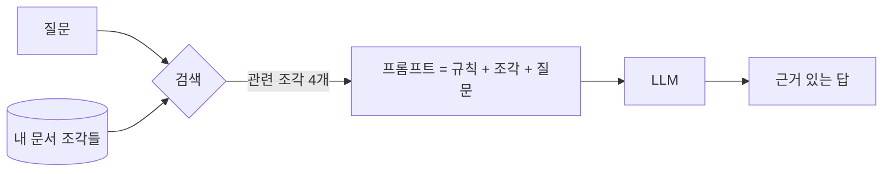

# RAG는 어떻게 내 문서를 아나

## 목차

- [1. 왜 RAG가 필요한가](#1-왜-rag가-필요한가)
- [2. 다섯 단계](#2-다섯-단계)
  - [① 문서 읽기 (로딩)](#-문서-읽기-로딩)
  - [② 조각내기 (청킹)](#-조각내기-청킹)
  - [③ 색인 (임베딩 + 키워드)](#-색인-임베딩--키워드)
  - [④ 검색 (하이브리드 + RRF)](#-검색-하이브리드--rrf)
  - [⑤ 생성 (프롬프트)](#-생성-프롬프트)
- [3. 실패하는 방식과 대책](#3-실패하는-방식과-대책)
- [4. 직접 해 보기](#4-직접-해-보기)

## 1. 왜 RAG가 필요한가

LLM은 학습한 적 없는 **내 문서**(캠핑장 규칙, 장비 매뉴얼, 회사 규정)를 모릅니다. 매번 모델을 다시 학습시킬 수도 없죠. 그래서 **질문할 때마다 관련 부분을 찾아서 같이 보여 주는 것**, 이게 RAG(Retrieval-Augmented Generation, 검색 증강 생성)입니다. 오픈북 시험과 같아요.



## 2. 다섯 단계

### ① 문서 읽기 (로딩)
`.md .txt .pdf .docx .html .csv` 를 글자로 바꿉니다.
- 한국 윈도우에서 만든 `.txt`는 **CP949** 인코딩인 경우가 많아 자동으로 바꿔 읽어요.
- 스캔한 PDF(그림)나 수식은 글자로 안 뽑힙니다 → 수능 수학이 그랬어요. [평가 문서](../05-applications/03-evaluation.md) 참고.

### ② 조각내기 (청킹)
문서를 600자 안팎의 조각으로 자릅니다. Nunchi 규칙:
- 마크다운 제목(`#`)을 따라가며 **제목 경로**를 기억 → 조각마다 "캠핑장 안내 > 불과 화기 사용" 같은 머리말을 붙여요. (본문에 주제어가 없어도 검색되게)
- 문단을 최대한 깨지 않기, 너무 긴 문단은 문장 단위로
- 앞 조각 끝 120자를 다음 조각 앞에 겹치기(오버랩)

### ③ 색인 (임베딩 + 키워드)
- **임베딩**: 각 조각을 의미 벡터로 바꿔 저장 (기본 `bge-m3`, 다국어·한국어에 강함)
- **키워드 색인**: 한국어는 조사 때문에 단어 모양이 바뀌니 **글자 2개씩**(2-gram) 잘라 색인

모두 SQLite 파일 하나(`~/nunchi/index.sqlite3`)에 들어갑니다.

### ④ 검색 (하이브리드 + RRF)
질문이 오면 두 방식으로 각각 찾고 **순위**로 합칩니다.

| | 키워드(BM25) | 의미(임베딩) |
|---|---|---|
| 강한 곳 | 고유명사, 숫자, 코드("E2") | 다른 말로 물을 때("와이파이 암호" ↔ "무선 비밀번호") |
| 약한 곳 | 동의어 | 숫자·코드 |

합치는 규칙(RRF): `점수 = Σ 1 / (60 + 순위)` — 두 방식의 점수 단위가 달라도 공정하게 합쳐져요.

### ⑤ 생성 (프롬프트)
```
[시스템] 너는 안경 속 음성 비서야. 1~3문장, 문서에 없는 건 지어내지 마…
[참고 문서]
[1] 솔바람 캠핑장 이용 안내 > 입실과 퇴실
퇴실(체크아웃)은 오전 11시까지입니다…
[질문] 여기 체크아웃 몇 시까지야?
```
→ "체크아웃은 오전 11시까지예요."

## 3. 실패하는 방식과 대책

| 증상 | 원인 | Nunchi의 대책 |
|---|---|---|
| 엉뚱한 문서를 찾음 | 질문이 너무 짧음("그건?") | 직전 질문을 붙여 검색 (후속 질문 처리) |
| 질문 꼬리말이 검색을 망침 | "알려줘", "뭐야"가 모든 문서와 겹침 | 질문 꼬리말 2-gram 제거 |
| 사진 질문이 문서를 못 찾음 | "이게 뭐야?"엔 검색어가 없음 | **캡션→검색**: 사진을 한 줄로 묘사해 검색어에 더함 |
| 임베딩 서버가 꺼짐 | 오프라인 현장 | 자동으로 키워드 검색만 사용 |
| 번호로 묻는 질문("5번 문제", "3단계")을 못 찾음 | 본문엔 "5."만 있고, 숫자 5는 선택지 ⑤ 등 거의 모든 조각에 있어 변별력이 없음 | 문항 번호를 제목으로 넣고(`## 국어 5번 문항`), 질문의 "N번"과 같은 제목의 절을 **통째로** 가져오기(번호 조회) → [수능 실험](../05-applications/03-evaluation.md) |

## 4. 직접 해 보기

```bash
nunchi ingest ../examples/knowledge
```

```bash
nunchi ask "텐트 안에서 숯불 피워도 돼?"
```

출력에서 `🔎 검색` 아래의 `의미 0.55 키워드 6.2` 같은 숫자가 각 조각의 의미 유사도와 키워드 점수예요. → [첫 RAG 실습](../04-practice/01-first-rag.md)

더 깊은 한국어 검색 기법은 [한국어 RAG 노하우](../02-concepts/04-korean-rag.md)에 있습니다.
