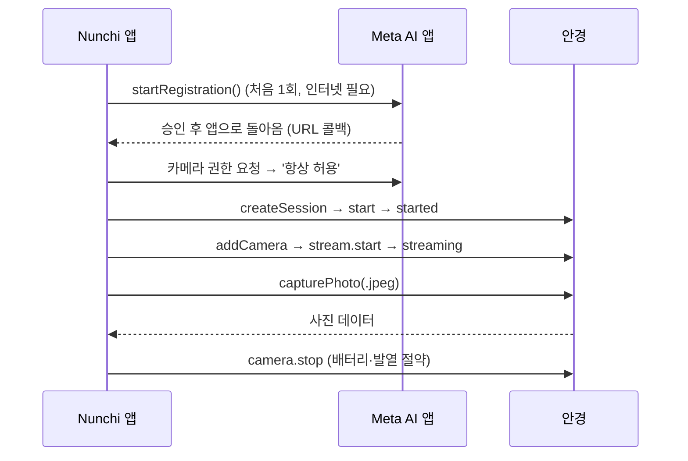
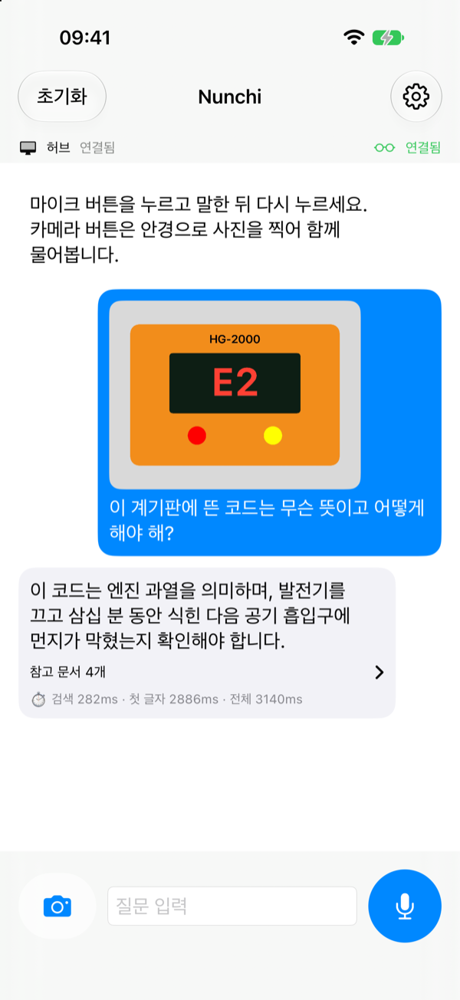

# 안경은 폰과 어떻게 이야기하나

## 목차

- [1. 안경 안에는 무엇이 있나](#1-안경-안에는-무엇이-있나)
- [2. 세 갈래의 연결](#2-세-갈래의-연결)
- [3. Meta Wearables Device Access Toolkit (DAT)](#3-meta-wearables-device-access-toolkit-dat)
  - [연결 순서](#연결-순서)
  - [꼭 알아둘 규칙](#꼭-알아둘-규칙)
- [4. 지원 기기 (DAT 1.0.1 기준)](#4-지원-기기-dat-101-기준)
- [5. 실물 안경이 없을 때: 가상 안경](#5-실물-안경이-없을-때-가상-안경)

## 1. 안경 안에는 무엇이 있나

레이밴 메타·오클리 메타 같은 AI 안경에는 **카메라, 마이크(여러 개), 스피커, 터치패드, 블루투스·와이파이 칩**이 있어요. 큰 AI는 안경 안에서 돌지 않고, **폰의 Meta AI 앱**을 거쳐 처리됩니다. 그래서 폰이 꺼져 있으면 안 돼요.

## 2. 세 갈래의 연결

| 통로 | 무엇을 | 특징 |
|---|---|---|
| **블루투스 LE** | 발견, 세션 시작, 제어 신호 | 저전력, 항상 연결 |
| **블루투스 클래식** | 카메라 영상(기본) | 대역폭 제한 → 해상도가 자동으로 내려갈 수 있음 |
| **Wi-Fi** | 고대역 카메라 영상 | 폰이 **안경이 만든 와이파이**에 붙는 방식(로컬 네트워크 권한 필요) |

여기에 **오디오**는 OS의 일반 블루투스 헤드셋 경로를 씁니다.

| 오디오 | 규격 | 음질 |
|---|---|---|
| 안경 마이크 → 폰 | **HFP** (통화 규격) | 8kHz 모노 |
| 폰 → 안경 스피커 | **A2DP** (음악 규격) | 고음질 |

> 💡 녹음(HFP)을 켜 둔 채로 답을 재생하면 통화 음질로 나와요. Nunchi는 녹음이 끝나면 오디오 경로를 재생용(A2DP)으로 바꿔서 답을 깨끗하게 들려줍니다.

## 3. Meta Wearables Device Access Toolkit (DAT)

내 앱이 안경 카메라 등에 접근하려면 Meta의 공식 SDK인 **DAT**를 씁니다 (2026년 11월 기준 v1.0.1, 개발자 프리뷰).

| 모듈 | 하는 일 | 상태 |
|---|---|---|
| MWDATCore | 등록, 기기 찾기, 권한, 세션 | 정식 |
| MWDATCamera | 카메라 스트리밍, 사진 촬영 | 정식 |
| MWDATDisplay | 메타 레이밴 디스플레이 화면 | 정식 |
| 카메라 스트림 오디오 (16kHz PCM) | 안경 마이크를 고음질로 | **실험 기능** (배포 불가, 연구용 가능) |
| Speech, Inputs, Motion, Voice Invocations | 기기 음성인식, 버튼, 모션, "헤이 메타, ○○ 시작해" | **실험 기능** |

### 연결 순서

### 꼭 알아둘 규칙
- **세션은 안경당 하나**만 열 수 있어요.
- 안경 다리를 접거나 벗으면 세션이 멈추거나 끝납니다. 다시 펴도 자동으로 재시작되지 않아요 → 앱이 새로 시작해야 함.
- **"헤이 메타"는 Meta AI가 받습니다.** 내 앱 호출은 앱 버튼으로 하거나, 실험 기능인 Voice Invocations("헤이 메타, ○○ 시작해")를 쓰세요.
- 해상도를 낮게 요청할수록 블루투스 압축이 줄어 **한 장의 화질은 오히려 좋아질 수 있어요.**

| 해상도 | 크기 | 프레임 |
|---|---|---|
| high | 720×1280 | 2, 7, 15, 24, 30 fps 중 선택 |
| medium | 504×896 | |
| low | 360×640 | |

## 4. 지원 기기 (DAT 1.0.1 기준)

레이밴 메타, Meta Ray-Ban Display, 오클리 메타 HSTN, 오클리 메타 뱅가드 등. Meta AI 앱 V292, 안경 펌웨어 V128 이상이 필요해요(Meta 문서 기준). 일부 기능은 서버에서 사용자별로 열리기 때문에 버전을 맞춰도 거절될 수 있습니다.

## 5. 실물 안경이 없을 때: 가상 안경

DAT에는 **MockDeviceKit**이 있어서, 실물 없이도 가상의 레이밴 메타를 만들어 등록 → 세션 → 카메라 → 사진까지 똑같은 코드로 시험할 수 있어요. Nunchi 앱(Debug 빌드)의 설정에 **'가상 안경'** 스위치를 넣어 두었습니다.

*가상 안경이 찍은 '발전기 계기판(E2)' 사진 → 허브의 비전 모델이 E2를 읽고 → 매뉴얼에서 '엔진 과열' 대처법을 찾아 답한 화면 (iOS 시뮬레이터)*

→ 직접 해 보기: [iOS 앱](../04-practice/05-ios-app.md) · [Android 앱](../04-practice/06-android-app.md)
