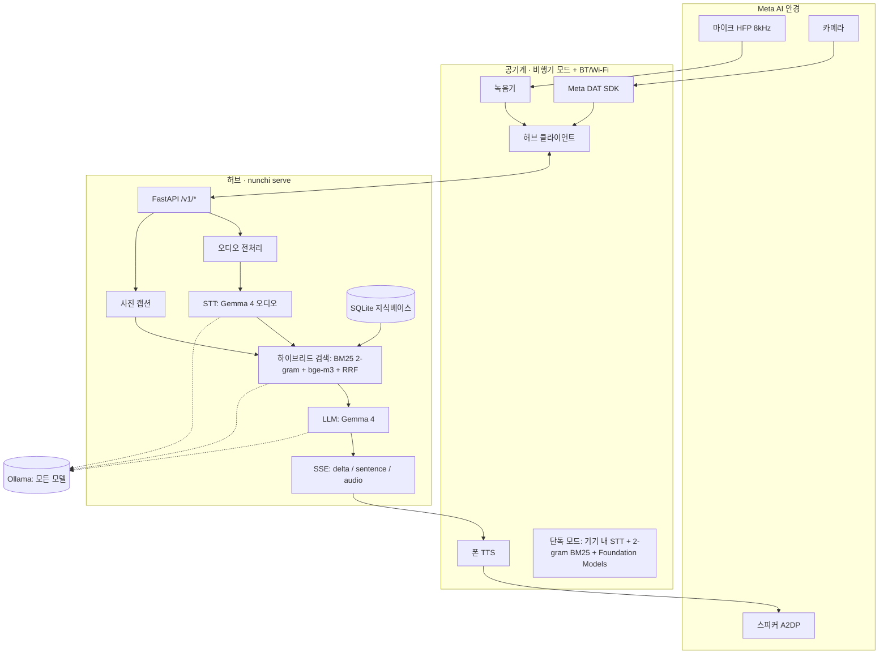

# 구조와 설계 결정

## 목차

- [1. 구성 요소](#1-구성-요소)
- [2. 질문 한 번의 흐름 (음성)](#2-질문-한-번의-흐름-음성)
- [3. 핵심 설계 결정과 이유](#3-핵심-설계-결정과-이유)
- [4. 지연시간 예산 (목표)](#4-지연시간-예산-목표)
- [5. 모드별 데이터 경계](#5-모드별-데이터-경계)

## 1. 구성 요소



| 위치 | 코드 | 역할 |
|---|---|---|
| `hub/nunchi/` | Python | 허브 서버·CLI (RAG, STT, TTS, API) |
| `hub/nunchi/web/` | HTML/JS | 브라우저 클라이언트 (외부 라이브러리 없음) |
| `clients/ios/` | Swift | iOS 앱 (DAT, 허브/단독 모드, 가상 안경) |
| `clients/android/` | Kotlin | Android 앱 (DAT, 허브 모드, 가상 안경) |
| `research/csat/` | Python | 수능 실험 도구 |

## 2. 질문 한 번의 흐름 (음성)

```
[앱] 녹음(16kHz WAV) ─POST /v1/voice─▶ [허브]
  1. 전처리: 직류 제거 → 고역 통과 → 앞뒤 무음 자르기 → 볼륨 정규화
  2. STT: Ollama /v1/audio/transcriptions (LLM과 같은 Gemma 4)    → event: transcript
  3. 검색: 질문(+직전 질문) → BM25·임베딩 각각 24개 → RRF → 상위 4개 → event: retrieval
     (질문에 "N번·N쪽·N단계"가 있고 같은 번호의 제목이 있으면 그 절을 통째로 맨 앞에 — 번호 조회)
  4. 생성: 음성용 시스템 프롬프트 + [참고 문서] + [질문] → 스트리밍  → event: delta…
  5. 문장 조립: 완성된 문장마다 마크다운 제거                         → event: sentence (폰이 바로 읽음)
  6. (선택) 허브 TTS: 문장별 WAV를 별도 스레드에서 병렬 합성          → event: audio
  7. 완료: 답·근거·단계별 시간                                       → event: done
```

## 3. 핵심 설계 결정과 이유

| 결정 | 이유 | 대안과 비교 |
|---|---|---|
| **Ollama 하나로 LLM·STT·임베딩·TTS** | 설치할 서버가 하나, 오프라인 꾸러미가 단순 | Whisper·Piper 등을 따로 두면 관리 대상이 3~4개 |
| **STT를 LLM과 같은 모델로** | 메모리에 모델 하나만 → 교체 대기 없음 | 24GB 맥에서 e2b(STT)+e4b(LLM)를 번갈아 쓰면 매번 수 초 재로딩 (실측) |
| **SQLite + numpy** | 벡터 DB 서버 불필요, 파일 하나라 백업·이동 쉬움 | 조각 수만 개까지는 브루트포스 코사인으로 수 ms |
| **2-gram BM25 + 임베딩 하이브리드** | 한국어 조사 문제를 형태소 분석기 없이 해결, 폰에서도 같은 규칙 | 형태소 분석기는 설치·폰 이식이 어려움 |
| **임베딩 실패 시 BM25로 자동 전환** | 현장에서 '검색 불가'보다 '조금 덜 정확'이 낫다 | |
| **문장 단위 스트리밍(SSE)** | 첫 소리까지의 시간을 줄임 | 전체 답 대기 시 체감 지연이 2~3배 |
| **TTS는 폰에서** (기본) | 가장 빠르고 네트워크 부담 없음 | 허브 TTS는 선택 사항 |
| **사진: 캡션→검색** | "이게 뭐야?"처럼 검색어 없는 질문도 근거 문서를 찾음 | 질문만으로 검색하면 실패 |
| **번호 조회 + 절 확장** | "5번 문제"·"3단계"는 유사도 검색보다 목차 조회가 정확. 절을 통째로 줘서 긴 지문이 잘리지 않음 | 수능 실험 검색 적중: 원문 38%·26% → 제목 65%·89% → 번호 조회 100% (국어·영어) |
| **카메라는 찍을 때만** | 안경 발열·배터리 | 상시 스트리밍은 열로 자동 정지될 수 있음 |
| **허브 기본 바인딩 127.0.0.1** | 실수로 네트워크에 노출 방지 | 폰 접속 시 `--host 0.0.0.0` + 토큰 권장 |

## 4. 지연시간 예산 (목표)

| 단계 | 목표 | 비고 |
|---|---|---|
| 녹음 종료 → 업로드 | < 0.1s | 같은 와이파이 |
| STT | < 0.3s | 3초 질문 기준, 모델 상주 시 |
| 검색 | < 0.05s | 조각 수천 개 |
| 첫 토큰 | < 0.5s | |
| 첫 문장 TTS 시작 | < 1s | 폰 TTS |

실측 중앙값과 분포는 [평가와 실험 결과](../05-applications/03-evaluation.md)에 있습니다.

## 5. 모드별 데이터 경계

| 모드 | 안경·드론 영상과 음성이 가는 곳 | 인터넷 필요 |
|---|---|---|
| 허브 | 공기계 → 같은 와이파이의 허브 (내 기기) | 없음 (최초 설치·등록 때만) |
| 단독 | 공기계 안에서 끝 | 없음 |
| 웹 | 브라우저 → 허브 | 없음 |
| 드론 | 기체 상태(USB·라디오·블루투스·Wi-Fi)와 드론 영상(수신기·MJPEG) → 폰 → 같은 네트워크의 허브, 또는 폰 안에서 끝 | 없음 |

어느 모드든 **사진 한 장도 내 네트워크 밖으로 나가지 않습니다.** (Meta AI 앱 자체의 동작·약관은 별개 — [안전·개인정보·법](../06-reference/03-safety-privacy-legal.md))
