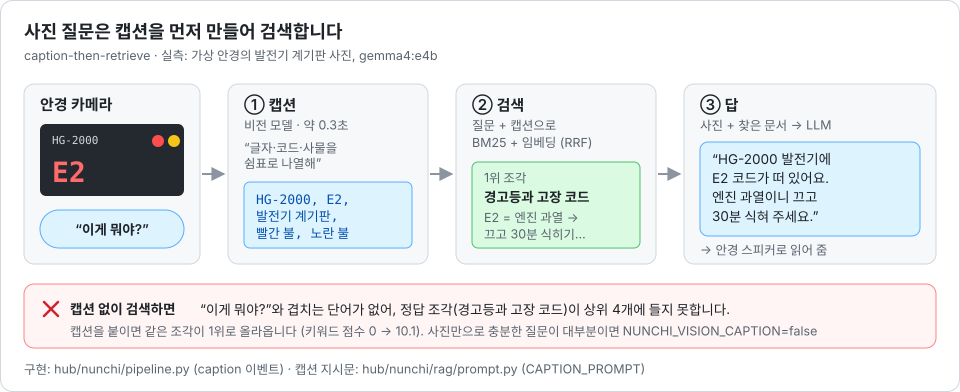

# 한국어 RAG 노하우

> 이 레포에서 실제로 효과를 확인한 기법만 모았어요. 코드는 `hub/nunchi/rag/` 에 있습니다.

## 목차

- [1. 형태소 분석기 없이: 글자 2-gram BM25](#1-형태소-분석기-없이-글자-2-gram-bm25)
- [2. 질문 꼬리말 지우기](#2-질문-꼬리말-지우기)
- [3. 맥락 헤더 (제목 경로 붙이기)](#3-맥락-헤더-제목-경로-붙이기)
- [4. 하이브리드 + RRF](#4-하이브리드--rrf)
- [5. 후속 질문 처리](#5-후속-질문-처리)
- [6. 음성 인식 오류를 LLM이 보정](#6-음성-인식-오류를-llm이-보정)
- [7. 사진 질문: 캡션→검색 (caption-then-retrieve)](#7-사진-질문-캡션검색-caption-then-retrieve)
- [8. 문서 구조를 살린 청킹 (수능 실험에서 배운 것)](#8-문서-구조를-살린-청킹-수능-실험에서-배운-것)
- [9. 조각 크기 고르기](#9-조각-크기-고르기)

## 1. 형태소 분석기 없이: 글자 2-gram BM25

한국어는 조사·어미가 붙어 단어 모양이 계속 바뀝니다("회의실은/회의실이/회의실을"). 단어 단위로 비교하면 놓치고, 형태소 분석기는 설치·폰 이식이 번거로워요. 해법은 **두 글자씩 자르기**.

```
"회의실은 2시간"  →  회의 / 의실 / 실은 / 2 / 시간
"회의실이 몇 시간" →  회의 / 의실 / 실이 / 몇 / 시간
                     ↑ 겹치는 조각이 많음 → 높은 점수
```

- 영문·숫자는 단어 그대로, 한글·한자·가나는 2-gram
- 같은 규칙을 Swift(iOS)·Python(허브)에 똑같이 구현 → 폰 단독 모드도 같은 검색 결과

## 2. 질문 꼬리말 지우기

"알려줘", "뭐야", "어떻게", "있어?" 같은 질문 꼬리말은 내용과 상관없이 많은 문서와 겹쳐 점수를 흐립니다. **질문 쪽에서만** 이 2-gram들을 뺍니다(문서는 그대로).

```
"체크인 시간 알려줘"  →  체크 / 크인 / 시간   ("알려", "려줘" 제거)
```

## 3. 맥락 헤더 (제목 경로 붙이기)

조각 본문에 주제어가 없을 때가 많아요. 예: "9시 이후 도착은 관리동에 미리 알려야 합니다." — 이 조각엔 '체크인'이라는 말이 없죠. 조각마다 **문서 제목 > 섹션 제목**을 붙여서 색인합니다.

```
솔바람 캠핑장 이용 안내 > 입실과 퇴실
9시 이후 도착은 관리동에 미리 알려야 합니다.
```

## 4. 하이브리드 + RRF

키워드와 의미 검색을 각각 24개씩 뽑아 **순위**로 합칩니다(`1/(60+순위)`). 그리고:
- 키워드가 하나도 안 겹치고 의미 유사도도 0.35 미만인 조각은 버림 → 관련 없는 문서를 LLM에 주지 않기
- 임베딩 서버가 없거나 모델 차원이 바뀌면 자동으로 BM25만 사용(경고 표시)

## 5. 후속 질문 처리

"그럼 주말엔?"은 혼자서는 검색이 안 돼요. 질문이 짧거나 '그럼/그거/거기…'로 시작하면 **직전 질문을 앞에 붙여** 검색합니다.

```
1차: "캠핑장 체크인은 몇 시부터야?"
2차: "그럼 주말엔?"  → 검색어: "캠핑장 체크인은 몇 시부터야? 그럼 주말엔?"
```

## 6. 음성 인식 오류를 LLM이 보정

8kHz 안경 마이크는 'ㅊ↔ㅅ' 같은 오류를 냅니다. 음성 질문일 때만 시스템 프롬프트에 한 줄을 더해요.

> 질문은 음성 인식으로 받아 적은 글이라 발음이 비슷한 단어가 잘못 적혔을 수 있다(예: 초크→쇼크). 참고 문서에 발음이 비슷한 단어가 있으면 그 단어를 뜻한 것으로 이해하고 답한다.

실측: "발전기 시동 걸 때 **쇼크**는 언제야?"(오인식) → 검색은 '시동 방법' 조각을 찾았고, 힌트를 넣은 뒤 LLM이 "**초크** 레버를…"로 올바르게 답함.

## 7. 사진 질문: 캡션→검색 (caption-then-retrieve)

"이게 뭐야?"에는 검색어가 없어서 문서를 못 찾습니다. 그래서 **사진을 먼저 한 줄로 묘사**(글자·코드·사물 명사)하게 하고, 그 캡션을 질문에 붙여 검색해요.

```
질문:  "이게 뭐야?"
캡션:  "HG-2000, E2, 발전기, 계기판, 빨간 불, 노란 불"     (약 0.3초)
검색:  "이게 뭐야? HG-2000, E2, 발전기…" → '경고등과 고장 코드' 조각
답:    "HG-2000 휴대용 발전기이며 코드 E2가 표시되고 있습니다. E2는 엔진 과열을 의미하므로…"
```



## 8. 문서 구조를 살린 청킹 (수능 실험에서 배운 것)

"국어 5번 문제 풀어 줘"처럼 **번호로** 묻는 질문은 검색이 의외로 못 찾습니다.

- 본문에는 "5."만 있고 "5번"이라는 말이 없어요.
- 숫자 `5`는 **거의 모든 조각에** 들어 있습니다. 선택지 ⑤가 NFKC 정규화로 `5`가 되고, 번호 목록·연도에도 숫자가 흔하니까요. 그래서 BM25에서 `5`의 변별력(IDF)이 거의 0입니다.
- 임베딩(의미 검색)은 원래 숫자에 약합니다. "5번 문제"와 "15번 문제"는 의미가 거의 같아 보여요.

해결은 두 단계입니다.

1. **문서에 번호를 제목으로**: 문항마다 `## 국어 5번 문항` 제목을 붙여 넣습니다(맥락 헤더에 "5번"이 들어감).
2. **번호 조회 + 절 확장**: 질문에서 "N번·N쪽·N장·N조·N항·N단계"를 찾아, **같은 번호가 붙은 제목의 절**을 검색 대신 목차처럼 바로 가져오고, 그 절의 조각들을 이어 붙여 **통째로** 줍니다. 국어처럼 지문이 길어 조각이 여러 개로 나뉘어도 지문·발문·선택지가 한 번에 들어가요. 같은 번호가 여러 문서에 있으면(국어 20번 / 영어 20번) 질문의 나머지 단어("국어")가 제목과 겹치는 쪽을 고릅니다.

실측 (2026 수능, `bge-m3` + 2-gram BM25, 질문 "국어 N번 문제"):

| 지식베이스 | 검색 적중 국어 (34문항) | 영어 (27문항) |
|---|---:|---:|
| 문제지 원문 그대로 | 38% | 26% |
| 문항 번호를 제목으로 | 65% | 89% |
| + 번호 조회·절 확장 | **100%** | **100%** |

정답률도 따라 올라 국어는 '문항을 직접 준 경우'(상한) 수준이 되고, 영어는 상한에 조금 못 미칩니다 (`gemma4:e4b` 국어 62% vs 상한 59%, 영어 81% vs 93%). 자세한 표는 [평가](../05-applications/03-evaluation.md#1-수능-국어수학영어).

> 번호 조회로 가져온 절은 **원문 그대로** 줘야 합니다. 처음엔 문서를 저장할 때 NFKC 정규화를 해서 선택지 ①~⑤가 1~5로, ㉠·ⓐ가 다른 글자로 바뀐 채 LLM에게 갔고, 검색 적중 100%인데도 정답률이 크게 낮았습니다. 이제 NFKC는 검색 토큰화에서만 씁니다.

```python
# hub/nunchi/rag/retriever.py (요약)
NUM_REF = re.compile(r"(?<![\d.])0*(\d{1,4})\s*(번|쪽|페이지|장|조|항|절|단계|호)")
# 1) 질문의 (번호, 단위)마다 제목에 같은 번호가 있는 절을 모으고
# 2) 질문의 나머지 단어가 '문서 제목 + 절 제목'과 가장 많이 겹치는 절을 고른 뒤
# 3) 그 절의 조각을 순서대로 이어 붙여(겹침 제거) 검색 결과 맨 앞에 둡니다.
```

끄기: `NUNCHI_NUMBER_LOOKUP=false`. 매뉴얼에도 그대로 통합니다 — `## 3단계: 연료 확인`처럼 단계 번호를 제목으로 달아 두면 "3단계 뭐였지?"가 바로 그 절로 갑니다.

> 채점할 때도 정규화를 맞추세요. 처음 버전은 문서를 NFKC로 바꿔 저장했기 때문에(ⓐ～ⓔ → a~e) 원문 발문과 그대로 비교하면 검색 적중을 실제보다 낮게 셌습니다. 비교할 땐 양쪽을 같은 방식으로 정규화하세요(`run_eval.squash`).

## 9. 조각 크기 고르기

| 문서 | 추천 `NUNCHI_CHUNK_CHARS` | 이유 |
|---|---|---|
| 규정·안내문(짧은 항목) | 400~600 | 항목 하나 = 조각 하나 |
| 매뉴얼(절차) | 600~800 | 단계가 끊기지 않게 |
| 긴 글(논문·지문) | 800~1200 + overlap 200 | 문맥 유지 |
| 표(CSV) | 행 단위 | Nunchi는 CSV를 '열이름: 값' 문장으로 변환 |
