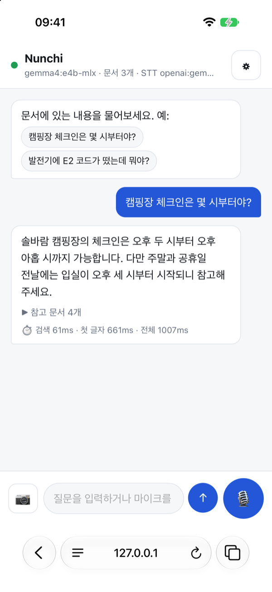

# 실습 2 — 음성으로 묻기

## 1. 음성 파일로 (가장 간단)

맥이라면 `say` 로 질문 음성을 만들어 볼 수 있어요. 안경 마이크와 같은 **8kHz**로 바꿔 봅니다.

```bash
say -v Yuna -o q.aiff "발전기 시동 걸 때 초크는 언제 열어?"
```

```bash
ffmpeg -y -i q.aiff -ar 8000 -ac 1 q8k.wav
```

```bash
nunchi voice q8k.wav --speak
```

```
🎙️  인식: 발전기 시동 걸 때 쇼크는 언제야?  (146ms)
🔎 검색 (hybrid, 35.9ms)
  [1] HG-2000 휴대용 발전기 점검 절차 > 시동 방법 의미 0.54 키워드 5.2
  …
💬 발전기 시동 시 '쇼크'라는 표현은 참고 문서에 나와 있지 않습니다. 혹시 엔진이 차가울 때 초크 레버를 닫힘으로 두는 절차를 말씀하시는 건가요?
⏱️  stt 146ms · retrieval 35.9ms · first_token 224ms · llm 360ms · total 542ms
```

- 8kHz라서 '초크'가 '쇼크'로 잘못 인식됐지만, LLM이 문서의 '초크'로 바로잡아 되묻습니다(음성 인식 오류 힌트 프롬프트).
- `-o answer.wav` 를 붙이면 답 음성을 파일로 저장해요.

음성 인식만 따로 시험:

```bash
nunchi transcribe q8k.wav
```

음성 합성만 따로 시험:

```bash
nunchi say "체크아웃은 오전 11시까지예요."
```

## 2. 맥 마이크로 바로 말하기

```bash
nunchi listen
```

```
맥(또는 맥에 연결한 블루투스 헤드셋) 마이크로 질문해 보세요. Ctrl+C로 종료.
🎙️  말하세요… (끝나면 Enter)
```

- 처음엔 macOS가 터미널의 마이크 권한을 물어요 → 허용
- 마이크 장치가 여러 개면: `ffmpeg -f avfoundation -list_devices true -i ""` 로 번호를 보고 `--device ":1"`

## 3. 웹 클라이언트 (폰 브라우저로도)

```bash
nunchi serve
```

브라우저로 `http://127.0.0.1:8765` 를 열면 아래 화면이 나와요. 마이크 버튼을 **누른 채로 말하거나**, 짧게 탭하면 다시 탭할 때까지 녹음합니다.



*아이폰 시뮬레이터의 사파리에서 연 웹 클라이언트. 주소 뒤에 `?q=질문`을 붙이면 열자마자 물어봅니다(`&speak=off`로 소리 끄기) — 위 화면은 `http://127.0.0.1:8765/?q=캠핑장 체크인은 몇 시부터야?&speak=off`.*

### 폰 브라우저에서 마이크를 쓰려면 HTTPS

브라우저는 보안상 `https://` 또는 `localhost` 에서만 마이크를 열어 줍니다. 폰에서 허브에 접속해 말하려면:

```bash
nunchi serve --host 0.0.0.0 --https --token <비밀번호>
```

- 자체 서명 인증서를 자동으로 만들어요(`~/nunchi/tls/`). 폰 브라우저의 "안전하지 않음" 경고에서 '계속'을 눌러야 합니다.
- 글자·사진 질문은 HTTP에서도 됩니다.

## 4. 앱에서 (안경 마이크)

앱의 마이크 버튼을 누르고 말한 뒤 다시 누르면 됩니다. 앱은 안경 마이크(블루투스 HFP)로 녹음해 16kHz WAV로 허브에 보내요.
- iOS: [iOS 앱](05-ios-app.md) · Android: [Android 앱](06-android-app.md)

## 5. 음성 인식 정확도 실험 (8kHz vs 16kHz)

```bash
nunchi bench --voice --sr 8000
```

```bash
nunchi bench --voice --sr 16000
```

`say` 로 질문 음성을 만들어 지정한 샘플레이트로 바꾼 뒤 전체 파이프라인을 돌리고, **문자 오류율(CER)** 을 계산합니다. 실측 결과는 [평가 문서](../05-applications/03-evaluation.md#2-음성-8khz-vs-16khz).

## 6. 설정 팁

| 하고 싶은 것 | 설정 |
|---|---|
| 고유명사 인식률 올리기 | `NUNCHI_STT_PROMPT="HG-2000, 초크, 솔바람"` (모델에 따라 반영 정도가 다름) |
| 전처리 끄기(원음 비교 실험) | `NUNCHI_AUDIO_PREPROCESS=false` |
| whisper.cpp 사용 | `NUNCHI_STT_BACKEND=whispercpp NUNCHI_STT_URL=http://127.0.0.1:8080` |
| 허브 음성 목소리 | `NUNCHI_TTS_VOICE=male-korean` (lfm3-audio) / `NUNCHI_SAY_VOICE=Yuna` (macOS) |
| 허브 TTS 끄기(폰이 읽음) | `NUNCHI_TTS_BACKEND=none` |
