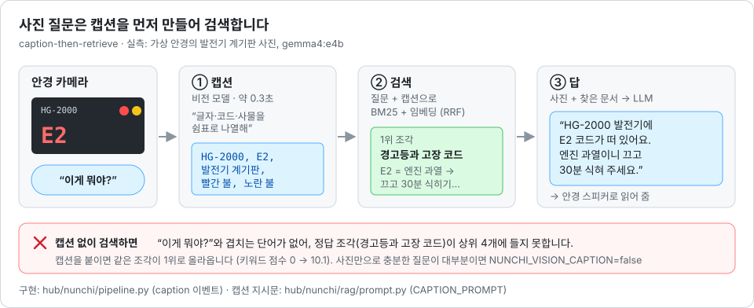

# 실습 3 — 사진으로 묻기 (캡션→검색)

## 1. 명령줄에서

```bash
nunchi ask "이게 뭐야?" --image panel.jpg
```

허브 API로:

```bash
curl -s -X POST http://127.0.0.1:8765/v1/vision -F image=@panel.jpg -F "question=이게 뭐야?"
```

## 2. 실제 결과 (가상 안경의 '발전기 계기판' 사진)

| 질문 | 캡션(검색어로 보탬) | 검색 1위 | 답 |
|---|---|---|---|
| 이게 뭐야? | HG-2000, E2, 발전기, 계기판, 빨간 불, 노란 불 | 경고등과 고장 코드 | 이 장비는 HG-2000 휴대용 발전기이며, 현재 코드 E2가 표시되고 있습니다. 코드 E2는 엔진 과열을 의미하므로 발전기를 끄고 30분 식힌 다음 공기 흡입구에 먼지가 막혔는지 확인해야 합니다. |
| 이거 왜 이래? 어떻게 해야 해? | HG-2000, E2, 빨간 불, 노란 불 | 경고등과 고장 코드 | 코드 E2는 엔진 과열 상태이므로 발전기를 끄고 30분 동안 식혀주세요. 그리고 공기 흡입구에 먼지가 막혔는지 확인해 보셔야 합니다. |

질문에는 'E2'도 '발전기'도 없지만, 사진 캡션이 검색어가 되어 매뉴얼의 정확한 조각을 찾았어요. 캡션 없이 "이게 뭐야?"만으로 검색하면 겹치는 단어가 하나도 없어(키워드 점수 0) 문서 세 개의 첫머리가 비슷한 의미 점수(0.40~0.44)로 나오고, 정답 조각은 **상위 4개에 들지 못합니다**. 캡션을 붙이면 같은 조각이 키워드 10.1 · 의미 0.67로 1위가 됩니다.



## 3. 어떻게 동작하나

```
① 캡션:  비전 모델에게 "사진 속 글자·코드·사물을 쉼표로 나열"  (max 60토큰, 약 0.3초)
② 검색:  질문 + 캡션 → 하이브리드 검색
③ 답변:  사진 + [참고 문서] + 질문 → 비전 모델
```

- SSE로 받으면 `caption` 이벤트가 먼저 와서, 앱 화면에 "사진에서 본 것"을 보여 줄 수도 있어요.
- 끄기: `NUNCHI_VISION_CAPTION=false` (사진만으로 답하는 질문이 대부분일 때)
- 문서 검색 없이 사진만: API에서 `use_rag=false`

## 4. 사진 팁

| 팁 | 이유 |
|---|---|
| 긴 변 1280px 정도로 줄여 보내기 | 모델이 어차피 줄임. 업로드·처리 빨라짐 (웹 클라이언트는 자동) |
| JPEG/PNG | 아이폰 HEIC는 맥 허브가 `sips`로 자동 변환, 그 외 허브는 거절 |
| 글자를 크게, 정면에서 | 계기판·라벨 판독률이 크게 오름 |
| 안경 해상도는 medium(504×896) | 낮을수록 블루투스 압축이 적어 한 장 화질이 좋아질 수 있음 |

## 5. 안경 카메라로 (앱)

앱의 📷 버튼 → 안경 카메라 세션 시작 → 사진 1장 → 카메라 끄기 → 허브로 전송. 입력창에 질문을 적고 누르면 그 질문으로, 비워 두면 "지금 보이는 게 뭐야?"로 물어요.

- 실물 안경이 없으면 설정의 **가상 안경**을 켜세요. 예시 계기판(E2) 사진이 들어갑니다.
- 수능 수학처럼 **수식이 많은 종이**를 비전 모델로 읽는 실험은 [평가 문서](../05-applications/03-evaluation.md)를 보세요.
