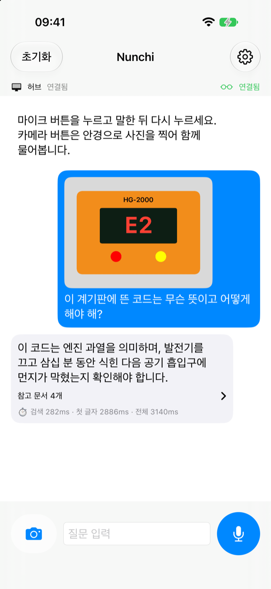
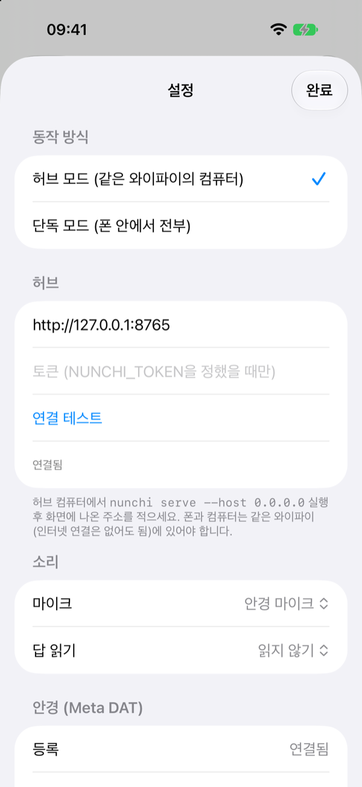

# 실습 5 — iOS 앱 (Nunchi)

> 상태: **iOS 시뮬레이터 빌드·실행 검증 완료** (Xcode 27.2, iOS 27.2 SDK, Meta DAT 1.0.1). 가상 안경(MockDeviceKit)으로 등록→세션→카메라→사진→허브 비전 답변까지 자동 점검했어요. 실물 안경 연결은 [연구 로드맵](../05-applications/04-research-roadmap.md)의 검증 항목입니다.



## 목차

- [1. 준비물](#1-준비물)
- [2. 열기](#2-열기)
- [3. 서명 설정 (한 번)](#3-서명-설정-한-번)
- [4. 처음 실행 후 할 일](#4-처음-실행-후-할-일)
- [5. 실물 안경 없이: 가상 안경 (Debug 빌드)](#5-실물-안경-없이-가상-안경-debug-빌드)
  - [자동 점검 (연구용)](#자동-점검-연구용)
- [6. 코드 구조](#6-코드-구조)
- [7. 개발 중 알게 된 것](#7-개발-중-알게-된-것)
- [8. Info.plist 핵심 (직접 만들 때 체크리스트)](#8-infoplist-핵심-직접-만들-때-체크리스트)

## 1. 준비물

- 맥 + Xcode 26.4 이상 (Meta DAT 요구 사항)
- 아이폰 iOS 17.2+ (단독 모드 LLM은 iOS 26+ & Apple Intelligence 기기)
- Apple ID (무료 개인 팀으로도 내 폰 설치 가능)
- (실사용) Meta AI 앱 + 안경, 개발자 모드 켜기

## 2. 열기

```bash
open clients/ios/Nunchi.xcodeproj
```

처음 열면 Xcode가 Meta DAT 패키지(`meta-wearables-dat-ios` 1.0.1)를 자동으로 내려받아요(인터넷 필요).

> Meta Wearables Device Access Toolkit을 쓰면 [Meta Wearables Developer Terms](https://wearables.developer.meta.com/terms)와 이용 정책에 동의하는 것입니다. 약관은 직접 읽어 보세요.

## 3. 서명 설정 (한 번)

1. 왼쪽 프로젝트 → **Nunchi** 타깃 → **Signing & Capabilities**
2. **Team**: 내 Apple ID 선택
3. **Bundle Identifier**: `com.example.nunchi` → `com.<내이름>.nunchi` 처럼 **나만의 값**으로 (겹치면 설치 실패)
4. 폰을 연결하고 상단에서 기기 선택 → ▶︎ 실행
5. 처음엔 폰의 설정 → 일반 → VPN 및 기기 관리 → 개발자 앱 신뢰

> 💡 XcodeGen으로 프로젝트를 다시 만들 수 있어요(`brew install xcodegen` → `cd clients/ios && xcodegen generate`). 설정 원본은 `project.yml` 입니다.

## 4. 처음 실행 후 할 일

1. ⚙︎ 설정 → **허브** 주소: `http://<허브IP>:8765`, 토큰 → **연결 테스트**
2. **안경 (Meta DAT)** → **Meta AI 앱과 연결** (처음 한 번, 인터넷 필요)
3. 메인 화면에서 🎙️ 버튼 → 말하기 → 다시 누르기
4. 📷 버튼 → 안경으로 사진 찍어 묻기 (처음엔 Meta AI 앱에서 카메라 권한 → '항상 허용')

## 5. 실물 안경 없이: 가상 안경 (Debug 빌드)

⚙︎ 설정 → **가상 안경 (개발용)** → 켜기

- SDK 안에 가상 레이밴 메타가 생기고 '등록됨·권한 허용·착용' 상태가 됩니다.
- 📷 버튼을 누르면 실물과 **똑같은 코드**(세션 → 카메라 → 사진)로 앱에 든 '발전기 계기판(E2)' 사진이 찍혀요.
- 실제 아이폰에서 켜기 전에 '폰 카메라를 안경 카메라로'를 켜면 폰 뒷면 카메라가 안경 카메라 역할을 합니다(실기기 검증 필요).
- 마이크는 가상화되지 않으니 설정 → 소리 → 마이크를 **폰 마이크**로.



*시뮬레이터는 맥과 같은 네트워크를 쓰므로 허브 주소가 `127.0.0.1`입니다. 실제 폰에서는 `nunchi serve --host 0.0.0.0`이 알려 주는 허브 컴퓨터의 주소(예: `http://192.168.0.10:8765`)를 넣으세요. (스크린샷은 소리를 끈 상태라 '답 읽기'가 '읽지 않기'로 보입니다. 기본값은 '폰이 읽기'.)*

### 자동 점검 (연구용)

시뮬레이터에서 아래처럼 실행하면 가상 안경 사진 → 허브 비전 질문까지 자동으로 돌고 콘솔에 결과를 남깁니다.

```bash
xcrun simctl launch booted com.example.nunchi -NunchiSelfTest photo -hubURL http://127.0.0.1:8765 -voiceOutput off
```

```
[Nunchi] selftest: start
[Nunchi] virtual glasses on
[Nunchi] photo captured: 179166 bytes
[Nunchi] answer: 이 코드는 엔진 과열을 의미하며, 발전기를 끄고 30분 동안 식힌 다음 공기 흡입구에 먼지가 막혔는지 확인해야 합니다.
```

(시뮬레이터는 맥과 네트워크를 공유해서 `127.0.0.1`로 허브에 붙습니다.)

## 6. 코드 구조

| 파일 | 역할 |
|---|---|
| `NunchiApp.swift` | `Wearables.configure()`, Meta AI 콜백(URL) 처리 |
| `AppModel.swift` | 녹음 → 허브/단독 처리 → 화면·소리 |
| `Hub/HubClient.swift` | 허브 API + SSE 파서 + multipart |
| `Audio/VoiceRecorder.swift` | 안경 마이크(HFP) 녹음 → 16kHz WAV |
| `Audio/SpeechOutput.swift` | 한국어 TTS, 허브 WAV 재생, A2DP 전환 |
| `Glasses/GlassesController.swift` | 등록·세션·카메라·사진 (타임아웃·취소 안전) |
| `Glasses/VirtualGlasses.swift` | MockDeviceKit 가상 안경 |
| `OnDevice/LocalKnowledgeBase.swift` | kb.json + 2-gram BM25 (허브와 같은 규칙) |
| `OnDevice/OnDeviceAssistant.swift` | 기기 내 받아쓰기 + Foundation Models |

## 7. 개발 중 알게 된 것

| 증상 | 원인·해결 |
|---|---|
| `Wearables.configure()` 가 "Internal error"로 실패 | **코드 서명 없이** 빌드한 경우(`CODE_SIGNING_ALLOWED=NO`). Xcode 기본(자동/로컬 서명)으로 빌드하면 정상 |
| 사진 찍기에서 "No eligible device" | 세션을 너무 빨리 만듦 → 기기가 '사용 가능'이 될 때까지 기다리게 수정(`activeDeviceStream`) |
| 가상 안경 스트림이 "Critical error"로 끝남 | 시뮬레이터엔 카메라가 없어 영상 소스가 없음 → 앱에 HEVC 영상(14KB)을 넣어 피드로 지정 |
| 중첩된 ObservableObject 변화가 화면에 안 보임 | 하위 객체를 직접 `@ObservedObject` 로 관찰하는 뷰를 따로 둠 |
| 시간 초과 처리 후 앱이 멈춤 | 콜백 기반 continuation이 취소를 무시 → `withTaskCancellationHandler` 로 해제 |
| 안경은 '연결됨'인데 사진에서 "안경 연결 시간이 초과" | `session.start()` **뒤에** `stateStream()`을 만들면, 세션이 빨리 시작될 때 이미 지나간 `.started`를 받지 못해 15초를 그냥 기다림 → 스트림을 `start()` **전에** 만들고 `session.state`도 먼저 확인 (가상 안경에서 재현, 예열된 실기기에서도 생길 수 있음) |

## 8. Info.plist 핵심 (직접 만들 때 체크리스트)

- `MWDAT` 사전: `AppLinkURLScheme`(`nunchi://`), `MetaAppID`(개발자 모드 0), `ClientToken`, `TeamID`, `Analytics.OptOut`
- `CFBundleURLTypes`: `nunchi` 스킴
- `UIBackgroundModes`: bluetooth-central, bluetooth-peripheral, external-accessory, audio
- `UISupportedExternalAccessoryProtocols`: `com.meta.ar.wearable`
- `NSBluetoothAlwaysUsageDescription`, `NSLocalNetworkUsageDescription`, `NSBonjourServices`(`_bonjour._tcp`)
- `NSAppTransportSecurity.NSAllowsLocalNetworking = true` (로컬 허브에 HTTP)
- `NSMicrophoneUsageDescription`, `NSSpeechRecognitionUsageDescription`, `NSCameraUsageDescription`(가상 안경)
