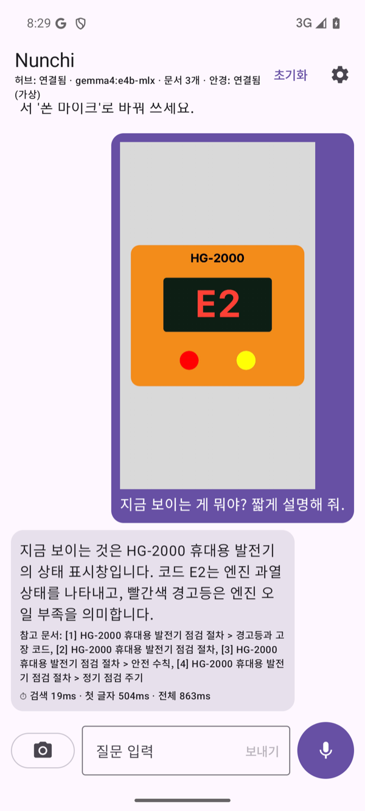

# 실습 6 — Android 앱 (Nunchi)

> 상태: **빌드·실행 검증 완료** — Meta DAT 1.0.1, Gradle 8.14.1 + AGP 8.11.1, JDK 21로 `assembleDebug`·`lintDebug`(오류 0)·단위 테스트 23개 통과. Android 15 에뮬레이터에서 가상 안경 사진 → 허브 비전 답변, **드론 카메라 → Gemma 4 → 화면**(가상 영상과 맥의 실제 카메라 중계), **폰 단독 RAG**, **실기 픽스호크 상태(맥 UDP 중계)** 까지 확인했어요. 실물 안경·실기기(폰)는 아직 검증 전입니다. 드론은 [실습 8](08-drone.md).



*Android 15 에뮬레이터 + 가상 안경 + 맥의 허브(`http://10.0.2.2:8765`). 같은 사진을 두 번째로 물은 화면이라 캐시 덕에 빠릅니다(새 사진이면 중앙값 2.7초 → [평가](../05-applications/03-evaluation.md#3-지연시간-p50--p90)).*

## 1. 준비물

- Android Studio (최신) — JDK 17 포함
- Android 12(API 31) 이상 폰 (안경 마이크 경로 지정 API 때문에)
- (실사용) Meta AI 앱 + 안경, 개발자 모드 켜기

## 2. 열고 실행

1. Android Studio → **Open** → `clients/android`
2. Gradle 동기화 (Meta DAT는 Maven Central에 있어 토큰 없이 받아짐)
3. 폰 연결(USB 디버깅) → ▶︎ Run

배포용 앱 ID가 생기면 `clients/android/local.properties` 에:

```properties
mwdat_application_id=<Developer Center 앱 ID>
mwdat_client_token=<클라이언트 토큰>
```

### 명령줄로 빌드하고 에뮬레이터에서 실행 (Android Studio 없이)

Gradle 8.14는 JDK 17~24에서 돕니다(JDK 26이면 실패). 맥이라면 `brew install openjdk@21` 후:

```bash
cd clients/android && JAVA_HOME=$(brew --prefix openjdk@21)/libexec/openjdk.jdk/Contents/Home ./gradlew assembleDebug
```

```bash
adb install -r app/build/outputs/apk/debug/app-debug.apk
```

에뮬레이터에서는 맥의 `127.0.0.1`이 **`10.0.2.2`** 로 보입니다. 앱 설정의 허브 주소를 `http://10.0.2.2:8765`로 두면 맥에서 `nunchi serve`(기본 127.0.0.1)로 띄운 허브에 바로 붙어요.

## 3. 사용

1. 첫 실행: 블루투스·마이크 권한 허용 → DAT 초기화
2. ⚙︎ → 허브 주소·토큰 → 저장 (상단에 "허브: 연결됨")
3. ⚙︎ → **Meta AI와 연결** (처음 한 번, 인터넷 필요)
4. 🎙️ 버튼 → 말하기 → 다시 누르기 / 📷 → 안경 사진으로 묻기
5. 실물 안경이 없으면 ⚙︎ → **가상 안경** 켜기 + '안경 마이크 사용' 끄기

## 4. 코드 구조

| 파일 | 역할 |
|---|---|
| `MainActivity.kt` | 권한 요청 → `Wearables.initialize()`, Meta AI 권한 계약(RequestPermissionContract) |
| `MainViewModel.kt` | 상태·대화·허브 응답 처리 |
| `HubClient.kt` | HttpURLConnection + org.json 으로 SSE·multipart (외부 라이브러리 없음) |
| `Audio.kt` | 안경 마이크 녹음(블루투스 SCO) · 한국어 TTS · WAV 재생 |
| `Glasses.kt` | 세션 → 카메라 → 사진(JPEG) · 가상 안경(MockDeviceKit) |
| `ui/MainScreen.kt` | Compose 화면 (상단 ✈︎ = 드론 화면) |
| `ui/DroneScreen.kt` | 드론 카메라 영상 + HUD + Gemma 4 결과, 카메라·비행컨트롤러 연결 |
| `drone/Mavlink.kt` | 최소 MAVLink v1/v2 파서·인코더 (테스트에서 dronefleet·실기 캡처로 검증) |
| `drone/DroneTelemetry.kt` | 실시간 상태 → 화면 요약·RAG 보고서·검색 힌트 (PreArm '최근 묶음' 규칙) |
| `drone/UsbSerial.kt` | USB OTG 시리얼 직접 구현: CDC-ACM(픽스호크)·FTDI·CP210x·CH340(텔레메트리 라디오) |
| `drone/Links.kt` · `DroneConnection.kt` · `VirtualDrone.kt` | UDP·TCP·블루투스 SPP·가상 드론, 하트비트·요청·끊김 감지 |
| `camera/DroneCamera.kt` | 드론 카메라: UVC 수신기(UVCAndroid)·MJPEG·가상 영상 → 배선·수신기는 [실습 9](09-fpv-video.md) |
| `ai/OnDeviceGemma.kt` · `ai/LocalAssistant.kt` | 폰 Gemma 4(LiteRT-LM) · 폰 RAG(캡션→검색→답, 없으면 추출형) |
| `rag/LocalRag.kt` | 허브와 같은 규칙의 2-gram BM25·마크다운 청커 (허브 결과와 같은지 테스트 — 예제 문서를 고치면 `hub/tests/make_bm25_parity.py`로 기대값을 다시 만듦) |
| `OnDeviceSpeech.kt` | 폰 단독 모드의 기기 내 받아쓰기 (안드로이드 12+) |

### 안경 마이크 녹음 방식 (공식 샘플과 동일)

```kotlin
audioManager.mode = AudioManager.MODE_IN_COMMUNICATION
audioManager.setCommunicationDevice(scoDevice)          // 안경(블루투스 SCO)
val rec = AudioRecord(MediaRecorder.AudioSource.VOICE_RECOGNITION, 16000, CHANNEL_IN_MONO, ENCODING_PCM_16BIT, …)
rec.setPreferredDevice(scoDevice)
// 녹음 끝나면 clearCommunicationDevice() + MODE_NORMAL → 답은 A2DP(음악 음질)로
```

### DatResult 다루기 팁
`onSuccess { }` 콜백 **안에서 suspend 함수를 부르지 마세요**. `fold(onSuccess = { it }, onFailure = { e, _ -> throw … })` 로 값을 꺼낸 뒤 바깥에서 기다리는 편이 안전합니다(이 레포의 `Glasses.kt` 방식).

### 빌드·실행하며 알게 된 것

| 증상 | 원인·해결 |
|---|---|
| `mergeDebugResources` 실패: "The string \"--\" is not permitted within comments" | XML 주석 안에 `--https` 같은 **하이픈 두 개**를 쓰면 안 됨 → 주석 문구를 바꿈 |
| 답 말풍선이 입력창에 가려 잘림 | 자동 스크롤이 '메시지 개수'에만 반응 → 스트리밍으로 **글자가 늘어날 때도** 마지막 말풍선 끝까지 따라 내려가게 |
| 상단 상태 줄 끝이 잘림 ("(가상)"이 안 보임) | `maxLines = 1` → 두 줄 + 말줄임 |
| 린트: 백업 경고 | 허브 주소·토큰이 클라우드 백업·기기 이전으로 나가지 않게 `data_extraction_rules.xml`로 전부 제외 |

## 5. 알려진 한계

- **폰 단독 모드**: 설정 → '폰에서'. 폰 Gemma 4는 `.litertlm` 모델 파일을 넣어야 동작하고(없으면 추출형 답변), 사진 분석은 모델이 없으면 허브로 보냅니다 → [폰 단독 모드](07-standalone-phone.md)
- APK가 커졌어요(디버그 약 150MB): 폰 LLM 엔진(LiteRT-LM, ARM64만 넣음) + 디버그 빌드의 아이콘 라이브러리. 배포판은 축소(minify)로 줄일 수 있어요.
- 평문 HTTP 허용(`network_security_config.xml`): 로컬 허브 접속용. 허브를 `--https` 로 띄우면 지워도 됩니다.
- 사진마다 세션을 새로 만들고 닫아요(가장 단순하고 안정적). 연속 촬영이 많다면 세션을 유지하고 `removeCamera()` 를 쓰는 방식으로 바꿀 수 있어요.
