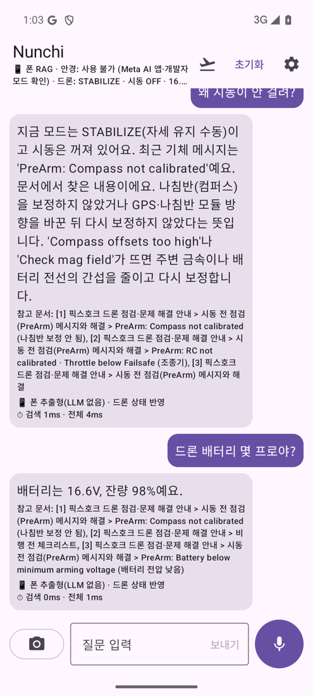

# 실습 7 — 폰 단독 모드 (네트워크 전혀 없이)

공유기도 컴퓨터도 없이, **공기계 안에서** 받아쓰기 → 검색 → 답변 → 음성까지 끝내는 방법이에요.

## 1. 선택지 한눈에

| 방법 | 기기 | LLM | 검색(RAG) | 상태 |
|---|---|---|---|---|
| **Nunchi iOS 단독 모드** | iPhone (iOS 26+ & Apple Intelligence 기기에서 LLM) | Apple Foundation Models | 2-gram BM25 (kb.json) | 이 레포에 포함, 시뮬레이터 빌드 검증 |
| Nunchi iOS (LLM 없는 기기) | iOS 17.2+ | 없음 → **추출형 답변**(문서 문장 그대로) | 2-gram BM25 | 포함 |
| Avenkin (구 OpenGlasses) | iPhone iOS 26+ | MLX / llama.cpp (GGUF) | 앱 자체 기능 | 외부 앱, BSL 1.1 라이선스(비상업 사용 허용) |
| **Nunchi Android 단독 모드** | Android 12+ (LLM은 램 8GB+ 권장) | 폰 Gemma 4 (LiteRT-LM, `.litertlm`) — 없으면 추출형 | 2-gram BM25 (허브와 같은 결과를 테스트로 확인) + 드론 실시간 상태 | 이 레포에 포함, 에뮬레이터에서 추출형 확인 (폰 모델 실행은 미검증) |

## 2. Nunchi iOS 단독 모드 쓰기

1. (같은 와이파이일 때) 설정 → **허브에서 지식베이스 받기** — 또는 허브에서 파일로 만들어 AirDrop:

```bash
nunchi export-mobile -o kb.json
```

2. 설정 → 동작 방식 → **단독 모드**
3. 마이크 버튼으로 질문

동작:
- 받아쓰기: Apple Speech, `requiresOnDeviceRecognition = true` → 음성이 기기 밖으로 나가지 않음 (한국어 기기 내 인식 데이터가 필요 — [오프라인 꾸러미](../03-setup/02-offline-bundle.md))
- 검색: 허브와 **같은 규칙**의 2-gram BM25 (임베딩 없이)
- 답변: Foundation Models가 가능하면 LLM 답변, 아니면 가장 관련 있는 조각의 앞 두 문장을 읽어 줌
- 설정 화면에 '기기 내 LLM: 사용 가능 / 사용 불가 이유'가 표시돼요.

> Foundation Models의 지원 언어는 OS 버전에 따라 달라질 수 있어 앱이 실행 중에 확인합니다(`SystemLanguageModel.default`). 사진 질문은 단독 모드에서 지원하지 않아요.

## 3. 사양 기준 (경험칙)

| 폰 램 | 현실적인 모델 크기 | 체감 |
|---|---|---|
| 4GB 이하 | 1B급 | 답 품질이 크게 떨어짐 → 추출형 답변 권장 |
| 6~8GB | 2~4B (4bit) | 짧은 질의응답 가능 |
| 8GB+ (최신 플래그십) | 4B + 비전 | 사진까지 시도 가능, 발열 주의 |

## 4. 허브 모드와 비교

| | 허브 모드 | 단독 모드 |
|---|---|---|
| 네트워크 | 오프라인 와이파이 | 없음 |
| 모델 크기 | 컴퓨터 메모리만큼 (e4b~26b) | 폰 한계 (~3B) |
| 사진 질문 | ○ (캡션→검색) | ✗ (Nunchi 기준) |
| 번호 조회 ("5번"→ 그 절 통째로) | ○ | ✗ (아직 허브에만 — [로드맵](../05-applications/04-research-roadmap.md)) |
| 배터리 | 폰은 중계만 → 오래감 | 빨리 닳음 |
| 지연 | 실측 중앙값은 [평가](../05-applications/03-evaluation.md) | 기기마다 다름 (연구 과제) |

## 5. Nunchi Android 단독 모드

1. 설정 → 어디서 답을 만들까 → **폰에서**
2. (선택) 폰 Gemma 4: `.litertlm` 모델(예: Gemma 4 E2B)을 `/sdcard/Android/data/io.github.aiglassesrok.nunchi/files/models/`에 넣기 — `adb push` 또는 설정 → 파일 가져오기
3. 문서: 앱에 예제 문서 4개(발전기·캠핑장·허브 사용설명서·드론 점검 안내)가 들어 있고, 설정 → **허브 문서 받기**(kb.json)나 **파일 가져오기**(.md·.txt)로 더할 수 있어요.

동작: 받아쓰기는 안드로이드 '기기 내' 인식기, 검색은 허브와 같은 2-gram BM25, 답은 폰 Gemma 4(사진이 있으면 캡션→검색→답) 또는 추출형. 드론이 연결돼 있으면 [실시간 상태](08-drone.md#6-상태검색-status-then-retrieve)를 함께 씁니다.



## 6. 안드로이드에서 직접 하려면 (참고)

1. 엔진 고르기: llama.cpp(GGUF, JNI) 또는 Google AI Edge(MediaPipe/LiteRT LLM)
2. Nunchi 허브의 `nunchi/rag/bm25.py` 를 Kotlin으로 이식 (iOS `LocalKnowledgeBase.swift` 가 좋은 참고 — 60줄 남짓)
3. 받아쓰기: `SpeechRecognizer.createOnDeviceSpeechRecognizer()` (Android 12+)
4. 포그라운드 서비스로 상시 실행 (안드로이드가 아이폰보다 '항상 켜 둔 허브폰'에 유리)

이 작업은 [연구 로드맵](../05-applications/04-research-roadmap.md)에 열린 과제로 올려 두었어요.
