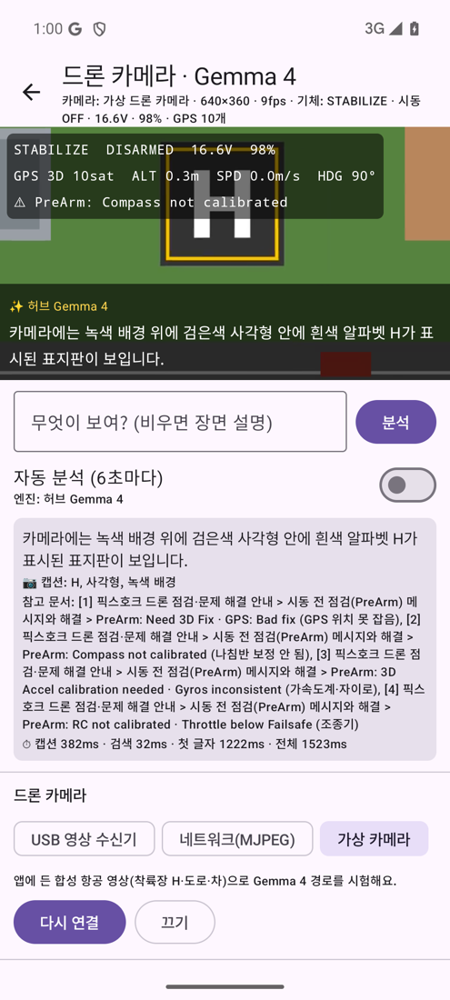
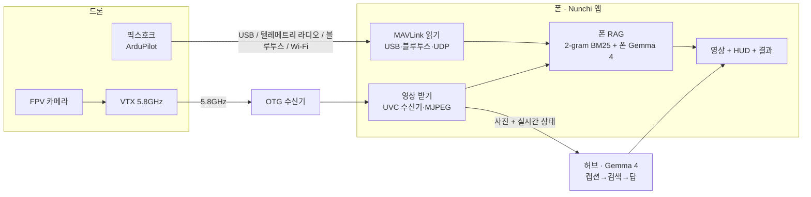

# 실습 8 — 드론(픽스호크) 연결: 드론 카메라 → Gemma 4 → 화면

안경은 가상으로 두고, **실제 드론 키트**(B-CUBE 픽스호크 2.4.8)를 Nunchi 앱에 붙입니다. 앱은 비행컨트롤러의 상태(MAVLink)와 드론 카메라 영상을 받아, **Gemma 4**가 영상을 보고 내 문서(점검 안내)를 찾아 답한 결과를 영상 위에 띄웁니다. RAG는 **허브(컴퓨터)** 에서도, **폰 안**에서도 돌 수 있습니다.

> **상태 (2026-11-20)**
> - **실기 확인**: 픽스호크 2.4.8(PX4v3) + **ArduCopter V3.6.12**를 맥 USB에 꽂아 MAVLink를 읽음 — 35초 동안 프레임 981개, **CRC 오류 0**. 맥이 UDP로 중계해 **Android 앱(에뮬레이터)·iOS 앱(시뮬레이터)** 에 실시간 상태·PreArm 경고가 뜨고, 허브 Gemma 4가 그 상태로 "왜 시동이 안 걸려?"에 답하는 것까지 확인.
> - **실제 카메라 확인**: 맥에 연결된 실제 카메라를 `scripts/video_relay.py`로 중계 → **Android·iOS 앱** → 허브 Gemma 4 → 영상 위 결과(Android 전체 2.3초 · iOS 3.9초), 실기 픽스호크 HUD와 함께.
> - **Android**: `assembleDebug`·`lintDebug`(오류 0)·단위 테스트 23개 통과. 가상 드론·가상 카메라·MJPEG 카메라 → 허브 Gemma 4 → 화면, 폰 단독 RAG(추출형) 확인.
> - **iOS**: 시뮬레이터 빌드 통과. 가상·실제 카메라(맥 중계) + 실기 텔레메트리(UDP) → 허브 Gemma 4 → 화면 확인.
> - **아직 못 한 것**: 5.8GHz 영상 실수신(수신기가 없어서 — 연결 방법은 [실습 9](09-fpv-video.md)), 텔레메트리 라디오 V5 쌍, 실제 폰의 USB OTG 직결·블루투스 모듈, 폰 안 Gemma 모델(.litertlm) 실행.



## 1. 이 키트의 부품과 역할

| 부품 | 하는 일 | Nunchi와의 관계 |
|---|---|---|
| 픽스호크 2.4.8 (ArduPilot) | 비행컨트롤러. 자세·GPS·배터리·경고(PreArm)를 MAVLink로 보냄 | 앱이 MAVLink로 읽음 → 화면 HUD, RAG의 '실시간 문서' |
| GPS·나침반(M8N) | 위치·방위 | 위치·기수 방향·GPS 상태 |
| 전원 모듈(XT60) | 전압·전류 측정 | 배터리 값 (설정 `BATT_MONITOR`가 켜져 있어야 보임) |
| 텔레메트리 라디오 V5 (기체용·지상용) | 433/915MHz로 MAVLink 무선 전달 | 지상용을 **폰 USB OTG**에 꽂으면 무선으로 상태 수신 |
| RC 수신기 + PPM 인코더 | 조종기 신호 | (앱은 조종하지 않음 — 읽기만) |
| MinimOSD | 영상 위에 비행 정보 겹치기 | 아날로그 영상에 OSD가 섞여 들어옴 |
| FPV 카메라 → **VTX(5.8GHz 영상 송신기, '모듈레이터')** → 안테나 | 아날로그 영상을 전파로 보냄 | 받는 쪽에 **5.8GHz 수신기**가 있어야 앱에 영상이 들어옴 → 연결은 [실습 9](09-fpv-video.md) |

## 2. 큰 그림



## 3. 비행컨트롤러 연결 (상태 받기)

앱: 상단 ✈︎ 버튼 → **드론 카메라 · Gemma 4** 화면 → 비행컨트롤러에서 방법 고르고 **연결**.

| 방법 | Android | iOS | 보드레이트 | 메모 |
|---|---|---|---|---|
| 픽스호크 본체 micro-USB → OTG | ✅ | ✗ | 상관없음 | 책상 위 점검용. 꽂으면 앱이 자동으로 열리고 연결(USB 권한 포함) |
| 텔레메트리 라디오 V5 **지상용** USB → OTG | ✅ (FTDI·CP210x·CH340) | ✗ | 57600 | 무선. 초록 불이 계속 켜지면 두 라디오가 연결된 것 |
| 블루투스 HC-05/06 → TELEM2 | ✅ | ✗ | 57600 | 설정에서 페어링(PIN 1234/0000), `SERIAL2_PROTOCOL=2`, `SERIAL2_BAUD=57` |
| Wi-Fi UDP 14550 | ✅ | ✅ | — | ESP8266/ESP32 텔레메트리, 또는 **컴퓨터 중계**(아래) |
| TCP | ✅ | ✗ | — | ArduPilot SITL(`tcp:5760`) 등 |
| 가상 드론 | ✅ | — | — | 100초 시나리오(부팅→PreArm→비행→배터리 부족 RTL) |

아이폰은 USB 시리얼을 앱에서 쓸 수 없어서, **컴퓨터(허브)에 꽂고 UDP로 중계**합니다. 같은 방법으로 Android 에뮬레이터에도 실기 상태를 넣을 수 있어요 (표준 라이브러리만 쓰는 스크립트, pyserial 불필요):

```bash
python3 scripts/mavlink_bridge.py --probe 15
```

```bash
python3 scripts/mavlink_bridge.py --udp 아이폰IP:14550
```

앱은 연결되면 1초마다 지상국 하트비트를 보내고, ArduPilot에 데이터 묶음(REQUEST_DATA_STREAM)을 요청합니다. 미션플래너·QGC와 같은 동작이며, ArduPilot은 이 주기를 `SRx_` 파라미터로 저장합니다. **시동·모드 변경 같은 조종 명령은 보내지 않습니다.**

## 4. 드론 카메라 영상 받기 (VTX → 앱)

VTX는 영상을 **5.8GHz 아날로그 전파**로 보냅니다. 컴퓨터나 폰이 그 전파를 직접 받을 수는 없어서, 받는 쪽에 **5.8GHz 수신기**가 필요합니다.

| 방법 | 연결 | 앱에서 |
|---|---|---|
| **OTG(UVC) 5.8GHz 수신기** | 폰 USB-C에 꽂음 (폰에 USB 카메라로 보이는 제품) | Android: 드론 카메라 → **USB 영상 수신기** (UVCAndroid) |
| 수신기 → **컴퓨터** → 네트워크 중계 | 수신기를 맥·PC에 꽂고 `scripts/video_relay.py`로 MJPEG 중계 | Android·iOS: **네트워크(MJPEG)** 에 `http://컴퓨터IP:8090/stream.mjpg` |
| 와이파이 카메라(ESP32-CAM 등)를 따로 닮 | 같은 와이파이 | **네트워크(MJPEG)** 에 `http://카메라IP:81/stream` |

카메라·VTX 배선, 수신기 고르기, 출력 규정은 [실습 9 — 드론 영상 연결](09-fpv-video.md)에 따로 정리했어요. 컴퓨터에서 장치 번호를 확인하고 중계하는 명령(표준 라이브러리 + ffmpeg, 여러 앱이 동시에 붙어도 됨):

```bash
python3 scripts/video_relay.py --list
```

```bash
python3 scripts/video_relay.py --device 장치번호 --host 0.0.0.0
```

> 맥 카메라(실물)를 이 중계로 Android·iOS 앱에 넣어 **실제 카메라 → Gemma 4 → 화면**은 확인했어요. 맥에 5.8GHz 수신기가 없어 **VTX 전파의 실수신은 아직 확인하지 못했습니다.** 수신기를 꽂으면 장치 목록에 새 카메라(예: `USB2.0 PC CAMERA`)로 나타납니다.

## 5. Gemma 4로 분석 → 화면

드론 화면의 **분석**(또는 **자동 분석**, 6초마다)을 누르면:

1. 지금 프레임을 JPEG(긴 변 768px)로
2. **허브 Gemma 4**(`/v1/vision`, `image_source=drone`) 또는 **폰 Gemma 4**(LiteRT-LM)가 먼저 한 줄로 묘사(캡션)
3. 캡션(+ 드론 질문이면 기체 경고)으로 문서 검색
4. `[실시간 기체 상태]`·`[참고 문서]`·`[질문]`으로 답 → 영상 아래쪽에 겹쳐 표시, 글자 조각이 오는 대로 갱신

| 엔진 | 쓰는 곳 | 준비 |
|---|---|---|
| 허브 Gemma 4 (`gemma4:e4b`) | Android·iOS | [허브 설치](../03-setup/01-hub.md) 후 앱 설정의 허브 주소 |
| 폰 Gemma 4 (LiteRT-LM) | Android | `.litertlm` 모델(예: Gemma 4 E2B, 사진 입력 지원)을 `/sdcard/Android/data/io.github.aiglassesrok.nunchi/files/models/`에 넣기 (`adb push` 또는 설정 → 파일 가져오기). 설정 → '폰에서' |

폰 모델이 없으면 폰 모드에서도 사진 분석은 허브로 보내고, 글자 질문은 **추출형 답변**(드론 상태 값 + 문서 문장)으로 오프라인에서 답합니다.

## 6. 상태→검색 (status-then-retrieve)

사진 질문의 '캡션→검색'처럼, 기체가 보낸 경고를 검색어에 붙입니다. "왜 시동이 안 걸려?"에는 검색어가 거의 없지만, 기체가 보낸 PreArm 메시지를 붙이면 그 해결 방법이 든 절이 올라옵니다.

**실기에서 알게 된 것**: ArduCopter 3.6은 실패한 점검을 **30초마다 한꺼번에** 보냅니다 (이 키트에서는 가속도계 보정·나침반 보정 ×2·조종기 4축·스로틀 페일세이프·Radio failsafe가 같은 순간에 옴). 그래서 앱은 **가장 최근 묶음(1.5초 안)** 만 '지금 시동을 막는 점검'으로 보고, 그 묶음에 없는 예전 메시지는 이미 해결된 것으로 칩니다. 40초 넘게 새 묶음이 없거나 시동이 걸리면 비웁니다.

| 질문 | 검색어에 붙은 것 | 1위 (허브 BM25 = 폰 BM25) |
|---|---|---|
| 왜 시동이 안 걸려? | (없음) | PreArm 소개 문단 — 어떤 점검이 문제인지 모름 |
| 왜 시동이 안 걸려? | `PreArm: Compass not calibrated` | **PreArm: Compass not calibrated (나침반 보정 안 됨)** |
| 왜 시동이 안 걸려? | 실기 묶음 4개 (가속도계·나침반·RC·스로틀) | **조종기 · 가속도계 · 나침반** 절이 1~3위 |

상태 키워드는 **드론을 묻는 질문일 때만** 붙입니다(배터리·시동·GPS·왜… 등의 낱말, 또는 짧고 모호한 질문). "캠핑장 체크인 몇 시야?"에는 붙이지 않아요. 음성 질문은 받아쓰기 전이라 질문을 모르므로, 허브가 받아쓴 질문을 보고 정합니다. GPS 미수신은 붙이지 않습니다 — STABILIZE는 GPS 없이도 시동이 걸리고, GPS가 막으면 ArduPilot이 `PreArm: Need 3D Fix` 같은 메시지를 따로 보냅니다.

## 7. 실측

모두 맥북(허브, `gemma4:e4b-mlx`) + Android 15 에뮬레이터 / iPhone 17 시뮬레이터에서 잰 한 번씩의 값입니다(반복 측정 아님).

| 무엇을 | 결과 |
|---|---|
| 실기 픽스호크 MAVLink 읽기 | 35초 · 프레임 981개(앱이 쓰는 메시지) · **CRC 오류 0** · MAVLink v1 |
| 드론 카메라 프레임 → 허브 Gemma 4 → 화면 | 전체 1.5초 (캡션 0.38초 · 검색 32ms · 첫 글자 1.2초) — 가상 영상 640×360 |
| **실제 카메라**(맥, `video_relay.py` 960px·10fps) → Android 앱 → 허브 Gemma 4 | 9~10fps 수신 · 전체 2.3초 (캡션 0.81초 · 검색 0.28초 · 첫 글자 1.84초) |
| 같은 실제 카메라 → iOS 앱 | 7fps 수신 · 전체 3.9초 (캡션 1.75초 · 검색 0.06초 · 첫 글자 3.23초) |
| "왜 시동이 안 걸려?" + 실시간 상태 → 허브 Gemma 4 | 1.1초 · 실기 PreArm 4개를 "조종기, 가속도계, 나침반, 스로틀"로 요약 |
| 같은 질문, 폰 단독(추출형, LLM 없음) | 1~4ms · 기체 메시지 + 문서의 해결 문장 |

## 8. 실물 없이 / 실물 + 컴퓨터로 시험하기

가상 드론 + 가상 카메라 + 드론 화면 (Android):

```bash
adb shell am start -n io.github.aiglassesrok.nunchi/.MainActivity --es nunchi_demo drone
```

실기 픽스호크를 맥에 꽂고 Android 에뮬레이터에서 (앱: 드론 화면 → Wi-Fi UDP → 연결):

```bash
adb emu redir add udp:14550:14550
```

```bash
python3 scripts/mavlink_bridge.py --udp 127.0.0.1:14550
```

맥의 실제 카메라(또는 맥에 꽂은 5.8GHz 수신기)로 — 앱: 드론 카메라 → 네트워크(MJPEG) → 에뮬레이터는 `http://10.0.2.2:8090/stream.mjpg`, iOS 시뮬레이터는 `http://127.0.0.1:8090/stream.mjpg`:

```bash
python3 scripts/video_relay.py --device 0
```

맥은 이 명령을 실행한 앱에 카메라 권한이 있어야 해요. 다른 앱 안에 든 터미널(IDE·AI 도우미 등)에서는 권한 창이 안 뜨고 멈출 수 있으니 맥 기본 **터미널** 앱에서 실행하세요(처음 한 번 '허용').

iOS 시뮬레이터 자동 점검(드론 화면에 저장된 카메라 — 가상 또는 MJPEG — + UDP 14550 + 허브 분석): Xcode의 실행 인자에 `-NunchiSelfTest drone`.

## 9. 만들며 알게 된 것

| 증상 | 원인·해결 |
|---|---|
| UDP 연결이 `port out of range:-1` | Kotlin `DatagramSocket(...).apply { bind(InetSocketAddress(port)) }` 안의 `port`가 **소켓의 `getPort()`(-1)** 로 해석됨 → 바깥에서 값을 꺼내 씀. 가상 드론으로는 안 보이고 실기 중계에서 드러남 (회귀 테스트 추가) |
| PreArm이 하나만 보임 | '가장 새 메시지만 현재'라고 가정했는데 실기 ArduPilot은 여러 개를 한꺼번에 보냄 → '최근 묶음' 규칙으로 |
| LiteRT-LM 최신판이 빌드 안 됨 | 0.17부터 Kotlin 2.4 필요 → 이 프로젝트(Kotlin 2.2.21)와 맞는 0.16.1 |
| 영상 수신기 라이브러리가 저장소 권한을 넣음 | UVCAndroid의 `MANAGE_EXTERNAL_STORAGE` 등을 `tools:node="remove"`로 뺌 |
| 실기 캡처에 위치가 섞임 | 테스트 자료(`pixhawk_arducopter3612_usb.bin`)는 위치·해발고도·기압 필드를 0으로 지우고 CRC를 다시 계산, 좌표가 든 메시지(AHRS2 등)는 뺌 |
| 맥 카메라 중계가 첫 장도 없이 멈춤 | macOS 카메라 권한은 **명령을 실행한 앱** 기준. AI 도우미 앱 안의 터미널·도구는 카메라 사용 설명이 없는 보조 프로그램으로 돌아 권한 창을 못 띄우고 '아직 안 정함'에서 멈춤 → 맥 기본 터미널에서 실행하니 바로 됨 (중계는 10초 동안 영상이 없으면 이 안내를 띄움) |
| `ffmpeg -listen 1` 중계가 한 번 끊기면 끝남 | ffmpeg의 HTTP 출력은 연결 하나만 받음 → 최근 JPEG 한 장을 여러 연결이 나눠 받는 `video_relay.py`로 바꿈 (Android·iOS·브라우저 동시, 다시 붙기 가능) |

## 10. 안전

- 책상 위 점검은 **프로펠러를 뗀 채로**. 앱은 조종 명령을 보내지 않지만, 조종기로 시동이 걸릴 수 있습니다.
- 비행 규정(고도 150m, 비행금지구역·관제권, 야간·가시권 밖 비행 승인)은 [점검 안내 문서](../../examples/drone/픽스호크-드론-점검안내.md)와 국토교통부·드론 원스톱 민원서비스의 최신 규정을 확인하세요.
- 드론 카메라로 사람을 찍을 때는 개인정보·초상권에 주의하세요 → [안전·개인정보·법](../06-reference/03-safety-privacy-legal.md)
