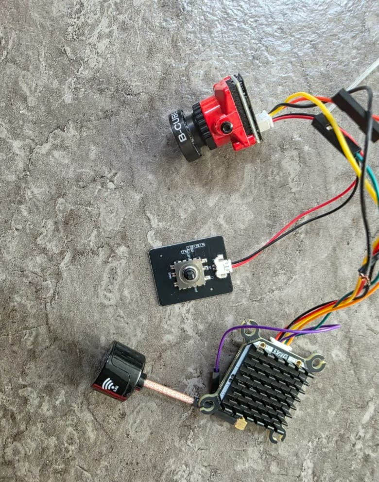
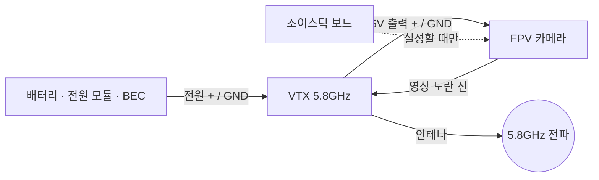
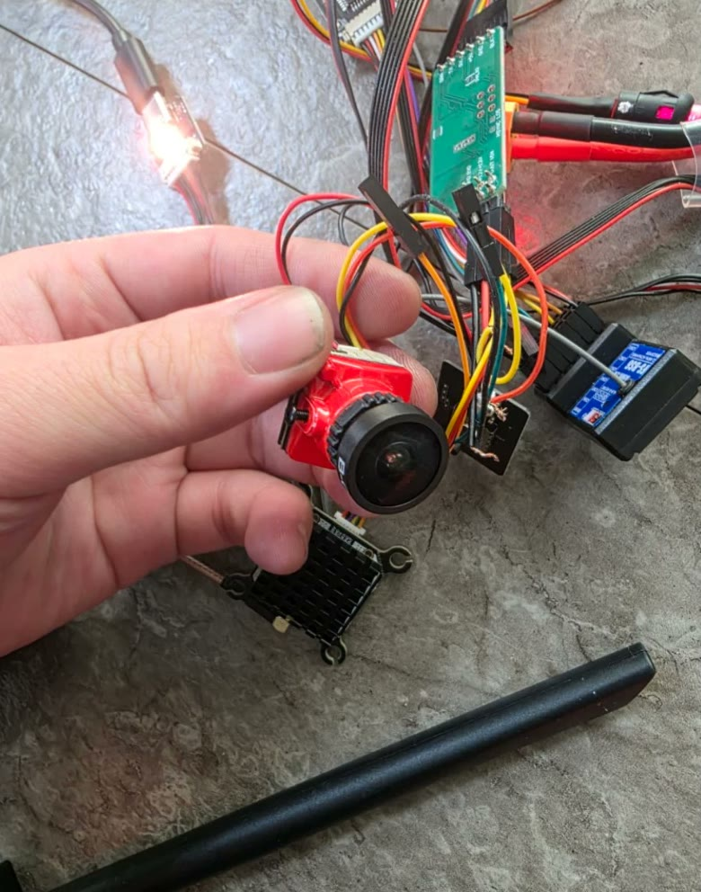

# 실습 9 — 드론 영상 연결: 소형 FPV 카메라 + 5.8GHz 송신기

> **한 줄 요약**: 드론 쪽은 **카메라와 송신기(VTX)만 연결하면 끝**이에요. 다만 이 영상은 5.8GHz **아날로그 전파**라서 스마트폰이 바로 받지 못하고, 받는 쪽에 **수신기가 하나** 더 있어야 해요. 인터넷이나 LTE는 필요 없습니다.



*이 키트의 영상 부품. 위부터 FPV 카메라(빨강), 카메라 설정용 조이스틱 보드, VTX(방열판)와 안테나.*

## 1. 부품과 역할

| 부품 | 하는 일 | 꼭 필요? |
|---|---|---|
| FPV 카메라 (빨간 B-CUBE) | 아날로그 영상(CVBS)을 노란 선으로 내보냄 | 필요 |
| VTX (영상 송신기, '모듈레이터') | 그 영상을 5.8GHz 아날로그 전파로 쏨. 밴드·채널·출력을 고름 | 필요 |
| 안테나 (버섯형) | VTX의 전파를 내보냄. **안테나 없이 VTX를 켜면 고장** | 필요 |
| 조이스틱 보드 | 카메라 화면 메뉴(OSD: 밝기·NTSC/PAL·좌우 반전 등) 조작 | 설정할 때만 |
| 5.8GHz 수신기 | 전파를 받아 다시 영상으로 → 폰·컴퓨터·고글 | **받는 쪽에 필요** |

## 2. 드론 쪽 연결: 카메라 → VTX





1. **안테나부터** VTX에 단단히 돌려 끼웁니다.
2. 카메라 **영상(노랑)** → VTX **영상 입력**. MinimOSD를 쓰면 카메라 → OSD 영상 입력, OSD 영상 출력 → VTX.
3. 카메라 **전원(빨강 +, 검정 −)** → VTX의 **5V 출력**(있는 제품) 또는 전원 모듈·BEC. 카메라 라벨·설명서의 입력 전압 범위를 먼저 봅니다.
4. VTX **전원 입력** → 배터리 또는 BEC. VTX의 입력 전압 범위(배터리 직결이 되는지, 5V 전용인지)를 확인합니다.
5. **접지(GND)는 모두 하나로** 묶입니다. 영상 선의 접지가 떠 있으면 줄무늬·잡음이 생겨요.
6. 전원을 넣고 VTX 버튼(또는 비행컨트롤러의 SmartAudio·Tramp 선)으로 밴드·채널·출력을 고릅니다.

> 선 색은 제품마다 다를 수 있어요. VTX 기판의 글자(VIN·GND·VID·5V 등)와 설명서를 꼭 확인하세요. 전원을 영상 단자에 잘못 넣으면 카메라나 VTX가 망가집니다.

## 3. 받는 쪽: 폰은 왜 바로 못 받나

폰의 5GHz 와이파이는 **디지털** 방식이고, VTX는 같은 5.8GHz 대역이라도 **아날로그(FM) 영상**을 보냅니다. 방식이 달라서 폰 와이파이로는 받을 수 없고, 아래 중 하나가 있어야 해요.

| 방법 | Android | iPhone | Nunchi에서 |
|---|---|---|---|
| **USB-C에 꽂는 5.8GHz OTG 수신기** (UVC 방식, 예: Eachine ROTG02) | ✅ 폰에 바로 | ❌ 앱에서 못 씀 | 드론 화면 → 카메라 **USB 영상 수신기** |
| **수신기 + 컴퓨터 중계** (수신기를 맥·PC에 꽂음) | ✅ | ✅ | `scripts/video_relay.py` → **네트워크(MJPEG)** |
| **5.8GHz → 와이파이 변환 박스** (박스가 자체 와이파이를 만듦) | 제품에 따라 | 제품에 따라 | MJPEG(HTTP) 주소를 주면 **네트워크(MJPEG)**. 전용 앱이나 RTSP만 되면 컴퓨터에서 `video_relay.py --url rtsp://…`로 다시 내보냄 |
| **FPV 고글 · 5.8GHz 모니터** | — | — | 앱 연결 없음. 지연이 가장 짧아 직접 조종할 때 좋음 |

- **OTG 수신기 고르기**: 폰에 USB 카메라(UVC)로 보이는 제품이어야 Nunchi가 직접 받아요. 전용 앱에서만 되는 제품도 있으니 'UVC'·'OTG' 표기를 확인하세요.
- **인터넷 불필요**: 드론과 수신기가 전파로 직접 연결돼요. LTE·인터넷이 끊겨도 영상은 나옵니다. 허브 Gemma 4로 분석하려면 폰과 컴퓨터가 같은 로컬 네트워크에만 있으면 돼요.
- **거리**: 출력·안테나·장애물에 따라 크게 달라요. 25mW면 트인 곳에서 보통 수백 m 안쪽이에요.
- **지연**: 아날로그 영상 자체는 지연이 거의 없지만, OTG 수신기나 중계는 USB·앱 처리만큼 조금 늦어요. Gemma 4 분석은 2~4초 걸리므로 **조종용이 아니라 설명·점검용**입니다.
- **채널**: 수신기의 밴드·채널을 VTX와 같게 맞추세요(대개 수신기의 자동 검색 버튼). 안테나 편파(RHCP·LHCP)도 양쪽이 같아야 멀리 갑니다.

## 4. Nunchi에서 보기

### Android + OTG 수신기 (가장 간단)

1. 수신기를 폰 USB-C에 꽂습니다(OTG 지원 폰). Nunchi를 열지, USB 장치를 쓸지 묻는 창이 뜨면 허용.
2. Nunchi 상단 ✈︎ → 드론 화면 → 드론 카메라 **USB 영상 수신기** → **카메라 켜기**
3. 수신기의 검색 버튼으로 VTX 채널을 잡습니다.
4. **분석**(또는 **자동 분석**, 6초마다) → Gemma 4 결과가 영상 아래쪽에 겹쳐 나옵니다. 픽스호크를 연결해 두면 기체 상태(모드·배터리·PreArm)도 영상 위에 같이 떠요 → [실습 8](08-drone.md)

### iPhone (또는 수신기를 컴퓨터에 꽂을 때)

```bash
python3 scripts/video_relay.py --list
```

```bash
python3 scripts/video_relay.py --device 1 --host 0.0.0.0
```

앱: 드론 화면 → **네트워크(MJPEG)** → `http://컴퓨터IP:8090/stream.mjpg` → 카메라 켜기 → 분석.

- 수신기를 꽂으면 `--list`에 새 카메라(예: `USB2.0 PC CAMERA`)로 나타나요. 그 번호를 `--device`에 넣습니다.
- `--host 0.0.0.0`은 영상을 같은 와이파이에 엽니다. 집·실험실 네트워크에서만 쓰고, 다 쓰면 Ctrl-C로 끄세요. 에뮬레이터·시뮬레이터 시험은 `--host` 없이 씁니다(이 컴퓨터 안에서만 열림).
- 여러 앱이 동시에 붙어도 되고, 끊겼다 다시 붙어도 됩니다. 브라우저로 `http://컴퓨터IP:8090/` 을 열면 바로 확인돼요.
- PAL 수신기라 영상이 안 오면 `--input-fps 25`.

## 5. 이 레포에서 확인한 것 (2026-11-20)

| 경로 | 결과 |
|---|---|
| 맥에 연결된 실제 카메라 → `video_relay.py`(가로 960px · 10fps) → **Android 앱**(에뮬레이터, 네트워크 MJPEG) → 허브 Gemma 4 → 화면 | 9~10fps로 받음 · 분석 전체 **2.3초** (캡션 0.81초 · 검색 0.28초 · 첫 글자 1.84초). 방 안 선반·상자 장면을 한두 문장으로 맞게 설명 |
| 같은 카메라 → **iOS 앱**(시뮬레이터) | 7fps로 받음 · 분석 전체 **3.9초** (캡션 1.75초 · 검색 0.06초 · 첫 글자 3.23초) |
| 실기 픽스호크(맥 USB → UDP 중계)를 함께 연결 | 두 앱 모두 영상 위 HUD에 실기 PreArm 4개 (스로틀 페일세이프·가속도계·나침반·Radio failsafe) |
| **5.8GHz 실수신** (VTX → 수신기 → 앱) | **아직 못 함** — 수신기가 없어요. 수신기는 컴퓨터·폰에 영상 장치(UVC)로 보이므로 위의 USB·중계 경로로 그대로 들어올 것으로 보지만, 실물로는 확인 전 |

*한 번씩 잰 값이에요(반복 측정 아님). 허브는 맥북의 `gemma4:e4b-mlx`. 카메라에 사람이 비칠 수 있어 화면 사진은 싣지 않았어요.*

## 6. 주의

- **안테나 없이 VTX 전원을 켜지 마세요.** 송신기가 탈 수 있어요.
- **출력**: 국내에서는 5.8GHz 영상 송신을 **25mW 이하**로 쓰는 것이 일반적인 기준이고, 그보다 높이면 아마추어무선 자격과 무선국 허가가 필요하다고 안내돼요. 이번에 법령 원문으로 확인하지는 못했으니, 날리기 전에 과학기술정보통신부·국립전파연구원의 최신 기준을 확인하고 VTX 출력은 25mW로 두세요.
- **열**: VTX는 켜 두기만 해도 뜨거워져요. 바람이 없는 책상 위에서 오래 켜 두지 말고, 방열판을 막지 마세요.
- **사람 촬영**: 드론 카메라 영상을 분석·중계할 때 다른 사람이 찍히지 않게 주의하세요 → [안전·개인정보·법](../06-reference/03-safety-privacy-legal.md)

## 7. 영상이 안 나올 때

| 증상 | 확인할 것 |
|---|---|
| 화면이 아예 안 나옴 | VTX 전원 LED, 카메라 전원(전압 범위), 노란 영상선, 수신기 채널 |
| 지글거림 · 눈 내리는 화면 | 채널 어긋남, 안테나 빠짐 · 편파 다름, 거리 |
| 흑백 · 화면이 위아래로 흐름 | NTSC/PAL 불일치 → 조이스틱 보드로 카메라 메뉴에서 바꾸기 |
| 모터를 돌리면 줄무늬 | 전원 잡음 → VTX·카메라를 BEC(깨끗한 5V)로, LC 필터 |
| 맥 중계가 "10초 동안 영상이 안 와요" | 명령을 실행한 앱의 카메라 권한(시스템 설정 → 개인정보 보호 및 보안 → 카메라). 다른 앱 안에 든 터미널(IDE·AI 도우미 등)은 권한 창을 못 띄우고 멈출 수 있어요 → 맥 기본 '터미널' 앱에서 실행 |
| 앱에 MJPEG가 안 들어옴 | 폰과 컴퓨터가 같은 와이파이인지, `--host 0.0.0.0`, 방화벽, 주소 끝 `/stream.mjpg` |

관련: [실습 8 — 드론(픽스호크) 연결](08-drone.md) · [픽스호크 점검 안내(앱이 검색하는 문서)](../../examples/drone/픽스호크-드론-점검안내.md)
