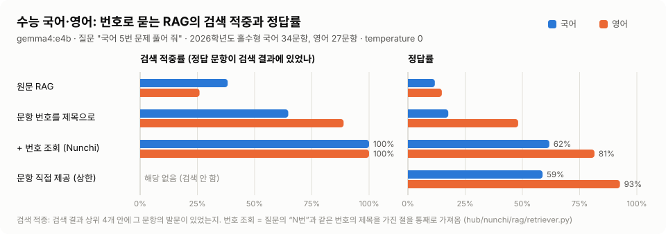
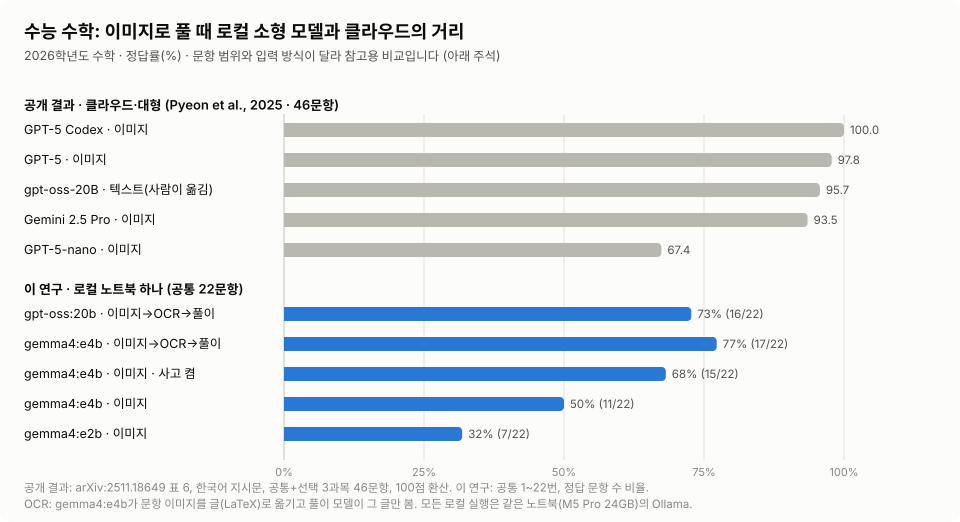
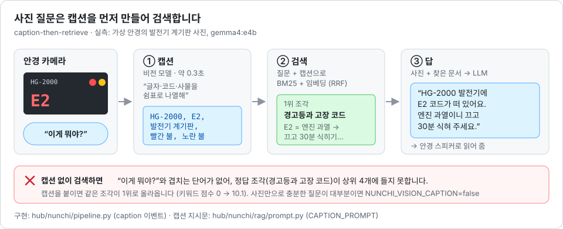

# 평가와 실험 결과

> 모든 수치는 **노트북 한 대**에서 인터넷 없이 잰 값입니다: Apple M5 Pro · 메모리 24GB · macOS 26 · Ollama 0.40.16 (`gemma4:e4b-mlx`, `gemma4:e2b-mlx`, `bge-m3`, `gpt-oss:20b`). 실제 안경 대신 Meta의 가상 안경(MockDeviceKit)과 macOS `say` 합성 음성을 썼습니다 → [한계](#6-한계).

## 목차

- [한눈에](#한눈에)
- [1. 수능 (국어·수학·영어)](#1-수능-국어수학영어)
  - [1.1 국어·영어 — 검색이 병목이었다](#11-국어영어--검색이-병목이었다)
  - [1.2 수학 — 이미지로 풀기, 그리고 클라우드와의 거리](#12-수학--이미지로-풀기-그리고-클라우드와의-거리)
  - [1.3 그래서 "클라우드가 필요 없나"](#13-그래서-클라우드가-필요-없나)
- [2. 음성: 8kHz vs 16kHz](#2-음성-8khz-vs-16khz)
- [3. 지연시간 (p50 / p90)](#3-지연시간-p50--p90)
- [4. 매뉴얼 Q&A (예제 문서 16문항)](#4-매뉴얼-qa-예제-문서-16문항)
- [5. 사진 질문: 캡션→검색](#5-사진-질문-캡션검색)
- [6. 한계](#6-한계)
- [7. 재현](#7-재현)
- [8. 드론 실험 (요약)](#8-드론-실험-요약)

## 한눈에

| 무엇을 | 결과 |
|---|---|
| 음성 질문 → 첫 문장 도착 (폰이 바로 읽기 시작) | **0.65초** (p90 0.80초) |
| 사진 질문 → 답 완료 | **2.7초** (p90 2.9초) · 그중 캡션+검색 1.2초 |
| 사진 질문 "이게 뭐야?"의 캡션→검색 | 캡션 없이 정답 조각 상위 4위 밖 → 캡션 붙이면 **1위** |
| 매뉴얼 Q&A (예제 16문항) | 정답 **94%** · 검색 **100%** |
| 블루투스 통화 음질(8kHz) vs 16kHz | 문자 오류율 0.178 vs **0.094** · 정답 81% vs **94%** |
| 수능 · 번호로 묻는 시험지 RAG | 검색 적중 국어 38%·영어 26% → **100%** (번호 조회) · `gemma4:e4b` 정답률 국어 12→**62%**, 영어 15→**81%** |
| 수능 영어 · 문항 직접 제공 | `gemma4:e4b` **93%** (25/27) |
| 수능 수학 · 사진 (공통 22문항) | `gemma4:e4b` OCR→사고 **77%** · `gpt-oss:20b` 73% ↔ 공개 클라우드 결과 93.5~100 (참고 비교) |
| 수능 국어 · 문항 직접 제공 | `gemma4:e4b` 59% · `gpt-oss:20b` 53% (사고 low) — 로컬 모델의 가장 큰 한계 |

드론 실험(두 번째 메인 실험)의 결과는 [8. 드론 실험](#8-드론-실험-요약)과 [드론 실험 기록과 결과](../07-drone/06-experiments.md)에 있습니다.

---

## 1. 수능 (국어·수학·영어)

2026학년도 대학수학능력시험(2025-11-13 시행) 홀수형. 국어 공통 1~34번, 영어 읽기 18~45번, 수학 공통 1~22번. 모든 호출은 `temperature 0`, 한 번씩. 방법·재현: [research/csat](../../research/csat/README.md)

| 조건 | 모델이 받는 것 | 안경 상황 |
|---|---|---|
| 원문 RAG | 문제지 PDF 원문을 지식베이스에 넣고 "국어 5번 문제 풀어 줘" | 시험지를 통째로 넣어 두고 번호로 묻기 |
| 문항 번호를 제목으로 | `## 국어 5번 문항` 제목을 붙인 문서 + 같은 질문 | 문서를 구조화해 넣기 |
| + 번호 조회 | 위 + 질문의 "5번"과 같은 번호 제목의 절을 통째로 가져옴 (Nunchi 기본값) | |
| 문항 직접 제공 | 지문·발문·선택지 텍스트를 그대로 | 상한선 (검색이 완벽할 때) |
| 이미지 | 문항 이미지 (수학) | 안경 카메라로 시험지를 봄 |
| 이미지→OCR→풀이 | gemma4:e4b가 이미지를 글(LaTeX)로 옮기고, 풀이 모델은 그 글만 봄 | 눈(작은 비전 모델)과 머리(큰 텍스트 모델)를 나눔 |

### 1.1 국어·영어 — 검색이 병목이었다



| 모델 | 조건 | 국어 (34문항·76점) | 영어 (27문항·61점) | 검색 적중 국어 / 영어 | 중앙값(초) 국어 / 영어 |
|---|---|---:|---:|---:|---:|
| gemma4:e2b | 원문 RAG | 11/34 (32%) · 23점 | 2/27 (7%) · 5점 | 38% / 26% | 3.7 / 2.7 |
| gemma4:e2b | 문항 번호를 제목으로 | 12/34 (35%) · 25점 | 11/27 (41%) · 22점 | 65% / 89% | 3.1 / 2.0 |
| gemma4:e2b | + 번호 조회 | 7/34 (21%) · 14점 | 11/27 (41%) · 25점 | 100% / 100% | 2.7 / 0.8 |
| gemma4:e2b | 문항 직접 제공 | 11/34 (32%) · 24점 | 9/27 (33%) · 20점 | — / — | 1.2 / 0.3 |
| gemma4:e4b | 원문 RAG | 4/34 (12%) · 10점 | 4/27 (15%) · 9점 | 38% / 26% | 1.6 / 1.1 |
| gemma4:e4b | 문항 번호를 제목으로 | 6/34 (18%) · 13점 | 13/27 (48%) · 29점 | 65% / 89% | 6.1 / 4.7 |
| gemma4:e4b | + 번호 조회 | 21/34 (62%) · 44점 | 22/27 (81%) · 49점 | 100% / 100% | 5.3 / 3.6 |
| gemma4:e4b | 문항 직접 제공 | 20/34 (59%) · 42점 | 25/27 (93%) · 56점 | — / — | 4.9 / 3.0 |
| gpt-oss:20b (사고 low) | 문항 직접 제공 | 18/34 (53%) · 40점 | 20/27 (74%) · 43점 | — / — | 2.2 / 1.4 |

**읽는 법**

- **원문 RAG는 실패합니다.** 문제지 PDF 텍스트를 그대로 넣고 "국어 5번 문제"라고 물으면 검색이 그 문항을 거의 못 찾고(검색 적중 국어 38% · 영어 26%), 모델은 엉뚱한 지문을 받습니다. `gemma4:e4b`는 이때 다른 문항을 풀거나 "풀 수 없다"고 답해 정답률이 국어 12%·영어 15%에 그쳤습니다.
- **번호를 제목으로 붙이는 것만으로는 부족합니다.** 영어는 적중률이 크게 오르지만(26% → 89%), 국어는 지문이 길어 여러 조각으로 나뉘고 숫자 `5`가 거의 모든 조각에 있어 65%에 그칩니다.
- **번호 조회가 검색 병목을 없앱니다.** 질문의 "N번"을 제목과 바로 맞춰 절을 통째로 가져오자 검색 적중이 **100%** 가 됐습니다. 정답률도 따라 올라 국어는 '문항 직접 제공'(상한)과 같은 수준이 됐고, 영어는 아직 12점 차이가 있습니다(`gemma4:e4b` 국어 62% vs 상한 59%, 영어 81% vs 93%).
- `gemma4:e2b`는 국어에서 어느 조건이든 우연(5지선다 20%)에 가까운 21~35%라 조건 사이의 차이를 읽기 어렵습니다. 작은 모델의 RAG 효과는 `gemma4:e4b`로 보세요.
- **RAG가 건네는 글을 바꾸지 마세요.** 처음 만든 번호 조회는 검색 적중 100%인데도 `gemma4:e4b` 정답률이 국어 38%·영어 74%(상한 59%·93%)에 그쳤습니다. 원인 두 가지를 고쳤습니다. ① 문서를 저장할 때 NFKC 정규화를 해서, LLM이 받는 시험지의 선택지 ①~⑤가 1~5로, ㉠·ⓐ 같은 표시가 다른 글자로 바뀌었습니다. ② 찾은 절 뒤에 관계없는 조각 3개를 함께 붙였습니다. 저장은 원문(NFC) 그대로, 번호로 물으면 그 절만 주도록 바꾼 뒤 다시 잰 값이 위 표입니다(`gemma4:e4b` 국어 38% → 62%, 영어 74% → 81%).
- **크다고 한국어를 더 잘 읽지는 않습니다.** 같은 노트북의 `gpt-oss:20b`(텍스트 전용, 20B)는 국어에서 `gemma4:e4b`(4B급)보다 낮았습니다(사고 low 53% vs 59%). 학습 데이터의 한국어 비중 차이 때문일 수 있습니다(추정 — 이 실험으로 원인을 가리지는 않았습니다).
- 영어 36·37·40·43번(2단 선택지 표)과 38·39번(주어진 문장)은 PDF 텍스트에서 구조가 사라져 처음엔 모든 모델이 틀렸습니다. `prepare.py`의 레이아웃 복원 후 다시 잰 값입니다 → [research/csat](../../research/csat/README.md).


### 1.2 수학 — 이미지로 풀기, 그리고 클라우드와의 거리



| 모델 | 방식 | 사고 | 정답 (22문항) | 정답률 | 원점수 (74점) | 중앙값(초) |
|---|---|---|---:|---:|---:|---:|
| `gemma4:e4b` | 이미지→OCR→풀이 | on | 17/22 | **77%** | 55 | 8.5 |
| `gpt-oss:20b` | 이미지→OCR→풀이 | medium | 16/22 | **73%** | 53 | 12.8 |
| `gemma4:e4b` | 이미지 | on | 15/22 | **68%** | 49 | 9.4 |
| `gemma4:e4b` | 이미지 | off | 11/22 | **50%** | 33 | 5.9 |
| `gemma4:e2b` | 이미지 | off | 7/22 | **32%** | 20 | 5.0 |
| *참고: GPT-5 (클라우드)* | *이미지 · 46문항* | | | *97.8* | | |
| *참고: Gemini 2.5 Pro (클라우드)* | *이미지 · 46문항* | | | *93.5* | | |
| *참고: gpt-oss-20B* | *사람이 옮긴 텍스트 · 46문항* | | | *95.7* | | |

참고 행은 Pyeon et al.(arXiv:2511.18649) 표 6의 100점 환산 점수(46문항, 한국어 지시문)입니다.

**읽는 법**

- **눈과 머리를 나누면 작은 모델도 강해집니다.** 같은 `gemma4:e4b`라도 이미지를 바로 풀게 하면 50%, 사고 모드를 켜면 68%, **이미지를 먼저 글(LaTeX)로 옮기고 그 글을 사고 모드로 풀게 하면 77%(55/74점)** 입니다. 모델 하나로 두 번 부르는 것뿐이에요.
- `gpt-oss:20b`는 이미지를 못 보므로 `gemma4:e4b`가 옮긴 글을 받아 풀었습니다: **16/22 (73%, 53/74점)**. 틀린 6문항 중 2문항(1·3번)은 OCR이 문제를 잘못 옮긴 탓입니다 — 1번은 거듭제곱근이 사라져 "9⁴×3⁻²"(=729, 선택지에 없음)가 됐고, 3번은 합의 범위가 빠져 풀 수 없는 문제가 됐습니다. 나머지 4문항은 사고가 길어져 출력 한도(12,000토큰)에 걸려 답을 못 냈습니다. 같은 모델이 **사람이 옮긴 문제로는 95.7점**(공개 결과)이었으니, 남은 차이의 대부분은 모델이 아니라 **눈(OCR)과 시간 한도**에서 나옵니다. 같은 출력 한도에서는 `gemma4:e4b`(OCR→사고 77%)가 오히려 앞섰습니다.
- 공개된 클라우드 결과(46문항, 한국어 지시문)는 이미지 입력 기준 GPT-5 97.8, Gemini 2.5 Pro 93.5, GPT-5 Codex 100, 작은 클라우드 모델 GPT-5-nano 67.4입니다. 같은 문항·같은 조건의 직접 비교가 아니므로 **방향만** 보세요.
- 사고 수준을 올리면 어려운 문항에서 수 분씩 생각하다 출력 한도(12,000토큰)에 걸려 답을 못 낸 경우가 있습니다(오답 처리).


### 1.3 그래서 "클라우드가 필요 없나"

| 일 | 로컬(노트북 한 대)로 충분한가 | 근거 |
|---|---|---|
| 내 문서에 근거해 짧게 답하기 (안경 비서의 본업) | **충분** | 매뉴얼 Q&A 94% · 검색 100% · 음성 질문 첫 문장 p50 0.65초 |
| 사진을 보고 묻기 ("이게 뭐야?") | **충분** | 캡션→검색으로 정답 조각 상위 4위 밖 → 1위 · 사진 질문 첫 문장 p50 2.6초 |
| 번호로 묻는 시험지·규정집 검색 | **충분** (번호 조회 필요) | 검색 적중 국어 38%·영어 26% → 100% |
| 계산형 추론 (수능 수학, 사진) | **거의** — 방법이 중요 | 4B급 77% · 20B 73% ↔ 공개 클라우드 결과 93.5~100 (참고 비교) |
| 긴 한국어 글의 추론 (수능 국어) | **아직 부족** | 4B급 59% · 20B 53% (사고 low) (클라우드는 미측정) |

정리하면, **"보고·찾고·답하는" 안경 비서의 일에는 클라우드가 필요 없었습니다.** 어려운 추론에서는 작은 모델이 뒤처지지만, 눈(OCR)과 머리(사고 모드)를 나누는 방법만으로 4B급 모델의 수학 정답률이 50%에서 77%로 올랐고, 같은 노트북에서 가장 좋은 방법(4B급 OCR→사고 77%)도 공개된 클라우드 결과(이미지 입력 93.5~100)보다는 **17~23점 낮습니다**. 다만 그 차이의 상당 부분은 모델이 아니라 눈(OCR 오류)과 시간 한도에서 나왔습니다 — 같은 gpt-oss-20B가 사람이 옮긴 문제로는 95.7점이었습니다(공개 결과). 긴 한국어 글의 추론은 이 연구에서 로컬 모델의 한계가 가장 뚜렷한 영역입니다.


---

## 2. 음성: 8kHz vs 16kHz

같은 질문 16개를 macOS `say`(Yuna)로 읽혀 각 샘플레이트로 바꾼 뒤 전체 파이프라인(전처리 → STT → 검색 → 답)을 돌렸습니다. 8kHz는 블루투스 HFP 통화 음질(협대역)을 흉내 낸 것입니다. `nunchi bench --voice --sr 8000`

| | 16kHz (광대역) | 8kHz (통화 음질) |
|---|---:|---:|
| 문자 오류율 CER (평균) | **0.094** | 0.178 (약 1.9배) |
| 답 정확도 (기대 키워드 포함) | **15/16 (94%)** | 13/16 (81%) |
| 검색 적중 (정답 문서) | 15/15 | 15/15 |
| 인식 시간 p50 | 167ms | 158ms |

지연시간의 기준값은 [3장](#3-지연시간-p50--p90)(캐시를 비우고 잰 값)을 보세요.

8kHz에서 틀린 예 — 검색은 맞는 문서를 찾았지만 **질문의 핵심어가 잘못 들려서** 답이 엇나갔습니다.

| 말한 것 | 8kHz에서 들린 것 |
|---|---|
| 발전기에 **E2** 코드가 떴는데 뭐야? | 발전기에 **이 이** 코드가 떴는데 뭐야 |
| 시동 걸 때 **초크**는 언제 열어? | 시동 걸 때 **쇼크**는 언제야? |
| **온수 샤워 몇 시까지** 돼? | 본소 생활 역시까지 그 |

→ 안경 마이크를 쓸 땐 **16kHz 경로**(Meta DAT의 카메라 스트림 오디오, 또는 폰 마이크)를 우선하고, 8kHz HFP밖에 없으면 업샘플링 전에 반드시 저역 통과 필터를 거치세요(필터 없이 올리면 "발전기"가 "탈탄기"로 들렸습니다). 원리는 [소리는 어떻게 글이 되나](../01-basics/05-how-voice-works.md).

## 3. 지연시간 (p50 / p90)

허브 HTTP API를 클라이언트 쪽에서 잰 값입니다(SSE 이벤트 도착 시각). 모드마다 모델을 내려 프롬프트 캐시를 비우고, 측정에 쓰지 않는 질문으로 예열한 뒤 **서로 다른 질문 16개 · 서로 다른 사진 16장**으로 잰 값입니다. `research/latency/measure.py`

| 질문 | 단계 (요청 시작부터) | p50 | p90 |
|---|---|---:|---:|
| 글자 질문 | 첫 글자 | **306ms** | 397ms |
|  | 첫 문장 | **452ms** | 547ms |
|  | 완료 | **504ms** | 657ms |
| 음성 질문 (16kHz) | 인식 끝 | **201ms** | 231ms |
|  | 첫 문장 | **654ms** | 801ms |
|  | 완료 | **724ms** | 880ms |
| 사진 질문 | 캡션 끝 | **1.18초** | 1.26초 |
|  | 검색 끝 | **1.19초** | 1.28초 |
|  | 첫 문장 | **2.57초** | 2.72초 |
|  | 완료 | **2.70초** | 2.86초 |
| 글자 질문 + 허브 TTS | 첫 문장 | **453ms** | 602ms |
|  | 첫 음성 조각 | **1.09초** | 1.52초 |
|  | 완료 | **1.44초** | 1.96초 |

**읽는 법**

- **"첫 문장"이 체감 속도입니다.** 폰은 첫 문장이 도착하자마자 읽기 시작하므로, 음성 질문은 약 0.65초 뒤에 안경에서 답이 들리기 시작합니다(폰 TTS 시작 시간 별도).
- **사진 질문이 가장 느립니다.** 새 사진은 비전 인코더가 처리해야 해서 캡션에 약 1.2초가 걸리고, 답변 호출에서 같은 사진을 한 번 더 인코딩합니다(완료 p50 2.70초). 두 호출이 사진 인코딩을 공유하게 하는 것이 다음 과제입니다 → [로드맵](04-research-roadmap.md).
- **캐시 착시 주의.** 처음엔 같은 사진 한 장과 질문 몇 개를 반복해서 쟀더니 사진 질문 완료 p50 **0.71초**, 글자 질문 첫 글자 **51ms**가 나왔습니다. 엔진(Ollama)의 프롬프트 캐시가 같은 입력을 재사용했기 때문입니다. 위 표는 모드마다 모델을 내려 캐시를 비우고, 서로 다른 질문 16개·서로 다른 사진 16장으로 다시 잰 값입니다. 지연을 잴 땐 반드시 입력을 바꾸세요.
- 같은 컴퓨터(허브 ↔ 측정 스크립트)에서 잰 값이라 와이파이·블루투스 왕복과 폰 TTS 시작은 포함되지 않았습니다. 위 iOS 스크린샷(시뮬레이터 → 허브)의 사진 질문은 전체 3.1초였습니다.

## 4. 매뉴얼 Q&A (예제 문서 16문항)

`examples/knowledge`(가상의 캠핑장 안내·발전기 점검 절차·허브 설명서)와 `examples/eval/questions.jsonl`. `nunchi bench`

| 지표 | 결과 |
|---|---:|
| 답 정확도 (기대 키워드 포함) | **15/16 (94%)** |
| 검색 적중 (정답 문서가 상위 4개 안) | **15/15 (100%)** · 1문항은 문서에 답이 없는 질문 |
| 검색 시간 p50 | 11ms |

틀린 1문항("헤이 메타라고 부르면 왜 대답을 안 해?")은 검색은 맞았지만 답이 기대 키워드를 쓰지 않았습니다.

## 5. 사진 질문: 캡션→검색

가상 안경의 '발전기 계기판' 사진(HG-2000, E2 코드, 빨간·노란 경고등)에 "이게 뭐야?"라고 물었을 때 검색 결과:

| 검색어 | 1위 | 정답 조각(경고등과 고장 코드) |
|---|---|---|
| "이게 뭐야?" (캡션 없이) | 발전기 문서 첫머리 (의미 유사도 0.44, 키워드 0) | **상위 4개 밖** — 4개 문서 첫머리가 비슷한 점수로 나옴 |
| "이게 뭐야?" + 캡션 "HG-2000, E2, 발전기 계기판, 빨간 불, 노란 불" | **경고등과 고장 코드** (키워드 10.1, 의미 0.67) | **1위** |



## 6. 한계

- **안경 실기기 없음.** Meta 가상 안경(MockDeviceKit)과 iOS 시뮬레이터로 측정했습니다. 실제 블루투스 왕복·안경 카메라 화질·주변 소음은 반영되지 않았습니다.
- **합성 음성.** 질문 음성은 macOS `say`로 만들었습니다. 사람 목소리·사투리·소음 환경의 CER은 더 높을 것입니다.
- **컴퓨터 한 대, 한 번씩.** 수능은 `temperature 0`으로 각 문항 한 번만 풀었습니다. 지연시간은 중앙값이지만 같은 노트북의 값입니다.
- **수능 범위.** 홀수형 공통과목만(국어 언어와 매체·화법과 작문, 수학 선택과목, 영어 듣기 제외). 영어 18번은 지문이 그림이라 텍스트 조건에서 제외했습니다.
- **클라우드 비교는 참고용.** 공개 결과(arXiv:2511.18649)는 46문항(공통+선택 3과목)·사람이 옮긴 텍스트 또는 원본 이미지 기준이고, 이 연구는 공통 22문항·자동 OCR/이미지 기준입니다. 같은 조건의 클라우드 재측정은 하지 않았습니다(인터넷 없는 연구라는 전제를 지키기 위해).
- **`gpt-oss:20b` 국어·영어는 사고 수준 low로만** 쟀습니다(수학은 medium). medium은 수학에서 문항당 최대 200초씩 생각하다 출력 한도에 걸려, 독해 61문항에는 시간이 너무 많이 들었습니다.
- **답 추출.** 모델 출력의 마지막 "정답: X"를 읽습니다. 형식을 어기거나 출력이 잘리면 오답으로 셉니다(실제 시험에서도 마킹을 안 한 셈).
- **Android 앱은 에뮬레이터까지만** 검증했습니다(빌드·린트·가상 안경 사진 질문). 실기기·실물 안경은 미검증입니다.

## 7. 재현

```bash
cd hub && .venv/bin/nunchi ingest ../examples/knowledge && .venv/bin/nunchi bench
```

```bash
.venv/bin/nunchi bench --voice --sr 8000
```

```bash
.venv/bin/nunchi serve --no-warmup
```

```bash
.venv/bin/python ../research/latency/measure.py --image 사진.jpg --speak -o latency.json
```

수능: [research/csat/README.md](../../research/csat/README.md) — 문제지는 평가원에서 직접 받아야 합니다.

이 문서의 숫자를 만든 원자료(문항별 결과·지연시간, 모델 출력 원문 제외): [research/results](../../research/results/README.md)

## 8. 드론 실험 (요약)

실기 픽스호크 2.4.8(ArduCopter 3.6.12, 책상 위·프로펠러 없음) + 맥북 허브(`gemma4:e4b-mlx`) + Android 15 에뮬레이터·iPhone 17 시뮬레이터에서 **한 번씩** 잰 값입니다(위 안경 실험처럼 16회 반복한 값이 아님).

| 무엇을 | 결과 |
|---|---|
| 실기 MAVLink 수신 (맥 USB, 35초) | 프레임 981개 · CRC 오류 0 · MAVLink v1 |
| "왜 시동이 안 걸려?"의 상태→검색 | 상태 없이 PreArm 소개 문단 → 경고를 붙이면 조종기·가속도계·나침반 절 1~3위 |
| 같은 질문 + 실기 상태 → `gemma4:e4b` | 1.1초(채팅) · 1.7초(드론 화면, 영상 포함) — "조종기·가속도계·나침반 보정" |
| 드론 카메라 한 장면 → 답 | 가상 영상 1.5초 · 실제 카메라 Android 2.3초 · iOS 3.9초 |
| 상태 질문, 폰 단독 (LLM 없이) | 1~4ms |
| 허브 BM25 = 폰 BM25 (예제 질문 28개) | 1위 28/28 일치 |

조건·원자료·재현 명령·한계: [드론 실험 기록과 결과](../07-drone/06-experiments.md) · 방법: [기체 상태로 RAG](../07-drone/04-status-then-retrieve.md)
