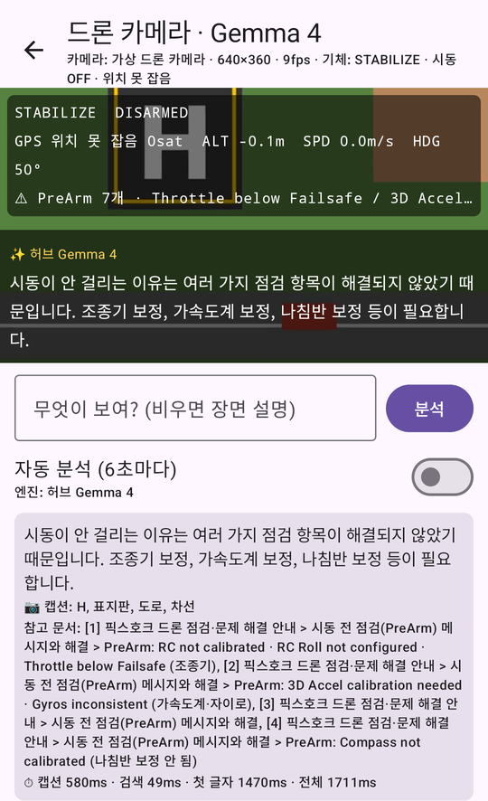
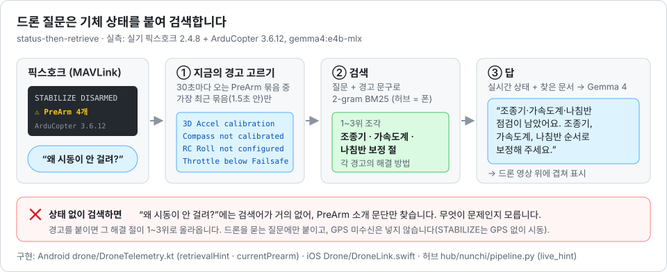
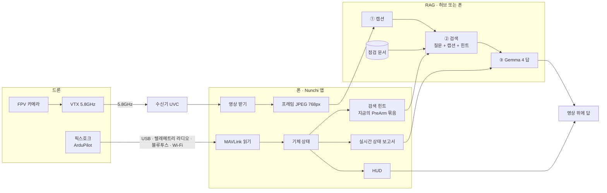

# 드론 실험 1 — 한눈에 보기

> **Nunchi의 두 번째 메인 실험.** 안경 실험이 "내가 본 것을 묻고 답하기"라면, 드론 실험은 **"드론이 보는 것과 드론의 상태를 묻고 답하기"** 예요. 같은 허브·같은 앱·같은 RAG를 쓰고, 영상 한 장도 내 네트워크 밖으로 보내지 않습니다.

  

실기 픽스호크(ArduCopter 3.6.12)에서 USB로 잡은 기록을 재생하고, 영상은 앱의 가상 카메라. "왜 시동이 안 걸려?" → 1.7초에 답.

## 목차

- [1. 무엇을 알아보는 실험인가](#1-무엇을-알아보는-실험인가)
- [2. 왜 드론인가](#2-왜-드론인가)
- [3. 만든 것](#3-만든-것)
- [4. 전체 구조](#4-전체-구조)
- [5. 결과 한눈에](#5-결과-한눈에)
- [6. 확인한 것과 아직인 것](#6-확인한-것과-아직인-것)
- [7. 읽는 순서](#7-읽는-순서)

## 1. 무엇을 알아보는 실험인가

| 연구 질문 | 지금까지의 답 (2026-11-20) |
|---|---|
| ① 비행컨트롤러의 실시간 상태를 '살아 있는 문서'로 RAG에 넣으면, "왜 시동이 안 걸려?" 같은 질문에 맞는 해결 방법을 찾을까? | **예.** 기체가 보낸 경고를 검색어에 붙이면(상태→검색) PreArm 소개 문단 대신 해당 해결 절이 **1~3위**로 올라오고, 허브 Gemma 4가 1.1~1.7초에 "조종기·가속도계·나침반 보정"으로 답했어요 |
| ② 드론 카메라 한 장면 → Gemma 4 → 화면이 현장에서 쓸 만큼 빠른가? | 가상 영상 **1.5초**, 맥의 실제 카메라 **2.3초**(Android)·**3.9초**(iOS). 장면 설명·점검에는 충분하고, 조종에는 쓰지 않아요 |
| ③ 허브 없이 폰 혼자서도 되나? | 상태 질문은 LLM 없이 **1~4ms**(추출형 답). 폰 안 Gemma 4(LiteRT-LM)는 연결해 두었지만 실제 폰에서는 아직 못 돌려 봤어요 |
| ④ 아날로그 FPV 영상(5.8GHz)을 앱이 받을 수 있나? | 받는 길(USB 영상 수신기·MJPEG 중계)은 만들었고 실제 카메라로 확인했어요. **VTX 전파 실수신은 아직**이에요(수신기 없음) |

## 2. 왜 드론인가

- **같은 질문, 다른 눈.** 안경은 사람 눈높이, 드론은 하늘 높이의 카메라예요. 둘 다 "카메라가 본 장면 + 내 문서"로 답하므로 Nunchi의 파이프라인(캡션→검색→답)을 그대로 씁니다.
- **드론에만 있는 문서: 기체 상태.** 비행컨트롤러는 1초에도 여러 번 모드·배터리·GPS·센서 상태와 경고를 보내요. 화면에 뜬 영어 경고(`PreArm: Compass not calibrated`)를 보고 사람이 매뉴얼을 뒤지는 일을, 앱이 대신 찾아 한국어로 답하게 하는 게 목표예요.
- **현장은 인터넷이 없을 때가 많아요.** 산·논밭·시설 점검·재난 현장. 안경 실험과 같은 원칙으로, 영상과 상태는 폰과 책상 위 허브(또는 폰 안)에서만 처리합니다.

## 3. 만든 것

| 구성 | 하는 일 | 코드 |
|---|---|---|
| **Android 드론 화면** | 영상 + HUD + Gemma 4 결과. 비행컨트롤러 연결 5가지(USB OTG·블루투스·Wi-Fi UDP·TCP·가상), 카메라 3가지(USB 영상 수신기·MJPEG·가상), 폰 RAG | `clients/android/…/drone`, `camera`, `ai`, `rag`, `ui/DroneScreen.kt` |
| **iOS 드론 화면** | 영상 + HUD + 허브 Gemma 4. Wi-Fi UDP 텔레메트리, MJPEG·가상 카메라 | `clients/ios/Nunchi/Drone`, `Views/DroneView.swift` |
| **허브** | 질문과 함께 실시간 상태(`live_context`)·검색 힌트(`live_hint`)·드론 사진 표시(`image_source=drone`)를 받음 | `hub/nunchi/pipeline.py`, `rag/prompt.py`, `server.py` |
| **중계 스크립트** | 컴퓨터에 꽂은 픽스호크 ↔ UDP, 카메라·5.8GHz 수신기 → MJPEG | `scripts/mavlink_bridge.py`, `scripts/video_relay.py` |
| **지식베이스** | 픽스호크 점검·문제 해결 안내 (구성품·연결·PreArm·페일세이프·LED·비행 모드·영상·법규) | `examples/drone/` |
| **테스트** | MAVLink 교차 검증, 실기 캡처 재생, 허브·폰 검색 결과 일치(패리티), 허브 드론 테스트 | `clients/android/app/src/test`, `hub/tests/test_drone_live.py` |

## 4. 전체 구조

## 5. 결과 한눈에

| 무엇을 | 결과 |
|---|---|
| 실기 픽스호크 MAVLink 읽기 (맥 USB, 35초) | 프레임 981개 · **CRC 오류 0** · MAVLink v1 · ArduCopter V3.6.12 |
| "왜 시동이 안 걸려?" 검색 (상태 없이 → 상태 붙여) | PreArm 소개 문단 → **조종기·가속도계·나침반 절 1~3위** |
| 같은 질문 + 실시간 상태 → 허브 Gemma 4 | **1.1초** · 실기 경고 4개를 "조종기, 가속도계, 나침반, 스로틀"로 요약 |
| 드론 화면에서 같은 질문 (가상 카메라 + 실기 기록 재생) | **1.7초** (캡션 0.58초 · 검색 49ms · 첫 글자 1.47초) |
| 드론 카메라 장면 설명 → 허브 Gemma 4 | 가상 영상 **1.5초** · 실제 카메라 Android **2.3초** · iOS **3.9초** |
| 상태 질문, 폰 단독 (LLM 없이) | **1~4ms** · 기체 값 + 문서의 해결 문장 |
| 허브 BM25 = 폰 BM25 (예제 문서 44조각, 질문 28개) | 1위 **28/28 일치** |

*한 번씩 잰 값이에요(반복 측정 아님). 허브는 맥북의 `gemma4:e4b-mlx`, 앱은 Android 15 에뮬레이터·iPhone 17 시뮬레이터. 조건과 원자료는 [실험 기록](06-experiments.md).*

## 6. 확인한 것과 아직인 것

| ✅ 확인 | ⏳ 아직 |
|---|---|
| 실기 픽스호크(ArduCopter 3.6.12) MAVLink 수신, CRC 오류 0 | 실제 폰의 USB OTG 직결·블루투스 모듈 |
| 실기 상태 → UDP 중계 → Android·iOS 앱 HUD·RAG | 텔레메트리 라디오 V5 쌍(433/915MHz) |
| 실기 경고로 상태→검색 → 허브 Gemma 4 답 | 5.8GHz VTX 영상 실수신 (USB 영상 수신기) |
| 맥의 실제 카메라 → 중계 → 두 앱 → Gemma 4 → 화면 | 폰 안 Gemma 4(`.litertlm`) 실행·지연 |
| 가상 드론·가상 카메라로 전 과정 (하드웨어 없이) | 비행 중 시험 (지금까지는 책상 위, 프로펠러 없이) |

## 7. 읽는 순서

| 문서 | 내용 |
|---|---|
| [2. 키트와 배선](02-hardware.md) | 부품 역할, 꽂는 곳, 폰과 잇는 방법, 이 키트에서 실제로 본 값 |
| [3. MAVLink](03-mavlink.md) | 메시지 구조, 앱이 읽고 보내는 메시지, 연결 방식별 구현, 검증 방법 |
| [4. 기체 상태로 RAG](04-status-then-retrieve.md) | 상태 보고서·검색 힌트, PreArm '최근 묶음' 규칙, 프롬프트, 허브 API |
| [5. 드론 카메라 → Gemma 4](05-camera-to-gemma.md) | 영상 경로 3가지, 분석 흐름, 엔진(허브·폰), 화면 구성, 지연 |
| [6. 실험 기록과 결과](06-experiments.md) | 실험별 조건·결과, 가상 드론 시나리오, 재현 명령, 한계, 다음 실험 |
| [7. 안전·법·전파·개인정보](07-safety.md) | 책상 점검, 앱이 기체에 보내는 것, 비행 규정, VTX 출력 |
| [8. 문제 해결](08-troubleshooting.md) | 연결·상태·영상·분석이 안 될 때 |

직접 해 보기: [실습 8 — 드론 연결](../04-practice/08-drone.md) · [실습 9 — 드론 영상 연결(카메라 + 송신기)](../04-practice/09-fpv-video.md)

---

[드론 실험 문서 처음](01-overview.md) · [다음: 키트와 배선 →](02-hardware.md)
