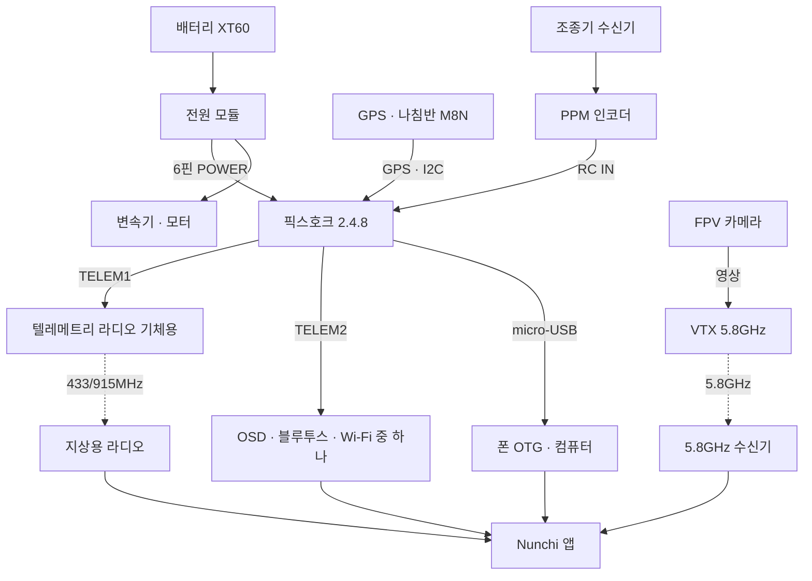
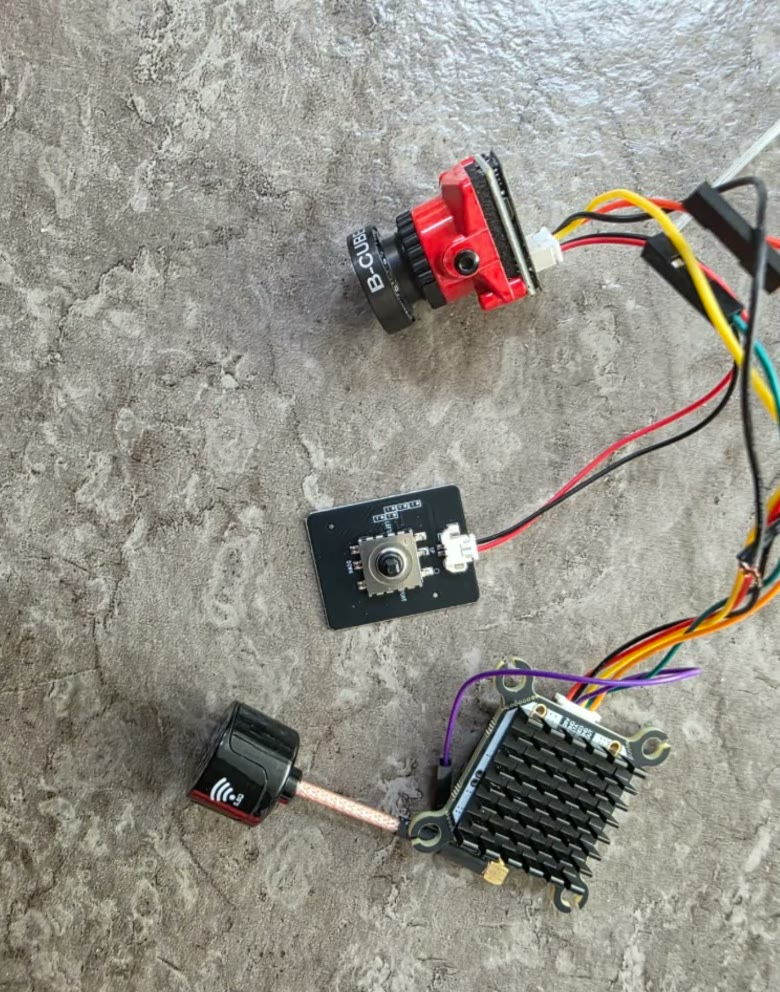
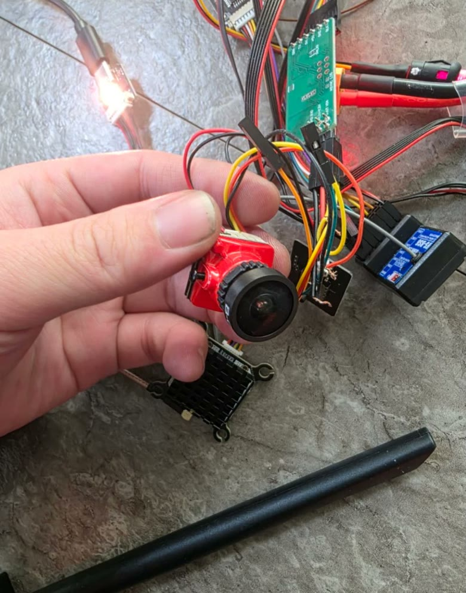

# 드론 실험 2 — 키트와 배선

> 기준 키트: **B-CUBE 픽스호크 2.4.8 키트**(ArduPilot 펌웨어). 다른 픽스호크·ArduPilot·PX4 기체도 MAVLink만 나오면 같은 방식으로 붙어요.

## 목차

- [1. 부품과 역할](#1-부품과-역할)
- [2. 연결 그림](#2-연결-그림)
- [3. 폰·컴퓨터와 잇는 방법](#3-폰컴퓨터와-잇는-방법)
- [4. 영상 부품](#4-영상-부품)
- [5. 이 키트에서 실제로 본 값 (2026-11-20)](#5-이-키트에서-실제로-본-값-2026-11-20)

## 1. 부품과 역할

| 부품 | 하는 일 | 꽂는 곳 | Nunchi에서 보이는 것 |
|---|---|---|---|
| **픽스호크 2.4.8** | 비행컨트롤러. 자세·위치를 계산하고 상태·경고를 MAVLink로 보냄 | 기체 중앙, 진동 방지 패드 위 (화살표가 기체 앞) | 모드, 시동, 센서 상태, 경고(PreArm) — HUD와 RAG의 '실시간 문서' |
| GPS·나침반 (M8N) | 위치·방위 | GPS 단자(GPS), I2C 단자(나침반) | GPS 상태·위성 수·기수 방향, 나침반 보정 경고 |
| 전원 모듈 (XT60) | 배터리 전압·전류 측정, 픽스호크 전원 | 배터리 ↔ 변속기 사이, 6핀 케이블 → POWER | 전압·전류·잔량 (파라미터 `BATT_MONITOR`가 켜져 있어야) |
| 부저 · 안전 스위치 | 알림음, 모터 출력 잠금 | BUZZER · SWITCH | `PreArm: Hardware safety switch` |
| 조종기 수신기 + PPM 인코더 | 조종기 신호 | RC IN | 조종기 보정 경고(`RC … not configured`), 신호 세기(RSSI) |
| 텔레메트리 라디오 V5 (기체용·지상용) | MAVLink를 433/915MHz 무선으로 | 기체용은 TELEM1, 지상용은 폰 USB OTG나 컴퓨터 USB | 무선으로 같은 상태 (57600bps) |
| 블루투스 모듈 HC-05/06 (선택) | MAVLink를 블루투스로 | TELEM2 | 폰과 페어링 후 SPP |
| 와이파이 모듈 ESP8266·ESP32 (선택) | MAVLink를 Wi-Fi UDP로 | TELEM2 | 폰·아이폰이 UDP 14550으로 받음 |
| MinimOSD | 아날로그 영상 위에 비행 정보 글자 겹치기 | TELEM2의 MAVLink + 카메라와 VTX 사이 영상선 | 영상에 OSD 글자가 섞여 옴 (앱은 HUD를 따로 그림) |
| FPV 카메라 · VTX · 안테나 | 영상을 5.8GHz 아날로그 전파로 | 카메라 → VTX | → [실습 9 — 드론 영상 연결](../04-practice/09-fpv-video.md) |
| 5.8GHz 수신기 (받는 쪽) | 전파 → 영상 (폰·컴퓨터에 USB 카메라처럼 보임) | 폰 USB-C 또는 컴퓨터 USB | 드론 카메라 영상 |

> TELEM2 하나에 OSD·블루투스·와이파이를 함께 물리지 말고, 한 번에 하나만 연결하세요.

## 2. 연결 그림

## 3. 폰·컴퓨터와 잇는 방법

| 방법 | 거리 | 준비물 | 앱 설정 | 이번 확인 |
|---|---|---|---|---|
| **USB 직결** (픽스호크 micro-USB) | 책상 위 | OTG 젠더·데이터 케이블 | 비행컨트롤러 **USB** (픽스호크 USB는 보드레이트 무관) | 맥 USB로 실기 확인, 폰 직결은 아직 |
| **텔레메트리 라디오** | 수백 m 이상 | 기체용 TELEM1 + 지상용 USB (FTDI·CP210x·CH340 칩) | **USB** · 57600 | 아직 |
| **블루투스 SPP** | 10m 안팎 | HC-05/06, 파라미터 `SERIAL2_PROTOCOL=2`·`SERIAL2_BAUD=57` | **블루투스** · 기기 주소 (폰 설정에서 먼저 페어링, PIN 1234 또는 0000) | 아직 |
| **Wi-Fi UDP** | 같은 와이파이 | ESP8266·ESP32 텔레메트리, 또는 컴퓨터 중계(`scripts/mavlink_bridge.py`) | **Wi-Fi UDP** · 14550 | 컴퓨터 중계로 실기 확인 (에뮬레이터·시뮬레이터) |
| TCP | — | ArduPilot SITL 같은 시뮬레이터 | **TCP** · `호스트:5760` | 실제 소켓 테스트만 |
| 가상 드론 | — | 없음 | **가상** | 확인 (100초 시나리오) |

아이폰은 앱에서 USB 시리얼과 블루투스 SPP를 쓸 수 없어서 **Wi-Fi UDP**로만 받아요(와이파이 모듈 또는 컴퓨터 중계).

## 4. 영상 부품

  
  &nbsp;
  

드론 쪽은 **카메라 → VTX(+ 안테나)** 만 연결하면 되고, 받는 쪽에 5.8GHz 수신기가 하나 더 있어야 해요. 배선 순서·수신기 고르기·출력 규정은 [실습 9](../04-practice/09-fpv-video.md)에 따로 정리했어요.

## 5. 이 키트에서 실제로 본 값 (2026-11-20)

| 항목 | 값 |
|---|---|
| USB 장치 | VID:PID `26AC:0011` (3D Robotics), 맥에서 `/dev/cu.usbmodem01` |
| 펌웨어 | ArduCopter **V3.6.12**, 보드 PX4v3 (NuttX), 프레임 QUAD |
| MAVLink | v1 (시작 바이트 `0xFE`), 기체 sys 1 |
| 35초 동안 | 앱이 쓰는 메시지 981개, CRC 오류 0 |
| PreArm 경고 | Hardware safety switch · 3D Accel calibration needed · Compass not calibrated (두 번) · RC Roll / Pitch / Throttle / Yaw not configured · Throttle below Failsafe · Radio failsafe on |

> 보정(가속도계·나침반·조종기)을 아직 하지 않은 키트라 경고가 많아요. 보정 방법은 [픽스호크 점검 안내](../../examples/drone/픽스호크-드론-점검안내.md)에 있고, 앱도 이 문서를 검색해서 답합니다.

---

[← 한눈에 보기](01-overview.md) · [드론 실험 문서 처음](01-overview.md) · [다음: MAVLink →](03-mavlink.md)
