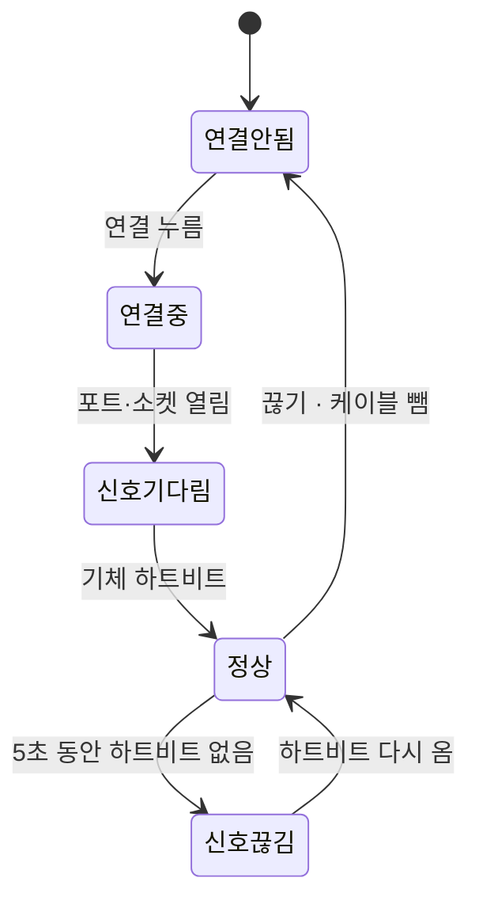

# 드론 실험 3 — MAVLink: 폰이 비행컨트롤러를 읽는 법

> MAVLink는 드론의 '상태 방송' 규약이에요. 픽스호크(ArduPilot·PX4)는 1초에도 수십 개씩 짧은 메시지를 보내고, 지상 프로그램(GCS)이 그걸 읽어 화면에 보여 줍니다. Nunchi 앱은 **읽기 전용 GCS**예요. 시동·조종 명령은 보내지 않습니다.

## 목차

- [1. 메시지 하나의 생김새](#1-메시지-하나의-생김새)
- [2. 앱이 읽는 메시지](#2-앱이-읽는-메시지)
  - [앱이 보내는 것](#앱이-보내는-것)
- [3. 연결 상태와 시간](#3-연결-상태와-시간)
- [4. 연결 방식별 구현](#4-연결-방식별-구현)
  - [USB OTG (Android)](#usb-otg-android)
  - [블루투스 SPP (Android)](#블루투스-spp-android)
  - [Wi-Fi UDP · TCP](#wi-fi-udp--tcp)
  - [가상 드론](#가상-드론)
- [5. 파서가 견디는 것](#5-파서가-견디는-것)
- [6. 어떻게 검증했나](#6-어떻게-검증했나)
- [7. iOS](#7-ios)
- [8. 컴퓨터로 중계 — `scripts/mavlink_bridge.py`](#8-컴퓨터로-중계--scriptsmavlink_bridgepy)

## 1. 메시지 하나의 생김새

| | MAVLink v1 | MAVLink v2 |
|---|---|---|
| 시작 바이트 | `0xFE` | `0xFD` |
| 머리 (시작 바이트 포함) | 6바이트: 길이 · 순번 · 기체 번호(sys) · 부품 번호(comp) · 메시지 번호(1바이트) | 10바이트: 길이 · 플래그 2개 · 순번 · sys · comp · 메시지 번호(3바이트) |
| 본문 | 메시지마다 정해진 길이 | 끝의 0 바이트를 잘라 보냄 (받는 쪽이 다시 채움) |
| 끝 | 체크섬 2바이트 | 체크섬 2바이트 (+ 서명 13바이트, 있을 때) |

체크섬은 X.25 CRC예요. 시작 바이트 뒤의 모든 바이트에 **메시지마다 정해진 상수(CRC_EXTRA)** 를 더해 계산하므로, 메시지 정의가 다르면 체크섬이 맞지 않아 걸러져요. 앱은 자기가 쓰는 18개 메시지의 CRC_EXTRA를 갖고 있습니다.

## 2. 앱이 읽는 메시지

| 번호 | 이름 | 앱에서 쓰는 값 |
|---|---|---|
| 0 | HEARTBEAT | 기체 종류·펌웨어(ArduPilot/PX4), 비행 모드, 시동(ARM) 여부, 시스템 상태. 1초마다 오며 끊김을 판단하는 기준 |
| 1 | SYS_STATUS | 센서 건강 비트(이상 센서 목록), 전압·전류·잔량 |
| 24 | GPS_RAW_INT | 위치 고정 종류(없음·2D·3D…), 위성 수, HDOP |
| 30 | ATTITUDE | 롤·피치 |
| 33 | GLOBAL_POSITION_INT | 위치, 이륙 지점 기준 고도, 해발, 기수 방향 |
| 65 | RC_CHANNELS | 조종기 신호 세기(RSSI) |
| 74 | VFR_HUD | 지면 속도, 상승 속도, 기수 방향 |
| 147 | BATTERY_STATUS | 셀 전압, 사용량(mAh), 잔량 |
| 242 | HOME_POSITION | 출발점(홈) → 홈까지 거리 |
| 253 | STATUSTEXT | 기체 메시지와 심각도 — `PreArm: …`, `Battery 1 is low …` 등 |

### 앱이 보내는 것

| 번호 | 이름 | 언제 | 왜 |
|---|---|---|---|
| 0 | HEARTBEAT (sys 255 · comp 190 · 종류 GCS) | 1초마다 | "지상국이 있다"고 알림 |
| 66 | REQUEST_DATA_STREAM | 연결 직후, 그 뒤 30초마다 | ArduPilot에 메시지 묶음별 전송 빈도 요청 (기체가 재부팅돼도 다시 받도록) |
| 76 | COMMAND_LONG · REQUEST_MESSAGE(512) | 위와 같이 | 홈 위치 한 번 요청 |

| 요청하는 묶음 (stream) | 담긴 메시지 | 빈도 |
|---|---|---|
| EXTENDED_STATUS (2) | SYS_STATUS, GPS_RAW_INT … | 2Hz |
| POSITION (6) | GLOBAL_POSITION_INT | 3Hz |
| EXTRA1 (10) | ATTITUDE | 4Hz |
| EXTRA2 (11) | VFR_HUD | 4Hz |
| EXTRA3 (12) | BATTERY_STATUS, SYSTEM_TIME … | 1Hz |
| RC_CHANNELS (3) | RC_CHANNELS | 1Hz |

> ArduPilot은 이 빈도 요청을 해당 텔레메트리 포트의 `SRn_*` 파라미터에 저장할 수 있어요. Mission Planner 같은 다른 지상국도 같은 방식이라 해롭지는 않지만, 기체 설정이 조금 바뀐다는 점은 알아 두세요. 앱이 기체에 보내는 것 전체는 [안전 문서](07-safety.md#2-앱이-기체에-보내는-것-읽기-전용)에 정리했어요.

## 3. 연결 상태와 시간



| 규칙 | 값 |
|---|---|
| 기체 하트비트가 끊겼다고 보는 시간 | 5초 |
| 지상국 하트비트 | 1초마다 |
| 스트림 다시 요청 | 30초마다 |
| 화면·상태 갱신 | 최대 초당 4번, 새 메시지·이벤트가 오면 바로 |
| 무시하는 것 | 다른 지상국의 하트비트(종류 GCS), 처음 잡은 기체와 다른 sys 번호 |

상태가 바뀌면 '최근 변화'에 이벤트로 남겨, 실시간 보고서와 화면에 보여 줘요.

| 이벤트 | 조건 |
|---|---|
| 기체 연결 | 첫 하트비트 |
| 시동 걸림 · 꺼짐 | 하트비트의 ARM 비트가 바뀜 |
| 모드 변경 | 비행 모드 번호가 바뀜 |
| GPS 3D 위치 잡음 · 잃음 | 고정 종류가 3(3D) 미만 ↔ 이상으로 바뀜 |
| 배터리 30% · 15% 이하 | 잔량이 그 선 아래로 내려감 |
| 기체 신호 끊김 | 5초 동안 하트비트 없음 |

## 4. 연결 방식별 구현

### USB OTG (Android)

외부 라이브러리 없이 USB 제어 명령을 칩별로 직접 구현했어요. 장치 필터에 등록된 장치를 꽂으면 Nunchi가 뜹니다.

| 칩 | 쓰는 곳 | USB VID | 설정 |
|---|---|---|---|
| CDC-ACM | 픽스호크 본체 USB | 3DR `0x26AC`, ArduPilot `0x1209`, CubePilot `0x2DAE`, Holybro `0x3162`, STM32 `0x0483` | SET_LINE_CODING(보드레이트), SET_CONTROL_LINE_STATE(DTR·RTS). 픽스호크 USB는 보드레이트 무관 |
| FTDI | 텔레메트리 라디오 | `0x0403` | 보드레이트 나눗수 계산(AN232B-05), 패킷마다 앞 2바이트 상태값 떼기 |
| Silicon Labs CP210x | 텔레메트리 라디오 | `0x10C4` | IFC_ENABLE, SET_BAUDRATE, LINE_CTL(8N1), MHS |
| WCH CH340 | 텔레메트리 라디오 | `0x1A86` | 초기화 순서 + 나눗수 |

케이블을 빼면 1초 안에 알아채고 '연결 안 됨'으로 바뀌어요. USB 권한은 Android 권한 창으로 묻습니다.

### 블루투스 SPP (Android)

시리얼 포트 UUID `00001101-0000-1000-8000-00805F9B34FB`로 연결해요. HC-05/06 모듈마다 되는 방법이 달라서 소켓을 세 가지 방법(보안 → 비보안 → 채널 1 직접)으로 차례로 시도합니다. 폰 설정에서 먼저 페어링해 두세요.

### Wi-Fi UDP · TCP

- **UDP**: 앱이 14550 포트에서 기다리고, 마지막으로 보낸 쪽에 하트비트·요청을 돌려보내요. ESP 와이파이 모듈과 컴퓨터 중계 모두 이 방식이에요.
- **TCP**: `호스트:포트`로 접속해요(ArduPilot SITL 기본 5760). 실제 소켓으로는 테스트했지만 SITL과 붙여 보지는 않았어요.

### 가상 드론

100초짜리 시나리오를 **실제 MAVLink v2 바이트**로 만들어 같은 파서로 읽어요. 하드웨어 없이도 파서·상태·HUD·RAG 전 과정을 시험할 수 있어요 → [시나리오 표](06-experiments.md#가상-드론-시나리오)

## 5. 파서가 견디는 것

- **체크섬이 틀리면 1바이트만 버리고** 다시 찾아요. 잡음이 섞여도 다음 메시지를 놓치지 않습니다.
- **모르는 메시지 번호**는 그 뒤가 다음 시작 바이트(또는 끝)일 때만 받아들여, 엉뚱한 곳에서 잡은 시작 바이트를 걸러요.
- v2의 **잘린 본문**(끝의 0)과 **서명 13바이트**를 처리해요.
- 받은 프레임 수와 체크섬 오류 수를 세어 화면의 '프레임 N'에 보여 줘요.

## 6. 어떻게 검증했나

| 테스트 | 무엇을 |
|---|---|
| `MavlinkTest` | 오픈소스 dronefleet MAVLink 라이브러리와 양방향 교차 검증(v1·v2, 잘린 본문, 서명), 잡음·깨진 바이트, 메시지 정의로 CRC_EXTRA를 다시 계산해 표와 비교, 모드 이름 |
| `RealPixhawkCaptureTest` | 실기 픽스호크 USB 캡처(29,675바이트, 위치 지움)를 그대로 읽기 — CRC 오류 0, ArduPilot 쿼드콥터 STABILIZE, 최근 PreArm 묶음 |
| `UsbSerialMathTest` | FTDI(AN232B-05)·CH340 보드레이트 값, FTDI 상태 바이트 떼기 |
| `NetworkLinkTest` | 실제 UDP·TCP 소켓 왕복 (`port out of range:-1` 회귀 방지) |
| `DroneTelemetryTest` | 가상 시나리오 20·60·80초 시점의 상태·보고서, 다른 지상국 하트비트 무시 |

## 7. iOS

- **Wi-Fi UDP만** 받아요. iOS 앱은 USB 시리얼과 블루투스 SPP를 쓸 수 없어서, 와이파이 모듈이나 컴퓨터 중계를 씁니다.
- `Drone/Mavlink.swift`는 Android와 같은 체크섬·메시지 규칙, `Drone/DroneLink.swift`는 UDP 수신(Network 프레임워크), 1초 하트비트, 5초 끊김, 0.25초 갱신이에요.

## 8. 컴퓨터로 중계 — `scripts/mavlink_bridge.py`

표준 라이브러리만 쓰고(pyserial 불필요, 맥·리눅스), 앱과 같은 파서 규칙이에요. 아이폰·에뮬레이터·시뮬레이터에서 실기 픽스호크를 쓸 때 필요해요.

```bash
python3 scripts/mavlink_bridge.py --probe 15
```

```bash
python3 scripts/mavlink_bridge.py --udp 192.168.0.23:14550
```

- 첫 줄: 꽂힌 비행컨트롤러를 15초 동안 읽고 요약해요.
- 둘째 줄: USB ↔ UDP 양방향 중계예요. 같은 와이파이의 폰·아이폰 IP를 넣고, 에뮬레이터는 `127.0.0.1:14550`(+ `adb emu redir add udp:14550:14550`)을 써요.
- 시리얼 포트는 자동으로 찾아요(`/dev/cu.usbmodem*` = 픽스호크 본체 USB, `/dev/cu.usbserial*`·`wchusbserial*` = 텔레메트리 라디오). 라디오는 `--baud 57600`(기본)이에요.

---

[← 키트와 배선](02-hardware.md) · [드론 실험 문서 처음](01-overview.md) · [다음: 기체 상태로 RAG →](04-status-then-retrieve.md)
