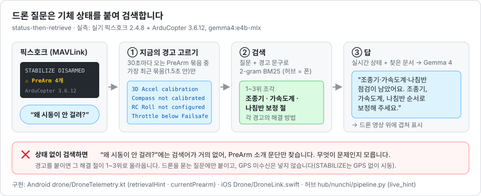

# 드론 실험 4 — 기체 상태로 RAG: 상태→검색

> 안경 실험의 핵심이 **캡션→검색**(사진을 먼저 글로 바꿔 검색어로)이었다면, 드론 실험의 핵심은 **상태→검색**이에요. 기체가 보낸 경고를 검색어에 붙이고, 실시간 상태 전체를 프롬프트 맨 앞에 '살아 있는 문서'로 넣습니다.



## 목차

- [1. 캡션→검색과 나란히](#1-캡션검색과-나란히)
- [2. 상태를 세 가지 글로](#2-상태를-세-가지-글로)
- [3. PreArm '최근 묶음' 규칙 — 실기에서 배운 것](#3-prearm-최근-묶음-규칙--실기에서-배운-것)
- [4. 검색 힌트에 넣는 것과 빼는 것](#4-검색-힌트에-넣는-것과-빼는-것)
- [5. 언제 붙이나 — 드론 질문 판별](#5-언제-붙이나--드론-질문-판별)
- [6. 프롬프트](#6-프롬프트)
- [7. 허브 API](#7-허브-api)
- [8. 결과](#8-결과)
- [9. 폰 혼자일 때 — 추출형 답](#9-폰-혼자일-때--추출형-답)
- [10. 한계](#10-한계)

## 1. 캡션→검색과 나란히

| | 안경: 캡션→검색 | 드론: 상태→검색 |
|---|---|---|
| 문제 | "이게 뭐야?"에 검색어가 없음 | "왜 시동이 안 걸려?"에 검색어가 거의 없음 |
| 검색어를 채우는 것 | 사진 캡션 ("HG-2000, E2, 계기판…") | 기체 경고 (`PreArm: Compass not calibrated` …) |
| 프롬프트에 더하는 것 | 사진 | `[실시간 기체 상태]` 보고서 (+ 드론 카메라 사진) |
| 효과 | 정답 조각 상위 4위 밖 → **1위** | PreArm 소개 문단 → 해당 해결 절 **1~3위** |

## 2. 상태를 세 가지 글로

앱은 MAVLink로 받은 값을 세 가지 글로 바꿔요.

| 글 | 쓰는 곳 | 예 |
|---|---|---|
| **요약** `summary()` | 화면 위 상태 줄 | `STABILIZE · 시동 OFF · 16.6V · 98% · GPS 10개` |
| **보고서** `report()` | 프롬프트의 `[실시간 기체 상태]`, LLM이 없을 때 답의 재료 | 아래 |
| **검색 힌트** `retrievalHint()` | 검색어 뒤에 붙임 (최대 300자) | `PreArm: 3D Accel calibration needed PreArm: Compass not calibrated …` |

보고서는 이런 모양이에요(실기 기록을 재생했을 때의 형태, 값은 예시):

```text
연결: Wi-Fi UDP :14550 · 정상 · 마지막 신호 0.4초 전
기체: ArduPilot 쿼드콥터 · 모드 STABILIZE(자세 유지 수동) · 시동 꺼짐(DISARM) · 상태 대기
배터리: 정보 없음
GPS: 위치 못 잡음 · 위성 0개
이상 센서: …
지금 시동을 막는 점검(PreArm) 7개:
- PreArm: Throttle below Failsafe
- PreArm: 3D Accel calibration needed
- PreArm: Compass not calibrated
- PreArm: RC Roll not configured
- …
최근 기체 메시지(새것부터):
- 14:34:05 [경고] PreArm: RC Yaw not configured
- …
최근 변화(새것부터):
- 14:33:58 기체 연결: ArduPilot 쿼드콥터 · 모드 STABILIZE(자세 유지 수동)
```

위치를 받으면 위도·경도·고도와 출발점까지 거리, 움직이면 속도·기수 방향·롤·피치, 조종기 신호 세기도 들어가요.

## 3. PreArm '최근 묶음' 규칙 — 실기에서 배운 것

- **처음 가정**: "가장 새 PreArm 메시지 하나만 지금의 문제." 가상 드론은 경고를 하나씩 보내서 이 가정이 맞았어요.
- **실기에서 본 것**: ArduCopter 3.6.12는 실패한 점검을 **30초마다 한꺼번에**(1초 안에 몇 개씩) 다시 보내요. 이 키트에서는 가속도계·나침반(두 번)·조종기 4축·스로틀 페일세이프·Radio failsafe가 같은 순간에 왔어요.
- **그래서 규칙**: 가장 최근 PreArm 메시지 시각에서 **1.5초 안**에 온 것들 = 지금 시동을 막는 점검. 그 묶음에 없는 예전 메시지는 이미 해결된 것으로 봐요. **40초** 넘게 새 묶음이 없거나 시동이 걸리면 비웁니다.

```text
시간 →     0초            30초           60초
받은 묶음  [가속 나침반     [가속 나침반     [가속 조종기     ← 나침반을 보정함
            조종기 스로틀]  조종기 스로틀]   스로틀]
'지금'     4개             4개             3개 (나침반은 해결된 것으로 빠짐)
```

같은 문구가 30초마다 다시 오면 새로 쌓지 않고 시각만 갱신해요(메시지는 최근 30개까지).

## 4. 검색 힌트에 넣는 것과 빼는 것

| 넣음 | 이유 |
|---|---|
| 지금의 PreArm 묶음 (최대 4개) | 시동을 막는 진짜 원인 |
| 최근 5분 안의 경고급(심각도 4 이하) 기체 메시지 1개 (PreArm 제외) | 예: `Battery 1 is low …`, `GPS Glitch` |
| 이상 센서 ("나침반(컴퍼스) 이상" 등) | SYS_STATUS의 건강 비트 |
| 배터리 30% 이하 → "배터리 부족" | 배터리 대처 절 |
| 링크 끊김 → "기체 신호 끊김" | 끊김 대처 절 |

| 뺌 | 이유 |
|---|---|
| GPS 미수신 | STABILIZE·ALT_HOLD는 GPS 없이도 시동이 걸려서, "왜 시동이 안 걸려?"를 엉뚱한 GPS 절로 끌고 가요. GPS가 시동을 막으면 ArduPilot이 `PreArm: Need 3D Fix`를 따로 보내요. GPS 상태는 보고서에는 그대로 들어가요 |
| PreArm 메시지가 있을 때의 '시동 전 점검(PreArm) 이상' 센서 비트 | 중복이고, '시동 전 점검'이라는 일반 낱말이 PreArm 소개 문단을 끌어올려요 |

## 5. 언제 붙이나 — 드론 질문 판별

힌트는 **드론을 묻는 질문일 때만** 검색어에 붙여요. "캠핑장 체크인 몇 시야?"에 PreArm을 붙이면 검색을 망치니까요. 아래 낱말 중 하나가 있거나, 공백을 빼고 8자 이하인 짧고 모호한 질문을 드론 질문으로 봐요.

> 드론 · 기체 · 픽스호크 · 비행 · 시동 · 이륙 · 착륙 · 배터리 · 전압 · GPS · 위성 · 고도 · 모드 · 나침반 · 컴퍼스 · 프리암 · PreArm · 경고 · 에러 · 오류 · 메시지 · 상태 · 위치 · 어디 · 속도 · 방향 · 자세 · ARM · 센서 · 신호 · 조종기 · 홈 · 출발점 · 귀환 · RTL · 고장 · 문제 · 왜 · 안 돼

| 질문 종류 | 누가 정하나 |
|---|---|
| 글자 질문·드론 화면 분석 | 앱 (질문을 아니까 드론 질문일 때만 힌트를 보냄) |
| 음성 질문 | 허브 (앱은 힌트를 보내 두고, 허브가 받아쓴 질문이 드론 질문일 때만 씀) |

보고서(`[실시간 기체 상태]`)는 질문 종류와 상관없이, 기체가 연결돼 있으면 늘 함께 보내요. 그래야 "배터리 몇 %야?"에 값으로 답할 수 있어요.

## 6. 프롬프트

시스템 지시문에 두 줄이 더해져요(허브와 폰이 같은 문구).

```text
[실시간 기체 상태]는 지금 연결된 드론 비행컨트롤러(픽스호크)가 보낸 값이다. 배터리·위치·고도·모드·시동·GPS를 물으면 그 값으로 답하고, 기체 메시지(PreArm 등)가 있으면 [참고 문서]에서 그 메시지의 해결 방법을 찾아 말한다.
첨부한 사진은 드론 카메라(FPV)로 지금 보고 있는 장면이다. 사진에서 보이는 것을 근거로 답한다.   ← 드론 카메라 사진일 때만
```

사용자 메시지는 상태 → 문서 → 질문 순서예요.

```text
[실시간 기체 상태]
연결: … · 기체: … · 지금 시동을 막는 점검(PreArm) 4개: …

[참고 문서]
[1] 픽스호크 드론 점검·문제 해결 안내 > 시동 전 점검(PreArm) 메시지와 해결 > PreArm: RC not calibrated · …
[2] …

[질문]
왜 시동이 안 걸려?
```

## 7. 허브 API

드론 연결 시 함께 보낼 수 있는 필드예요(`/v1/ask`의 JSON, `/v1/voice`·`/v1/vision`의 폼). 없으면 예전과 똑같이 동작해요.

| 필드 | 뜻 |
|---|---|
| `live_context` | 실시간 상태 보고서 (최대 4000자) → 프롬프트 맨 앞 `[실시간 기체 상태]` |
| `live_hint` | 검색 힌트 (최대 500자, 실제로는 앞 300자) → 검색어 뒤에 |
| `image_source` | `/v1/vision`만. `drone`이면 드론 카메라 지시문, 기본 `glasses` |

자세한 형식: [허브 API 레퍼런스](../04-practice/04-hub-api.md)

## 8. 결과

**검색** (허브 BM25 = 폰 BM25, 예제 문서)

| 질문 | 검색어에 붙은 것 | 1위 |
|---|---|---|
| 왜 시동이 안 걸려? | (없음) | PreArm 소개 문단 — 어떤 점검이 문제인지 모름 |
| 왜 시동이 안 걸려? | `PreArm: Compass not calibrated` | **PreArm: Compass not calibrated (나침반 보정 안 됨)** |
| 왜 시동이 안 걸려? | 실기 묶음 4개 (가속도계·나침반·조종기·스로틀) | **조종기 · 가속도계 · 나침반** 절이 1~3위 |

**답** (허브 Gemma 4, 실기 상태)

| 어디서 | 시간 | 답 (요지) |
|---|---|---|
| Android 앱, 실기 픽스호크 UDP 중계 | 1.1초 | 조종기, 가속도계, 나침반, 그리고 스로틀 관련 문제 |
| iOS 앱 자동 점검, 실기 픽스호크 | — | 조종기·가속도계·나침반 점검이 끝나지 않았다 → 조종기 보정, 3차원 가속도계 보정, 나침반 보정을 먼저 |
| Android 드론 화면, 실기 기록 재생 + 가상 카메라 | 1.7초 | 조종기 보정, 가속도계 보정, 나침반 보정 등이 필요 (참고 문서 1~4위: 조종기·가속도계·PreArm 소개·나침반) |

## 9. 폰 혼자일 때 — 추출형 답

허브도 폰 LLM도 없으면, 앱이 값과 문서 문장으로 직접 답해요(1~4ms).

| 질문에 이 낱말이 있으면 | 답 |
|---|---|
| 배터리·전압·잔량 | "배터리는 16.6V, 잔량 98%예요." |
| 위치·어디 | 위도·경도 + 출발점에서 몇 m |
| 고도·높이 | 이륙 지점 기준 고도 |
| GPS·위성 | 고정 종류 + 위성 수 |
| 속도 | 지면 속도 |
| 모드·상태·시동 | "지금 모드는 STABILIZE(자세 유지 수동)이고 시동은 꺼져 있어요." + 지금의 PreArm 목록 |

문제 질문(왜·안 돼·경고·어떻게·해결…)이거나 값으로 답할 게 없으면, 검색 1위 조각에서 질문과 가장 많이 겹치는 문장 2개를 덧붙여요.

## 10. 한계

- 경고가 영어 원문이라, 점검 문서의 절 제목에 경고 원문(`PreArm: …`)을 함께 적어 두어야 잘 걸려요. 지식베이스를 직접 쓸 때 참고하세요.
- '최근 묶음' 규칙은 ArduCopter 3.6.12에서 확인했어요. PX4나 최신 ArduPilot은 아직 확인 전이에요.
- 드론 질문 판별은 손으로 만든 낱말 목록이에요. 놓치는 질문이 있으면 상태 키워드가 붙지 않아요(보고서는 붙음).

---

[← MAVLink](03-mavlink.md) · [드론 실험 문서 처음](01-overview.md) · [다음: 드론 카메라 → Gemma 4 →](05-camera-to-gemma.md)
