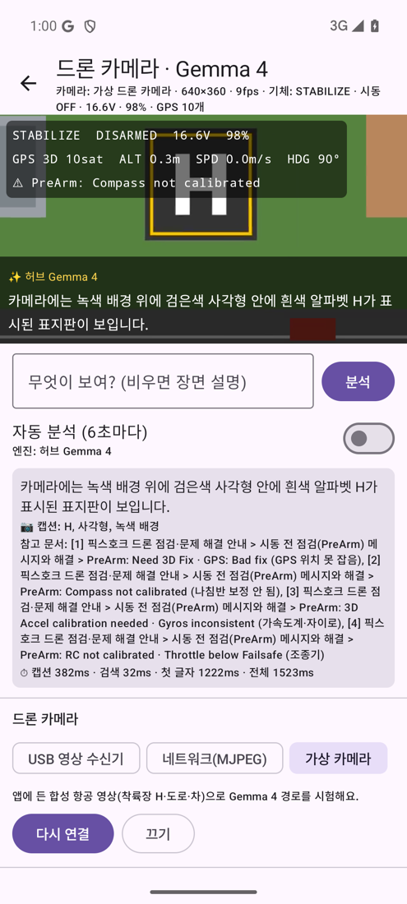
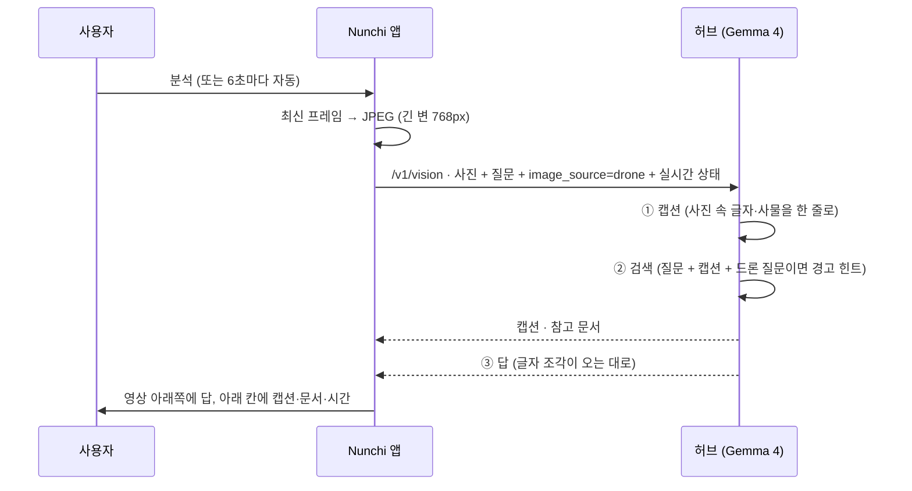

# 드론 실험 5 — 드론 카메라 → Gemma 4 → 화면

> 드론 카메라의 지금 장면을 한 장 떼어 Gemma 4에게 보여 주고, 내 문서와 기체 상태를 함께 근거로 답을 받아 **영상 위에 겹쳐** 보여 줍니다. 안경 실험의 사진 질문(캡션→검색→답)과 같은 파이프라인이에요.

가상 드론 + 가상 카메라. 장면 설명까지 1.5초 (캡션 382ms · 검색 32ms · 첫 글자 1.2초).

## 목차

- [1. 영상이 앱까지 오는 길](#1-영상이-앱까지-오는-길)
- [2. 분석 한 번의 흐름](#2-분석-한-번의-흐름)
- [3. 엔진 두 가지](#3-엔진-두-가지)
- [4. 화면 구성](#4-화면-구성)
- [5. 지연 실측](#5-지연-실측)
- [6. 무엇을 물을 수 있나](#6-무엇을-물을-수-있나)
- [7. 한계](#7-한계)

## 1. 영상이 앱까지 오는 길

| 소스 | Android | iOS | 설명 |
|---|---|---|---|
| **USB 영상 수신기** (UVC) | ✅ UVCAndroid로 받아 NV21 → JPEG | ❌ 앱에서 USB 카메라를 못 씀 | 5.8GHz OTG 수신기를 폰 USB-C에 꽂음 |
| **네트워크 MJPEG** | ✅ (최대 15fps) | ✅ | ESP32-CAM(`:81/stream`), IP 카메라, 컴퓨터 중계(`scripts/video_relay.py`) |
| **가상 카메라** | ✅ | ✅ | 앱에 든 합성 항공 영상 (착륙장 H·도로·빨간 차, 640×360, 8초 반복) |

아날로그 FPV 카메라 + VTX에서 수신기까지는 [실습 9 — 드론 영상 연결](../04-practice/09-fpv-video.md)을 보세요.

## 2. 분석 한 번의 흐름

- 질문 칸이 비어 있으면 "지금 보이는 것을 한두 문장으로 설명해 줘."로 물어요.
- 캡션은 "사진에 보이는 글자(숫자·코드·제품명 포함)와 주요 사물을 검색어로 쓸 수 있게 한 줄로" 만들게 해요. 그래서 OSD 글자나 기체 라벨도 검색어가 될 수 있어요.
- 기체가 연결돼 있으면 실시간 상태 보고서가 함께 가고, 드론 질문이면 지금의 경고도 검색어에 붙어요 → [기체 상태로 RAG](04-status-then-retrieve.md)

## 3. 엔진 두 가지

| | 허브 Gemma 4 | 폰 Gemma 4 |
|---|---|---|
| 어디서 | 책상 위 컴퓨터 (Ollama, `gemma4:e4b`) | 폰 안 (Google AI Edge LiteRT-LM 0.16.1) |
| 준비 | 앱 설정의 허브 주소 | `.litertlm` 모델(예: Gemma 4 E2B, 사진 입력 지원)을 `/sdcard/Android/data/io.github.aiglassesrok.nunchi/files/models/`에 (`adb push` 또는 설정 → 파일 가져오기) |
| 앱 | Android · iOS | Android (설정 → '폰에서') |
| 계산 | 맥 GPU(MLX) | 폰 GPU, 안 되면 CPU로 다시 (최대 4096토큰, 사진 1장) |
| 검색 | 허브 검색 (BM25 + 임베딩) | 폰 2-gram BM25 (허브 BM25와 같은 결과를 테스트로 확인) |
| 상태 | 확인 | 연결만 해 둠 (실제 폰 실행은 아직) |

폰 모드인데 모델이 없으면, 사진 분석은 허브로 보내고 글자 질문은 추출형으로 답해요.

## 4. 화면 구성

| 자리 | 보이는 것 |
|---|---|
| 맨 위 | 제목, 카메라 상태(소스·해상도·fps), 기체 요약 |
| 영상 왼쪽 위 (HUD) | `모드  ARMED/DISARMED  전압  잔량` / `GPS 고정 위성 ALT SPD HDG` / `⚠ PreArm N개 · …` |
| 영상 아래쪽 | `✨ 허브 Gemma 4`(또는 폰) + 답, 글자 조각이 오는 대로 갱신 |
| 그 아래 | 질문 칸 + **분석**, **자동 분석(6초마다)** 스위치, 엔진 |
| 분석 자세히 | 답 · 📷 캡션 · 참고 문서 · ⏱ 캡션/검색/첫 글자/전체 시간 |
| 드론 카메라 | USB 영상 수신기 · 네트워크(MJPEG) · 가상 카메라, 주소, 켜기/끄기 |
| 비행컨트롤러 | 연결 방식, 보드레이트·포트·주소, 연결/끊기, 상태, 최근 메시지, 실시간 보고서 |

자동 분석은 앞의 분석이 끝나지 않았으면 그 차례를 건너뛰어요.

## 5. 지연 실측

| 영상 | 앱 | 받은 영상 | 캡션 | 검색 | 첫 글자 | 전체 |
|---|---|---|---|---|---|---|
| 가상 (640×360) | Android | 9fps | 0.38초 | 32ms | 1.2초 | **1.5초** |
| 가상 + "왜 시동이 안 걸려?" + 실기 기록 재생 | Android | 9fps | 0.58초 | 49ms | 1.47초 | **1.7초** |
| 맥의 실제 카메라 (960×1706, 중계) | Android | 9~10fps | 0.81초 | 0.28초 | 1.84초 | **2.3초** |
| 같은 실제 카메라 | iOS | 7fps | 1.75초 | 0.06초 | 3.23초 | **3.9초** |

*허브는 맥북의 `gemma4:e4b-mlx`, 앱은 에뮬레이터·시뮬레이터. 한 번씩 잰 값이라 앱 사이의 차이를 결론 내기에는 일러요.*

## 6. 무엇을 물을 수 있나

| 질문 예 | 쓰는 것 |
|---|---|
| (비움) | 사진 → 장면 설명 한두 문장 |
| "착륙장 보여?", "빨간 차 어디 있어?" | 사진 |
| "왜 시동이 안 걸려?" | 실시간 상태 + 지금의 경고 + 점검 문서 (+ 사진) |
| "배터리 몇 %야?", "지금 모드가 뭐야?" | 실시간 상태의 값 |

## 7. 한계

- **한 장씩 봐요.** 영상의 움직임(시간 흐름)은 아직 모릅니다.
- **조종용이 아니에요.** 답까지 1.5~4초가 걸려요. 조종은 FPV 고글·모니터로 하세요.
- 아날로그 영상의 잡음·OSD 글자가 캡션에 섞일 수 있어요. 실제 5.8GHz 영상으로는 아직 시험하지 않았어요.
- 야간·역광·빠른 움직임은 시험하지 않았어요.

---

[← 기체 상태로 RAG](04-status-then-retrieve.md) · [드론 실험 문서 처음](01-overview.md) · [다음: 실험 기록과 결과 →](06-experiments.md)
